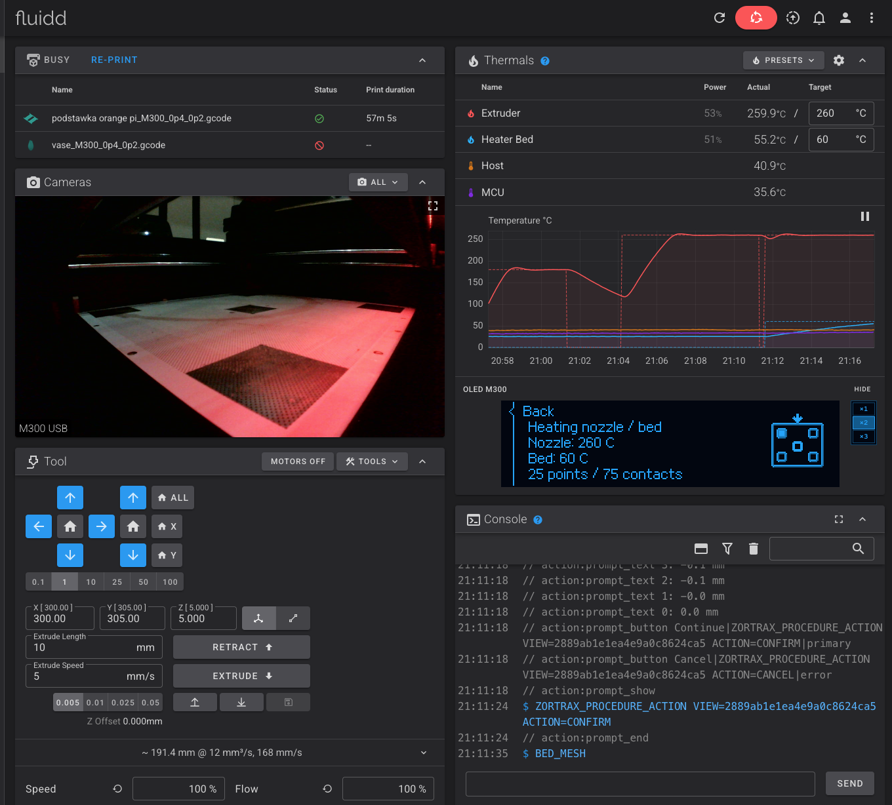

# Zortrax M300 Classic — Klipper 1.0.4

[](docs/img/m300-fluidd-camera-thermals-oled-2026-11-26.png?raw=true)

*26 November 2026: Fluidd preparing a 25-point bed measurement, with the USB camera, optional Host/MCU temperatures and the live OLED preview. Original operator screenshot; click for full size.*

[Polski](README_PL.md) · [Download 1.0.4 ZIP](https://github.com/MarcinKowalik-AGH/Zortrax-m300-Klipper/releases/download/v1.0.4/Zortrax_M300_Klipper_v1.0.4.zip) · [Release notes](docs/en/RELEASE_v1.0.4.md) · [Operator handbook](docs/en/USER_GUIDE.md)

Klipper for the original **Zortrax M300 Classic / STM32F103**, retaining its OLED,
encoder, contact plate and controller. Current package: **host 1.0.4 / R16.19,
MCU 1.0.9**, Fluidd on **4480** and Moonraker on **7125**.
It includes a pinned Klipper core and compiled Fluidd extension.
It does not apply to M300 Plus, M300 Dual or Inventure.

## What is included

| Area | Current behavior |
|---|---|
| OLED and Fluidd | Shared procedure owners, phase-bound confirmations, OEM artwork, live OLED preview and adjustable display timers |
| Operator macros | 36 M300-specific macros use `M300_`; existing `ZORTRAX_` aliases remain compatible |
| Menu corrections | Fan test retains its screen while switching fans; Current procedure reopens OLED; Back restores the invoking screen; PID uses the public macros |
| Leveling and mesh | OEM screw adjustment plus a separate 25-point / 75-contact measurement; `MESH=AUTO` loads a saved mesh at print start |
| Contact recovery | Recognized missing/unstable contact lowers the bed by up to 100 mm within known Z travel, invalidates Z and asks for nozzle cleaning |
| Status lighting | A completed verified Z home resolves its preceding contact notice; unrelated faults remain active |
| Restart and cancellation | Supervision during planned motion drain, mesh cancellation and controlled handoff before accepting a replacement file |
| Thermal startup | A 40-second native extruder gain-check window for delayed warm reheating; other native and MCU thermal guards remain active |
| Runtime counters | MCU print-time synchronization while idle, with existing host journals retained |

[Full change list](docs/en/RELEASE_v1.0.4.md) · [OLED audit and bindings](docs/en/OLED_MENU_AUDIT.md) · [44-macro catalogue](docs/pl/MACRO_REFERENCE.md) · [Historical 65-screen illustrated guide](docs/pl/OLED_FUNCTIONS.md)

## Install on a new host

Prepare one Klipper, Moonraker and Fluidd instance with KIAUH, then run as that
account. The installer deploys the complete matching runtime, configuration,
macros and built Fluidd, checks the configuration offline and backs up the
replaced setup. Debian 13 Trixie / Python 3.13 is supported; no previous Pi or
private configuration archive is required.

```bash
git clone --branch orange-pi --single-branch https://github.com/MarcinKowalik-AGH/Zortrax-m300-Klipper.git "$HOME/m300-src" &&
cd "$HOME/m300-src" &&
sha256sum -c --quiet SHA256SUMS &&
python3 install-new-host.py --serial /dev/ttyS2 --baud 750000 --port 4480 --apply
```

`/dev/ttyS2` is the Orange Pi Zero 4 UART2 example. Select the enabled UART and
baud matching your board and the printer's existing bootloader/MCU.
The [first-install guide](docs/en/FIRST_INSTALL.md) also covers the public full
ZIP, wiring, MCU SD installation and commissioning. An existing MCU **1.0.9**
does not need to be flashed again for this host update.

## Update an existing Orange Pi

Finish the print or procedure, wait for Ready and set both heater targets to zero:

```bash
cd "$HOME/m300-orange-pi" &&
git pull --ff-only &&
sha256sum -c --quiet SHA256SUMS &&
python3 install-orange-pi.py
```

The default command updates host modules and macros while preserving operator
PID, saved mesh, qualified Z, UART and existing configuration choices.
For the separate Fluidd update, use
`python3 install-orange-pi.py --update-fluidd --port 4480`, then reload the page.
That web-only command does not install OLED Python fixes.
[Update and rollback instructions](docs/en/INSTALL.md).

## Optional camera and temperatures

All three options start **disabled** and can be enabled independently.

| Option | Enable | Configuration / guide |
|---|---|---|
| USB camera | `python3 install-camera.py --enable --apply` | Separate `m300_camera.conf`; [camera guide](docs/en/CAMERA.md) |
| Host CPU curve | Uncomment `[include m300_host_temperature.cfg]` in `printer.cfg` | [Temperature guide](docs/en/HOST_TEMPERATURE.md) |
| STM32 MCU curve | Uncomment `[include m300_mcu_temperature.cfg]` in `printer.cfg` | Requires MCU 1.0.9; [temperature guide](docs/en/HOST_TEMPERATURE.md) |

After changing a temperature include, run `FIRMWARE_RESTART` while idle.
Comment the relevant include again to disable it; disabled options do not
prevent startup. The new-host installer supplies both templates and the MCU
diagnostic module. `M300_MCU_TEMPERATURE` reads the same approximate STM32 die
measurement used by the MCU graph. Other Orange Pi zones are read on demand
with `python3 read-host-temperatures.py`; they do not add more graph curves.

Camera changes are applied with `python3 install-camera.py --apply`.
Disable streaming with `--disable --apply` or `enabled: False` in its config
followed by `--apply`. The camera config belongs to its installer and is not
included in `printer.cfg`. **UV4L-MJPEG Stream** works in the tested OrcaSlicer
2.5.2 Device view. The screenshot above shows the camera and both temperature
curves on the operator's printer.

## Documentation and validation

| Task | Guide |
|---|---|
| New host or full ZIP installation | [First installation](docs/en/FIRST_INSTALL.md) |
| Existing printer, Fluidd repair or rollback | [Update](docs/en/INSTALL.md) |
| MCU image and version | [MCU 1.0.9](docs/en/MCU_FIRMWARE_1.0.9.md) |
| Printing, pause, material change and stop | [Operator handbook](docs/en/USER_GUIDE.md) · [Print controls](docs/en/PRINT_CONTEXT.md) |
| Leveling, contact and mesh | [Contact leveling](docs/en/LEVELING.md) · [Contact recovery](docs/en/CONTACT_RECOVERY.md) |
| Profiles and models | [OrcaSlicer profiles](https://github.com/MarcinKowalik-AGH/Zortrax-m300-Orca-Slicer) · [SD/model support](docs/en/MODELS_SD.md) |
| Menus, settings and diagnostics | [OLED audit](docs/en/OLED_MENU_AUDIT.md) · [Controls](docs/en/RC1_UI.md) · [Errors](docs/en/ERRORS.md) |

Software checks include **1055 host tests**, actual Klippy FILEOUTPUT,
upgrade/rollback, fresh installation on Python 3.12/3.13 and Fluidd tests.
The menu inventory covers **44 views, 582 rows and 26 registered commands**.
Physical acceptance remains separate: see the [hardware register](docs/pl/ACCEPTANCE_REGISTER.md).
The screenshot confirms visible UI features; it does not qualify every
procedure or the calibration accuracy of the temperature sensors.

[Release 1.0.4](https://github.com/MarcinKowalik-AGH/Zortrax-m300-Klipper/releases/tag/v1.0.4) · [Ready Git deployment](https://github.com/MarcinKowalik-AGH/Zortrax-m300-Klipper/tree/orange-pi) · [Build and tests](https://github.com/MarcinKowalik-AGH/Zortrax-m300-Klipper/actions/workflows/build-m300.yml) · [Changelog](CHANGELOG.md) · [Sources and licences](THIRD_PARTY_NOTICES.md)
