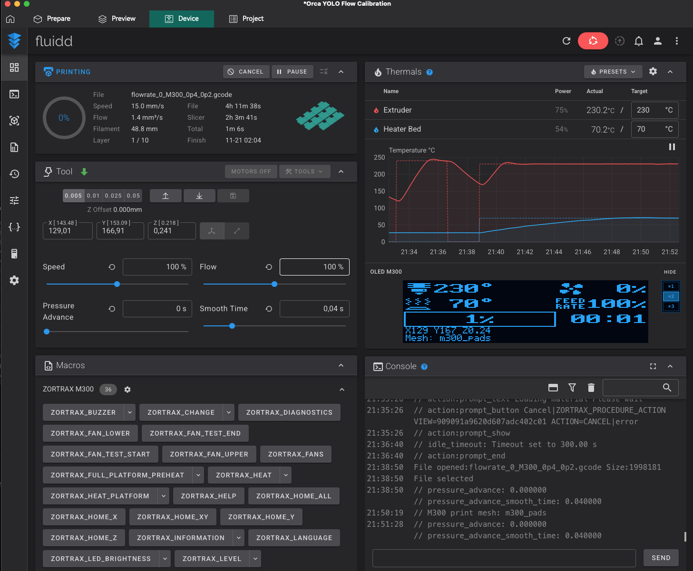

# Zortrax M300 Classic — Klipper 1.0.2

[](docs/img/m300-orcaslicer-fluidd-printing.png?raw=true)

*OrcaSlicer’s Device tab during a print on the M300 Classic, 20 November 2026. The console and the OLED preview show the active `m300_pads` mesh. Click the image for the original.*

[Podręcznik po polsku](README_PL.md) · [Operator handbook](docs/en/USER_GUIDE.md) · [Download 1.0.2](https://github.com/MarcinKowalik-AGH/Zortrax-m300-Klipper/releases/tag/v1.0.2)

This port runs Klipper on the original **Zortrax M300 Classic** controller with its OLED, encoder and contact plate. The supported pair is host **1.0.2** and MCU **1.0.8**. Fluidd runs on port **4480**. The 36 printer-specific operator macros now start with `M300_`. Existing files can still call the previous `ZORTRAX_` names.

[Optional USB camera](docs/en/CAMERA.md): disabled by default, with a separate host configuration and Fluidd view.

## Install and operate

For a **new KIAUH host**, clone this repository and run the first-install entry
point below as the KIAUH account. It installs the complete matching Klipper,
M300 configuration/macros and compiled Fluidd. A previous Pi or personal backup
is not required. Debian 13 Trixie with Python 3.13 is supported by this path.
The example selects Orange Pi Zero 4 UART2; use your board's enabled UART and
the baud configured in the printer's existing compatible bootloader/MCU.

```bash
git clone https://github.com/MarcinKowalik-AGH/Zortrax-m300-Klipper.git "$HOME/m300-src" &&
cd "$HOME/m300-src" &&
python3 install-new-host.py --serial /dev/ttyS2 --baud 750000 --apply
```

KIAUH must already provide one Klipper/Moonraker/Fluidd instance. The installer
uses the latest successful `orange-pi` deployment, verifies the pinned core,
tests the production configuration offline, and backs up the replaced stock
setup. See the full first-install guide for MCU flashing and calibration.

| What you want to do | Where to start |
|---|---|
| Install on a new Orange Pi or Raspberry Pi | [First installation, wiring, full ZIP and commissioning](docs/en/FIRST_INSTALL.md) |
| Update a running printer or recover a blank Fluidd page | [Host update, Fluidd repair and rollback](docs/en/INSTALL.md) |
| Update the printer MCU with the installed SD bootloader | [Application and verification](docs/en/MCU_FIRMWARE_1.0.8.md) · [MCU SD archive](https://github.com/MarcinKowalik-AGH/Zortrax-m300-Klipper/releases/tag/mcu-v1.0.8) |
| Prepare the plate and print from OrcaSlicer or SD | [Operator handbook](docs/en/USER_GUIDE.md) · [OrcaSlicer profiles](https://github.com/MarcinKowalik-AGH/Zortrax-m300-Orca-Slicer) · [Models and SD](docs/en/MODELS_SD.md) |
| Pause, change colour, purge and resume | [Print controls](docs/en/PRINT_CONTEXT.md) · [Material procedures](docs/en/MAINTENANCE_MATERIAL.md) |
| Use the encoder, menus and Fluidd controls | [Controls and macros](docs/en/RC1_UI.md) · [Display settings](docs/en/SETTINGS_INFORMATION.md) · [Illustrated OLED reference (PL)](docs/pl/OLED_FUNCTIONS.md) |
| Diagnose a fault or qualify hardware | [Error catalogue](docs/en/ERRORS.md) · [Board identification](docs/en/HARDWARE_VARIANTS.md) · [Hardware acceptance register (PL)](docs/pl/ACCEPTANCE_REGISTER.md) |

## Update an existing Orange Pi

Finish the print or procedure, wait for Ready and turn both heater targets off. Run the following in your existing checkout of the `orange-pi` branch. The path below is the default.

```bash
cd "$HOME/m300-orange-pi" &&
git pull --ff-only &&
sha256sum -c --quiet SHA256SUMS &&
python3 install-orange-pi.py
```

In the Fluidd console run `ZORTRAX_INFO REFRESH=0` to read the host and MCU versions. The default installer updates the host. The update guide covers first-time cloning, a damaged Git checkout, and the separate Fluidd repair on port 4480.

## Verification and release status

1.0.2 is the final source release dated 21 November 2026. The operator has reported a completed Benchy, bed lowering and head parking after a completed print, and filament handling from the OLED and Fluidd. The register gives the scope and version evidence for each observation. Outstanding hardware checks include repeatability of contact Z, first-layer coverage across the plate, and the 1.0.2 manual-purge/resume sequence on the machine.

[Final audit](docs/en/FINAL_AUDIT_2026-11-21.md) · [1.0.2 notes](docs/en/RELEASE_v1.0.2.md) · [Build and software tests](https://github.com/MarcinKowalik-AGH/Zortrax-m300-Klipper/actions/workflows/build-m300.yml) · [Hardware register](docs/pl/ACCEPTANCE_REGISTER.md) · [Source and licences](THIRD_PARTY_NOTICES.md)
