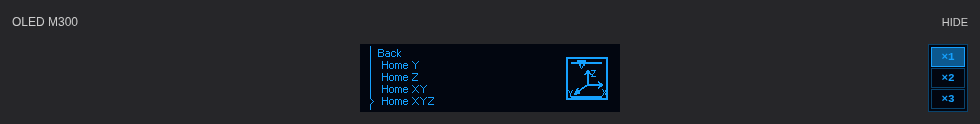

# Zortrax M300 Classic — Klipper v1.0.0-beta.21

**Beta.21:** Toned activity icons and native 4bpp autonomous MCU artwork. [Release notes and host/MCU update instructions](docs/en/RELEASE_v1.0.0-beta.21.md). The illustrated handbook below retains its explicit beta.20 visual baseline.

**Current user and technical documentation, updated 10 November 2026.** This port targets the original **M300 Classic with STM32F103**, not M300 Plus, M300 Dual or Inventure. The historical illustration reference is `4828a9da9d5fd8b0b93eb2ac267732ee7e49d506`; current firmware and artwork are described in the beta.21 supplement.

[Download beta.21](https://github.com/MarcinKowalik-AGH/Zortrax-m300-Klipper/releases/tag/v1.0.0-beta.21) · [Polski — pełna instrukcja](README_PL.md) · [First installation](docs/en/FIRST_INSTALL.md) · [Existing installation](docs/en/INSTALL.md)

## Start with the illustrated instructions

| Guide | Contents |
|---|---|
| [65 illustrated OLED functions (Polish)](docs/pl/OLED_FUNCTIONS.md) | Actual OLED screens and graphics; exact menu path, function, preconditions, matching Fluidd action and icon meaning |
| [Complete menu reference](docs/pl/OLED_MENU_REFERENCE.md) | Real menu rows, contextual print screens and reproducible 256×64 / 768×192 renders |
| [Current Fluidd interface](docs/en/FRONTEND_BETA20.md) | Tune entry, All versus Calibrate, fixed card order, centered OLED and right-side ×1/×2/×3 controls |
| [Daily operation (Polish)](docs/pl/USER_GUIDE.md) | Checks, temperatures, material, START/END, pause/resume/cancel and updates |
| [Bed leveling and mesh](docs/pl/BED_MESH_AND_LEVELING.md) | Mechanical leveling versus mesh, 25 contact positions, 61×61 interpolation, persistence and activation |
| [Technical reference](docs/pl/TECHNICAL_REFERENCE.md) | Hardware/configuration limits, Z variants, UART/SPI and recovered OEM temperature maps |
| [Motion planner and flow limits](docs/pl/PRINT_LIMITS_AND_PLANNER.md) | Native Klipper planning, acceleration, STEP timing and extrusion flow |
| [All 39 configuration macros](docs/pl/MACRO_REFERENCE.md) | Function, parameters, groups and direct diagnostic commands |
| [Documentation evidence and checks](docs/pl/DOCUMENTATION_CHECK.md) | Source hashes, image provenance, coverage and repeatable validation |



*Isolated browser render using the beta.20 production component CSS, pixel helper and actual OLED bitmap. Not a screenshot of a live printer. Beta.21 changes the activity artwork, not this layout.*

## Current behavior

The physical OLED and Fluidd preview share a host-rendered 256×64, 16-level frame. Navigation events use a dedicated read-only API; the browser rearms reception independently of PNG decoding. Normal temperatures/statuses and animation timing stay unchanged. The preview is not an optical or MCU-framebuffer readback and can slightly lead the physical display during transport.

Since beta.20 the image is centered in the whole Temperature card. ×1/×2/×3 remain at the right edge under HIDE with a total height equal to the ×1 canvas. Colors match the indexed OLED palette. Integer device-pixel blocks preserve square pixels; only the enlarged image scrolls when it does not fit. Selection is stored in the browser. The physical OLED brightness settings are separate.

Tune can be opened before the first measurement without sending printer commands. All invokes shared ZORTRAX_HOME_ALL, not mesh. Calibrate invokes BED_MESH with its own guarded preparation. The contact drawing stays above the heatmap. A saved mesh preview is not active Z compensation.

Changes: [beta.18](docs/en/RELEASE_v1.0.0-beta.18.md), [beta.19](docs/en/RELEASE_v1.0.0-beta.19.md), [beta.20](docs/en/RELEASE_v1.0.0-beta.20.md), [beta.21](docs/en/RELEASE_v1.0.0-beta.21.md). Earlier release notes are historical, not current layout/API instructions.

## Update an existing Orange Pi installation

Only while **idle and Ready**, without a paused job or active procedure:

```bash
git -C "$HOME/m300-orange-pi" pull --ff-only &&
python3 "$HOME/m300-orange-pi/install-orange-pi.py"
```

Hard-refresh Fluidd with **Cmd+Shift+R**. The host update provides toned normal-menu artwork even on MCU R14.18. To change the independent MCU waiting/error screens as well, separately install **R14.19** using the [beta.21 host/MCU instructions](docs/en/RELEASE_v1.0.0-beta.21.md). The host installer does not flash the MCU. Retain UART baud, bootloader and factory data; no new mesh calibration is needed.

Do not force past unknown local edits or replace this port through an upstream-only Klipper/Fluidd update. The installer checks recognized files, preserves configuration and supplies transactional backup/rollback. A new host must follow [FIRST_INSTALL](docs/en/FIRST_INSTALL.md). That includes services, hardware identification, compatible UART and the correct application image; the updater above is not a substitute. [Existing-install recovery](docs/en/INSTALL.md) · [Connection](docs/en/CONNECTION.md) · [Factory Z variants](docs/en/HARDWARE_VARIANTS.md).

## Printing, limits and original firmware data

START_PRINT performs native preparation, loads the selected mesh and produces **two Y and two X purge lines** within M300 limits. `MESH=AUTO` loads `m300_pads` if available and otherwise continues without mesh. An explicit `MESH=m300_pads` requires the profile. It does not automatically measure a new mesh at each print start. PAUSE parks through the shared controller; CANCEL closes the file and clears pause independently of optional parking. [Operation and precautions](docs/pl/USER_GUIDE.md).

The configured 300 mm/s XY motion limit is not a guaranteed extrusion speed. Stable flow through the extruder/hotend/nozzle, material, line width, layer height and motion dynamics constrain printing. No unmeasured universal maximum volumetric flow is claimed. [Planner/flow calculations](docs/pl/PRINT_LIMITS_AND_PLANNER.md).

OEM reverse engineering recovered the **ADC-to-temperature conversion data**, including the hotend linear characteristic and a bed table with **205 pairs**. These are sensor characteristics, not merely temperature presets or a new calibration certificate. [Maps, temperatures and limits](docs/pl/TECHNICAL_REFERENCE.md). Original menu assets and procedure evidence retain their provenance and licensing.

## Versions and verification

| Layer | Current reference |
|---|---|
| Distribution | v1.0.0-beta.21 |
| Host / MCU | R16.12 / 0.13.14.19-TONED-OLED-UART8 |
| Klipper upstream | ee2c6fb6b00b2b5d097ef70d0868df7d74943b51 |
| OLED event API / browser pipeline | NAV-EVENT-1 / NAV-PIPELINE-2 |
| OLED zoom layout / Tune | OLED-ZOOM-2 / TUNE-PREPARE-1 |
| New activity artwork | ACTIVITY-TONES-1 |

The historical [beta.20 release build](https://github.com/MarcinKowalik-AGH/Zortrax-m300-Klipper/actions/runs/42798305380) passed 741 host tests, 140 frontend tests, 84 raster cases, 54 browser-layout cases and ARM/native Klippy/packaging checks. The user accepted that visual result on 10 November. Beta.21 has its own matching build and artwork/MCU tests; acceptance of beta.20 does not imply physical testing of beta.21. No new physical temperature, flow or positioning measurement is claimed.

The beta.20 illustrated manual includes **65 native renders and their exact 3× copies (130 PNGs)**, three browser layout demonstrations and the user's original screenshots. To reproduce the historical images, use their recorded beta.20 source commit. To validate preserved documentation and current update instructions:

```bash
python docs/tools/check_manual.py
```

Source and audit references: [features](docs/en/FEATURES.md), [source provenance](docs/en/PROVENANCE.md), [hardware audit](docs/en/CONFIGURATION_AUDIT.md), [third-party notices](THIRD_PARTY_NOTICES.md), [build instructions](docs/en/BUILD.md). Supervise first hardware tests after changes. Documentation does not remove mechanical, thermal or electrical safeguards.
