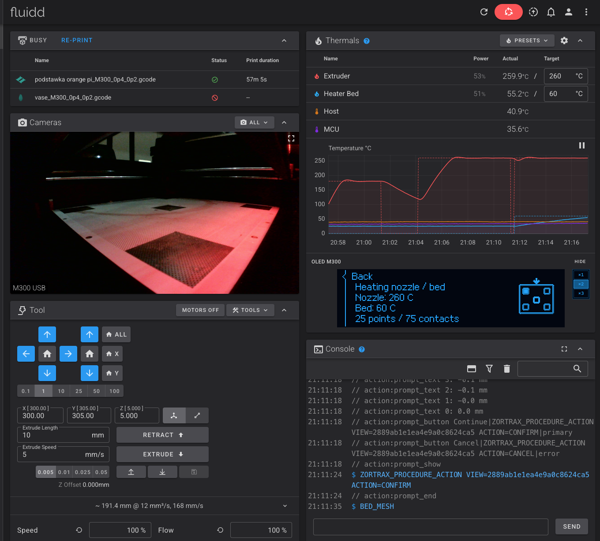

# Zortrax M300 Classic — Klipper 1.0.4

[](docs/img/m300-fluidd-camera-thermals-oled-2026-11-26.png?raw=true)

*26 listopada 2026 r.: przygotowanie pomiaru 25 punktów stołu we Fluidd, z kamerą USB, opcjonalnymi temperaturami Host/MCU i podglądem OLED. Oryginalny zrzut operatora; kliknij, aby otworzyć pełny rozmiar.*

[English](README.md) · [Pobierz ZIP 1.0.4](https://github.com/MarcinKowalik-AGH/Zortrax-m300-Klipper/releases/download/v1.0.4/Zortrax_M300_Klipper_v1.0.4.zip) · [Opis wydania](docs/pl/RELEASE_v1.0.4.md) · [Podręcznik operatora](docs/pl/USER_GUIDE.md)

Klipper dla oryginalnego **Zortrax M300 Classic / STM32F103**, z zachowaniem
fabrycznego OLED, pokrętła, płyty kontaktowej i sterownika. Aktualna paczka:
**host 1.0.4 / R16.19, MCU 1.0.9**, Fluidd na porcie **4480**, Moonraker na **7125**.
Zawiera przypięty rdzeń Klippera i gotową rozbudowaną wersję Fluidd.
Nie jest przeznaczona dla M300 Plus, M300 Dual ani Inventure.

## Co zawiera aktualne wydanie

| Obszar | Działanie |
|---|---|
| OLED i Fluidd | Wspólne procedury, potwierdzenia bieżącej fazy, grafika OEM, podgląd OLED i regulowane czasy przygaszania/uśpienia |
| Makra operatorskie | 36 makr charakterystycznych dla M300 ma nazwy `M300_`; poprzednie aliasy `ZORTRAX_` zachowują zgodność |
| Poprawki menu | Fan test zachowuje ekran przy przełączaniu wentylatorów; Current procedure ponownie otwiera OLED; Back odtwarza poprzedni ekran; PID korzysta ze wspólnych makr |
| Poziomowanie i mesh | Regulacja śrub według OEM oraz osobny pomiar 25 punktów / 75 kontaktów; `MESH=AUTO` ładuje zapisany profil przed drukiem |
| Brak kontaktu dyszy | Rozpoznany błąd styku opuszcza stół o maksymalnie 100 mm w znanym zakresie Z, unieważnia Z i prosi o czyszczenie dyszy |
| Kolory statusu | Poprawnie zakończone bazowanie Z rozwiązuje poprzedni komunikat styku; inne błędy pozostają aktywne |
| Restart i anulowanie | Nadzór podczas opróżniania kolejki ruchów, anulowanie meshu oraz kontrolowane zakończenie przed przyjęciem kolejnego pliku |
| Ponowne nagrzewanie | Natywne okno kontroli przyrostu temperatury ekstrudera wynosi 40 s; pozostałe zabezpieczenia termiczne Klippera i MCU pozostają aktywne |
| Liczniki pracy | Synchronizacja czasu druku do MCU podczas bezczynności, z zachowaniem dzienników hosta |

[Pełna lista zmian](docs/pl/RELEASE_v1.0.4.md) · [Audyt OLED i powiązania komend](docs/pl/OLED_MENU_AUDIT.md) · [Katalog 44 makr](docs/pl/MACRO_REFERENCE.md) · [Historyczny atlas 65 ekranów](docs/pl/OLED_FUNCTIONS.md)

## Instalacja na nowym hoście

Przygotuj po jednej instancji Klippera, Moonrakera i Fluidd przez KIAUH, a potem
uruchom instalator jako ten sam użytkownik. Wdraża pełny zgodny zestaw: Klipper,
konfigurację, makra i gotowe Fluidd. Sprawdza konfigurację offline i zachowuje
kopię zastępowanych plików. Obsługuje Debian 13 Trixie / Python 3.13; nie wymaga
starego Pi ani prywatnego archiwum konfiguracji.

```bash
git clone --branch orange-pi --single-branch https://github.com/MarcinKowalik-AGH/Zortrax-m300-Klipper.git "$HOME/m300-src" &&
cd "$HOME/m300-src" &&
sha256sum -c --quiet SHA256SUMS &&
python3 install-new-host.py --serial /dev/ttyS2 --baud 750000 --port 4480 --apply
```

`/dev/ttyS2` jest przykładem UART2 dla Orange Pi Zero 4. Wybierz port włączony na
swojej płytce i baud zgodny z bootloaderem/MCU drukarki.
[Pełna instrukcja](docs/pl/FIRST_INSTALL.md) opisuje także publiczny ZIP,
połączenia, wgrywanie aplikacji MCU z SD i pierwsze uruchomienie.
Jeśli masz już **MCU 1.0.9**, nie musisz wgrywać go ponownie do tej aktualizacji hosta.

## Aktualizacja działającego Orange Pi

Zakończ wydruk lub procedurę, poczekaj na Ready i wyzeruj oba cele grzałek:

```bash
cd "$HOME/m300-orange-pi" &&
git pull --ff-only &&
sha256sum -c --quiet SHA256SUMS &&
python3 install-orange-pi.py
```

Polecenie aktualizuje moduły hosta i makra, zachowując własny PID, zapisany mesh,
kwalifikowane ustawienia Z, UART i istniejące wybory konfiguracji.
Osobna aktualizacja strony Fluidd to
`python3 install-orange-pi.py --update-fluidd --port 4480`, a następnie odświeżenie
strony. Samo to polecenie nie instaluje poprawek modułów Python menu OLED.
[Aktualizacja i wycofanie zmian](docs/pl/INSTALL.md).

## Opcjonalna kamera i temperatury

Wszystkie trzy opcje są domyślnie **wyłączone** i można je włączać niezależnie.

| Opcja | Włączenie | Konfiguracja / instrukcja |
|---|---|---|
| Kamera USB | `python3 install-camera.py --enable --apply` | Osobny `m300_camera.conf`; [instrukcja kamery](docs/pl/CAMERA.md) |
| Wykres CPU hosta | Odkomentuj `[include m300_host_temperature.cfg]` w `printer.cfg` | [Instrukcja temperatur](docs/pl/HOST_TEMPERATURE.md) |
| Wykres MCU STM32 | Odkomentuj `[include m300_mcu_temperature.cfg]` w `printer.cfg` | Wymaga MCU 1.0.9; [instrukcja temperatur](docs/pl/HOST_TEMPERATURE.md) |

Po zmianie include temperatur wykonaj przy bezczynnej drukarce `FIRMWARE_RESTART`.
Aby wyłączyć opcję, ponownie zakomentuj jej include; wyłączone opcje nie blokują
startu. Nowy instalator dostarcza oba pliki i moduł diagnostyczny MCU.
`M300_MCU_TEMPERATURE` odczytuje ten sam przybliżony pomiar wewnętrzny STM32 co
wykres MCU. Pozostałe strefy Orange Pi odczytasz na żądanie przez
`python3 read-host-temperatures.py`; nie dodają kolejnych krzywych wykresu.

Zmiany kamery stosuje `python3 install-camera.py --apply`. Transmisję wyłącza
`--disable --apply` lub `enabled: False` w jej konfiguracji i ponowne `--apply`.
Pliku kamery nie dodaje się do `printer.cfg`. Tryb **UV4L-MJPEG Stream** działa
w sprawdzonej zakładce Device OrcaSlicera 2.5.2. Nowy zrzut na górze strony
pokazuje kamerę oraz oba wykresy na drukarce operatora.

## Dokumentacja i walidacja

| Czynność | Instrukcja |
|---|---|
| Nowy host lub pełny ZIP | [Pierwsza instalacja](docs/pl/FIRST_INSTALL.md) |
| Działająca drukarka, naprawa Fluidd, wycofanie zmian | [Aktualizacja](docs/pl/INSTALL.md) |
| Obraz MCU i sprawdzenie wersji | [MCU 1.0.9](docs/pl/MCU_FIRMWARE_1.0.9.md) |
| Druk, pauza, zmiana materiału i zatrzymanie | [Podręcznik operatora](docs/pl/USER_GUIDE.md) · [Sterowanie drukiem](docs/pl/PRINT_CONTROL.md) |
| Poziomowanie, styk i mesh | [Poziomowanie i mesh](docs/pl/BED_MESH_AND_LEVELING.md) · [Brak kontaktu](docs/pl/CONTACT_RECOVERY.md) |
| Profile i pliki | [Profile OrcaSlicera](https://github.com/MarcinKowalik-AGH/Zortrax-m300-Orca-Slicer) · [Obsługa SD](docs/en/MODELS_SD.md) |
| Menu, ustawienia i diagnostyka | [Audyt OLED](docs/pl/OLED_MENU_AUDIT.md) · [Sterowanie](docs/pl/RC1_UI.md) · [Katalog błędów](docs/en/ERRORS.md) |

Testy programu obejmują **1055 testów hosta**, prawdziwy proces Klippy FILEOUTPUT,
migracje i wycofanie zmian, nową instalację na Pythonie 3.12/3.13 oraz Fluidd.
Inwentaryzacja menu obejmuje **44 widoki, 582 wiersze i 26 zarejestrowanych komend**.
Odbiory na sprzęcie prowadzi osobny [rejestr](docs/pl/ACCEPTANCE_REGISTER.md).
Nowe zdjęcie potwierdza widoczne funkcje interfejsu; nie zastępuje próby każdej
procedury ani sprawdzenia dokładności czujników temperatury.

[Wydanie 1.0.4](https://github.com/MarcinKowalik-AGH/Zortrax-m300-Klipper/releases/tag/v1.0.4) · [Gotowa gałąź instalacyjna](https://github.com/MarcinKowalik-AGH/Zortrax-m300-Klipper/tree/orange-pi) · [Kompilacja i testy](https://github.com/MarcinKowalik-AGH/Zortrax-m300-Klipper/actions/workflows/build-m300.yml) · [Historia zmian](CHANGELOG.md) · [Źródła i licencje](THIRD_PARTY_NOTICES.md)
