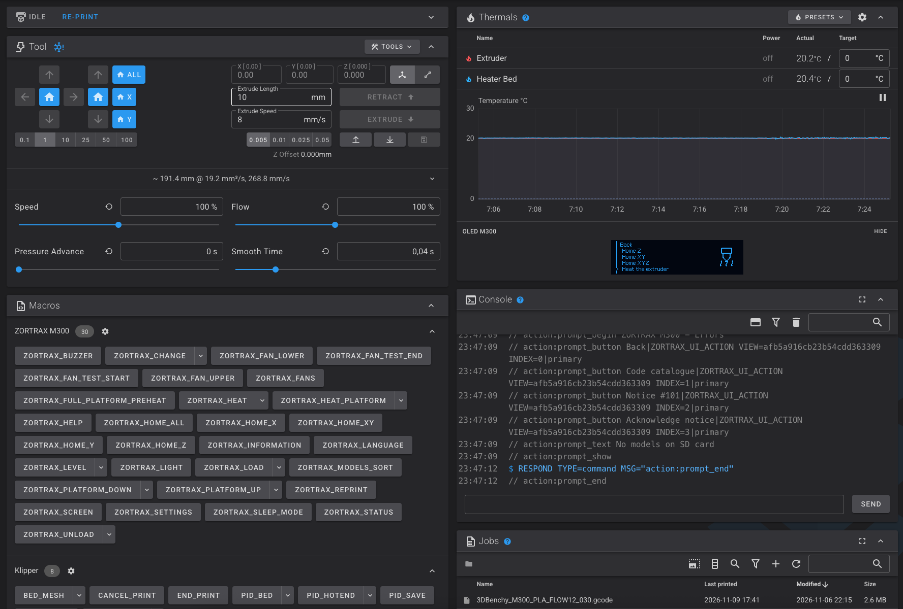
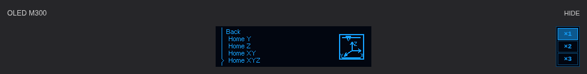
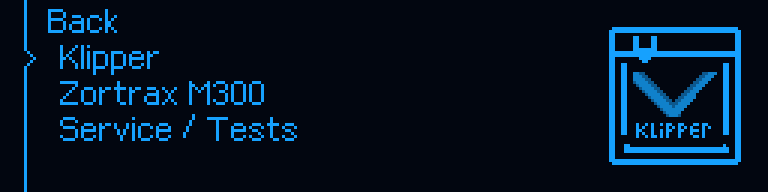
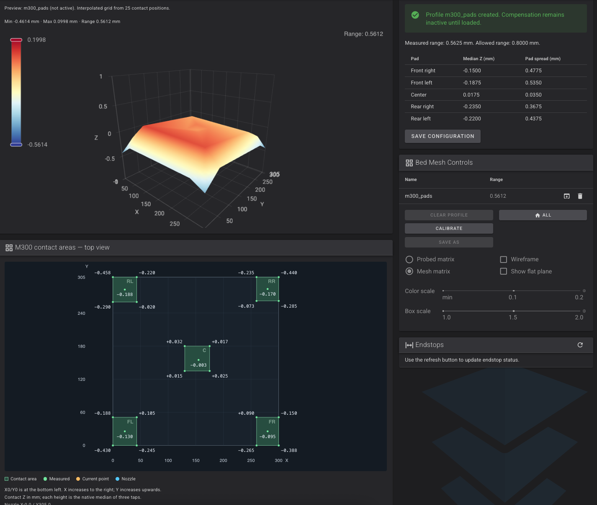

# Zortrax M300 Classic — Klipper, Orange Pi i oryginalny OLED

> **Beta.22 — ostre ikony OLED:** przywrócone 24 dodatkowe ikony oraz wyostrzone 37 zestawów OEM, bez nadpisywania oryginalnych zasobów. [Aktualizacja na porcie 4480 i porównanie wariantów](docs/pl/RELEASE_v1.0.0-beta.22.md). Nie trzeba wgrywać MCU.

**Beta.21:** Cieniowane 24 ikony aktywności i zgodne zasoby autonomicznego OLED w MCU R14.19. [Zakres, ilustracja i dwie części aktualizacji](docs/pl/RELEASE_v1.0.0-beta.21.md). Ilustrowany manual 65 ekranów poniżej zachowuje jawny punkt odniesienia beta.20.

**Pełna instrukcja użytkownika i opis techniczny portu.** Stan dokumentacji: 10 listopada 2026; oprogramowanie odniesienia: **v1.0.0-beta.20**. Projekt dotyczy klasycznego M300 ze sterownikiem STM32F103, nie modeli Plus, Dual ani Inventure.

[Gotowa beta.21](https://github.com/MarcinKowalik-AGH/Zortrax-m300-Klipper/releases/tag/v1.0.0-beta.21) · [README po angielsku](README.md) · [Pierwsza instalacja](docs/pl/FIRST_INSTALL.md) · [Kontrola kompletności dokumentacji](docs/pl/DOCUMENTATION_CHECK.md)



*Rys. 1. Rzeczywisty interfejs użytkownika z 10.11.2026, sprzed beta.20; historyczny układ podglądu OLED. Panel temperatur zawiera podgląd OLED. Widoczne wartości, nazwy plików i stan menu są zapisem chwili wykonania zrzutu, nie zalecanymi nastawami.*

## Nowe instrukcje po poprawkach z 10 listopada

**[OLED — 65 ekranów, grafik i opisów funkcji](docs/pl/OLED_FUNCTIONS.md)**: ścieżka menu, działanie po kliknięciu, wymagania, odpowiednik w Fluidd oraz znaczenie symbolu. Osobny [przewodnik po beta.18–20](docs/pl/UPDATE_2026-11-10.md) opisuje Tune, All/Calibrate i nowy układ skalowania.



*Render demonstracyjny z produkcyjnym CSS i bitmapą projektu, nie zdjęcie sesji drukarki. Ekran jest wycentrowany, przyciski ×1/×2/×3 są pod HIDE i mają wysokość podglądu ×1. Użytkownik potwierdził poprawny efekt beta.20.*

## Co jest w tym porcie

Klipper na hoście planuje ruch i steruje zadaniami. MCU wykonuje zaplanowane impulsy oraz obsługuje sprzęt i lokalne zabezpieczenia. Oryginalny panel z pokrętłem pozostaje użyteczny, a te same procedury są dostępne z Fluidd. Port zachowuje fabryczny styk dyszy z metalowymi polami stołu; nie wymaga BLTouch do opisanego poziomowania.

| Obszar | Funkcje |
|---|---|
| Druk | Natywny G-code, wspólny START/END, cztery linie startowe (2Y + 2X), PAUSE/RESUME/CANCEL, wymiana materiału w pauzie, ponowny wydruk |
| Ruch | Kartezjański planer Klippera, osobne Home X/Y/Z/XY/XYZ, oryginalna kolejność Y przed X przy wspólnym bazowaniu, fabryczne profile Z 400/800 kroków/mm |
| Platforma | Autokalibracja śrub według odtworzonej procedury OEM; osobno mesh: 25 pozycji, po trzy kontakty, profil `m300_pads` |
| Termika | Natywne grzałki/PID, odzyskane z firmware mapy ADC–temperatura, autonomiczne chłodzenie MCU 50/45°C |
| Panel | Menu Klipper / Zortrax M300 / Service / Tests, ustawienia jasności, dźwięku i uśpienia, informacje o drukarce i katalog komunikatów |
| Fluidd | Makra w grupach, wspólne okna procedur, mapa pól kontaktu, podgląd OLED z szybką nawigacją i całkowitymi kwadratowymi pikselami |
| Pliki | Pliki hosta, opcjonalny odczyt oryginalnej karty SD, zweryfikowany podzbiór M300 1.3.1 Z-code; nie uniwersalny konwerter wszystkich Z-code |

Źródła funkcji: [aktualny kontroler druku](host/klippy/extras/m300_print_control.py), [menu](host/klippy/extras/m300_menu.py), [makra](host/config/m300_operations.cfg), [stan i granice wdrożenia](docs/pl/OVERVIEW_PL.md).

## Instrukcja — rozdziały

| Rozdział | Zawartość |
|---|---|
| [Przegląd i architektura](docs/pl/OVERVIEW_PL.md) | Podział host/MCU/Moonraker/Fluidd, diagram połączeń, funkcje OEM i Klipper-native, ograniczenia |
| [Pierwsza instalacja](docs/pl/FIRST_INSTALL.md) | Linux, KIAUH, UART, przygotowany pakiet, aplikacja MCU, kontrola pierwszego uruchomienia |
| [Codzienna obsługa](docs/pl/USER_GUIDE.md) | Start, pauza, wznowienie, anulowanie, filament, grzanie, aktualizacja, diagnostyka |
| [Funkcje OLED krok po kroku](docs/pl/OLED_FUNCTIONS.md) | 65 ilustracji, działania, warunki i znaczenie grafik |
| [Zmiany z 10.11.2026](docs/pl/UPDATE_2026-11-10.md) | Tune, All/Calibrate, skala ×1/×2/×3, centrowanie, aktualizacja i weryfikacja |
| [Menu OLED i galeria](docs/pl/OLED_MENU_REFERENCE.md) | Rzeczywiste drzewo, przycisk i pokrętło, 65 renderów, ekrany kontekstowe, podgląd w Fluidd |
| [Poziomowanie i mesh](docs/pl/BED_MESH_AND_LEVELING.md) | M07 a mesh, pomiar 25 punktów, ocena wyniku, zapis, wczytanie i aktywacja |
| [Parametry techniczne i łącza](docs/pl/TECHNICAL_REFERENCE.md) | Fabryczne parametry, limity konfiguracji, rewizje Z, UART/SPI, mapy temperatur i bezpieczeństwo |
| [Planer i ograniczenia prędkości](docs/pl/PRINT_LIMITS_AND_PLANNER.md) | Look-ahead, przyspieszenie, kroki, przepływ objętościowy, ekstruder/hotend, przykład obliczeniowy |
| [Katalog makr i diagnostyki](docs/pl/MACRO_REFERENCE.md) | Wszystkie 39 makr plikowych dostarczanych w konfiguracji, parametry i bezpośrednie komendy |
| [Źródła, obrazy i walidacja](docs/pl/DOCUMENTATION_CHECK.md) | Lista zrealizowanych wymagań, pochodzenie obrazów, zakres testów i odtwarzanie renderów |

## Aktualizacja działającej drukarki

Tylko przy **bezczynnej drukarce w stanie Ready**, bez aktywnego lub wstrzymanego zadania:

```bash
git -C "$HOME/m300-orange-pi" pull --ff-only &&
python3 "$HOME/m300-orange-pi/install-orange-pi.py"
```

Potem odśwież Fluidd przez **Cmd+Shift+R**. Zmiany frontendu z beta.18–20 nie wymagają ponownego wgrywania MCU. Nie zastępuj portu aktualizacją standardowego Klippera/Fluidd. Instalator zachowuje kalibracje i odmawia nadpisania nieznanych zmian; nie używaj `reset --hard`, aby ominąć taką kontrolę. Szczegóły: [aktualizacja i odzyskiwanie](docs/pl/USER_GUIDE.md).

## Trzy ważne rozróżnienia

**Prędkość przejazdu nie jest prędkością poprawnej ekstruzji.** Profil ruchu 300 mm/s nie oznacza, że oryginalny hotend przetopi materiał potrzebny do takiego wydruku. Praktycznym ograniczeniem podczas długich ruchów z materiałem jest wydajność układu ekstruder–hotend–dysza; pozostają także ograniczenia dynamiki i jakości. W repo nie ma uniwersalnej, zmierzonej wartości maksymalnego przepływu dla wszystkich materiałów.

**Widoczny mesh nie musi być aktywny.** Pomiar tworzy profil i podgląd; kompensacja pozostaje wyłączona do wczytania. Domyślny `START_PRINT MESH=AUTO` ładuje `m300_pads`, jeśli istnieje; przy jego braku kontynuuje bez mesh. `MESH=m300_pads` wymaga profilu zamiast cicho rezygnować z kompensacji.

**Mapy temperatur to charakterystyki czujników, nie tylko zadane temperatury procedur.** Z oryginalnego oprogramowania odtworzono liniowe przeliczenie toru hotendu i nieliniową tabelę stołu (205 par). Ich rolę i granice opisuje [rozdział techniczny](docs/pl/TECHNICAL_REFERENCE.md).

## OLED — render z kodu



*Rys. 2. Render 256×64 powiększony dokładnie 3×, z czcionką i grafiką używanymi w projekcie. Nie jest zdjęciem drukarki ani grafiką wygenerowaną przez model obrazowy.*

## Mesh — wynik rzeczywistego pomiaru



*Rys. 3. Historyczny zrzut użytkownika z 09.11.2026 (w beta.20 schemat jest nad heatmapą): utworzony profil, kompensacja jeszcze nieaktywna. Zakres bezpośrednich obserwacji 0,5625 mm i zakres prezentowanej siatki 0,5612 mm dotyczą tego konkretnego pomiaru.*

## Weryfikacja i odpowiedzialność

Wydanie beta.20 przeszło 741 testów hosta, 140 testów frontendu, 84 porównania rastra i 54 testy układu przeglądarek oraz kompilację ARM i testy natywnego Klippy. [Przebieg wydania](https://github.com/MarcinKowalik-AGH/Zortrax-m300-Klipper/actions/runs/42798305380). Są to testy programowe — nie pomiar temperatur zewnętrzną sondą, powtarzalności kontaktu, przepływu materiału ani opóźnienia na każdym komputerze.

Pierwsze próby ruchu, kontaktowego Z, grzania i druku wykonuj pod nadzorem. Nie kasuj danych fabrycznych MCU i nie kopiuj ustawień innych wersji M300. Kod portu i zależności zachowują swoje licencje; prawa do grafiki OEM pozostają przy właścicielu. [Pochodzenie](docs/en/PROVENANCE.md) · [Licencje](THIRD_PARTY_NOTICES.md).
