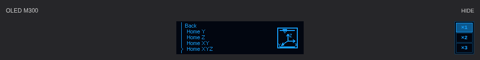

# Current user interface — beta.20, 10 November 2026

[Main documentation](../../README.md) · [Illustrated OLED function guide (Polish)](../pl/OLED_FUNCTIONS.md) · [Polish update guide](../pl/UPDATE_2026-11-10.md)

Source reference: `4828a9da9d5fd8b0b93eb2ac267732ee7e49d506`, `v1.0.0-beta.20`. This documentation update does not change the runtime, MCU or printer configuration. Historic release notes are not current instructions.

## OLED preview and scale controls



This is an isolated browser render using the actual component stylesheet, compiled pixel helper and real OLED raster. It is not a screenshot of a connected printer. The physical OLED and its browser preview use the host's same 256×64 rendered frame, but the preview is not optical or MCU-framebuffer readback.

The preview is centered relative to the entire Temperature card. Three controls ×1/×2/×3 remain pinned to the far-right edge below HIDE, not alongside the moving image. Their combined height equals the ×1 canvas: 68 CSS px at DPR1 or 66 CSS px at DPR2. Only the image scrolls horizontally when enlarged beyond its center column.

At DPR1/2 the content targets 256×64, 512×128 or 768×192 CSS pixels. A two-device-pixel guard surrounds it. At fractional DPR the result snaps to integer square device-pixel blocks; the CSS dimensions can differ. OS magnifiers and remote/pinch compositor scaling are outside this guarantee. The controls use the indexed image palette: #16A1FE foreground, #0A436C border, #0C588E selection and #020610 background.

The selected scale persists in browser storage. Changing it redraws the decoded cached frame; it neither fetches another PNG nor changes the printer. HIDE/SHOW only toggles the browser preview. Navigation uses NAV-EVENT-1 / NAV-PIPELINE-2. Animations and normal temperature/status cadence remain unchanged.

## Tune and mesh

Opening Tune from the slider icon now shows the preparation panel in the authentic initial IDLE state, before a measurement token exists. It does not home, heat, probe or activate a profile. **All** uses the shared ZORTRAX_HOME_ALL and shows homing progress/temperatures. **Calibrate** uses BED_MESH, including its guarded heating/homing preparation; an extra All step is not required.

The contact-area plan stays **above** the heatmap before/during/after measurement. Existing historical screenshots with a different order are clearly marked. A saved profile preview is not active compensation. The 25 positions are three contacts each and are interpolated to 61×61; this is not 3721 physical measurements. SAVE_CONFIG persists the result and restarts Klipper, while LOAD activates it. START_PRINT MESH=AUTO loads m300_pads if present and otherwise continues without compensation; an explicit profile name requires that profile. START does not perform a new mesh automatically.

## Functions and distinct actions

The [65 illustrated OLED screens](../pl/OLED_FUNCTIONS.md) provide the exact menu path, action, operator/precondition notes, matching Fluidd control and icon meaning. They are generated from production menu rows, OEM/project sprites and bitmap fonts using illustrative data, with 256×64 originals and exact 3× previews.

In particular, selecting **Hotend TEMP / Bed TEMP** only chooses a future menu value; **Heat hotend / Heat bed** applies it. OEM **Heat the extruder** is a guided procedure, while **Full platform preheating** is a saved START option, not an immediate heat command. **Home** is axis reference, **Autocalibration** is guided screw leveling, and **Bed mesh** builds compensation data. **Fan Print speed** means model-fan duty, not print velocity. **Save calibration** performs SAVE_CONFIG; it is not read-only. **Service / Tests** includes potentially moving/heating actions.

## Installation and verification

For an existing idle, Ready installation:

```bash
git -C "$HOME/m300-orange-pi" pull --ff-only &&
python3 "$HOME/m300-orange-pi/install-orange-pi.py"
```

Hard-refresh Fluidd with Cmd+Shift+R. Beta.18–20 do not require a new MCU flash, baud change or mesh reset. Preserve local edits and use the installer safeguards. For a new host, follow [FIRST_INSTALL](FIRST_INSTALL.md), not the updater alone.

The release build [42798305380](https://github.com/MarcinKowalik-AGH/Zortrax-m300-Klipper/actions/runs/42798305380) passed 741 host tests, 140 frontend tests, 84 pixel-raster cases and 54 layout cases plus native Klippy, ARM, strict frontend checks and packaging. These are software/browser validations. The user accepted the beta.20 appearance on 10 November; no new physical accuracy, thermal or maximum-flow measurement is claimed.

An old failed CI email is not a statement about the final successful release. Verify the exact source SHA, finished build, immutable release and orange-pi BUILD_PROVENANCE.json. Do not weaken tests or silently re-label a failed build as passing.
