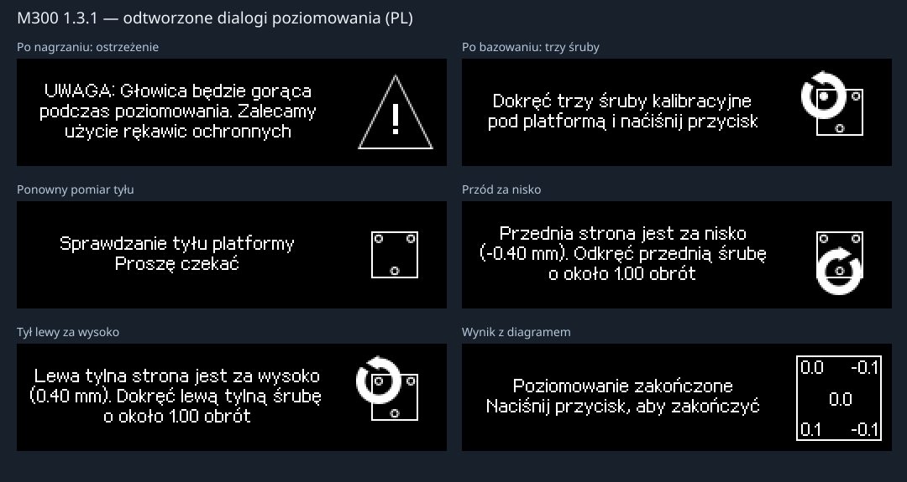

# M07 leveling — R16.5 audit

[Installation](INSTALL.md) · [Polski: full screen/descriptor table](../pl/LEVELING.md)

R16.5 fixes the first-point shutdown reported on 2 November 2026 and restores
the M300 Classic 1.3.1 leveling dialogs. The installed R14.5 MCU is compatible.
Software/reference-frame validation is separate from physical acceptance.

## Reported failure

The first fault in the supplied `klippy(8).log` is `NO_RELEASE: PC7 remains
active`. Subsequent MCU `klipper_shutdown` / `Command request` messages are
the consequence of the host-requested shutdown.

The trace records contact at count 100185, then release at count 100126
with `pin_value=1` at time 6034.935258. At 6035.334100 the pin is active again.
That is 59 counts, **0.1475 mm at the detected 400 counts/mm**. Native
`HomingMove` stops on the first opening edge; its target did not make the
configured 1 mm retract complete. R16.5 detects release, completes the
previously bounded contact + 1 mm endpoint, drains movement, settles for
50 ms, then checks PC7. A genuinely stuck contact still faults. No global
travel limit is extended. The edge-only negative control reproduces the fault.

The repeated missing `M300NativeMotion.panel_update` method is also fixed:
native mode accepts panel telemetry without giving it motion authority.

## OEM dialog recovery

Source application: M300 1.3.1, 146392 bytes, base `0x08008000`, SHA-256
`11e2ea439d33436418bbeb51579cc7c12ef0a329019829bcf7e5eccbfc863b75`.
The previous R16.3 view used adapted 5×7 text and custom phase descriptions.
R16.5 uses the recovered 13-pixel font, 12-pixel line advance, 192×60 text
box and sprite origin `(200,7)`. OEM line breaks and translations are retained.



The [manifest](../../host/klippy/extras/m300_leveling_oem_131.json) contains all
five languages, exact strings, font records and descriptor associations.

| Phase | Original English text | Text ID | Sprite descriptor |
|---|---|---:|---|
| Heat | Heating the extruder / Please wait | 123 | `0x0801C2B8` |
| Hot-head warning | WARNING: Printhead will be hot… Please wear safety gloves. | 124 | `0x0801C434` |
| Homing / initial four points | Please wait | 108 | `0x0801C2B8` |
| Three knobs | Please tighten three calibration knobs at the bottom of the platform and press the button | 125 | `0x0801FE50` |
| Rear / front / center checks | Checking the points at the backside / frontside / Checking the center point | 126–128 | `0x0801CA28` |
| Rear left low / high | Rear left side is too low / too high… | 131 / 132 | `0x0801E90C` / `0x0801F4C0` |
| Rear right low / high | Rear right side is too low / too high… | 133 / 134 | `0x0801ED14` / `0x0801F8B4` |
| Front low / high | Front side is too low / too high… | 129 / 130 | `0x0801F0CC` / `0x0801FC6C` |
| Contact fault | Error #042 Pad probing failed… | 136 | `0x0801FE34` |
| Result | Calibration done. / Press the button to continue | 137 | Five-point numeric diagram |

Both OLED and Fluidd consume the same `describe()` result and panel language.
Session/phase metadata and synthetic labels such as `WAIT_PREPARE: Wait
Prepare` are removed from operator prompts. Tokens remain in action commands;
diagnostics are available through calibration/procedure status commands.

## Sequence and arithmetic

Start → heat to 260°C → warning and confirmation → native XYZ G28 → three-knob
confirmation → initial corners → rear adjustments → front adjustment → center
→ result diagram and observation commit confirmation.

Initial point order: **0=(269,44), 1=(35,44), 4=(35,275), 3=(269,275)**;
center **2=(150,158)** is last. Reference height is the **maximum of the initial
four** and remains constant. With `d_i=h_i−h_ref` in raw counts:

- Rear screws use `d_4` and `d_3`, accepting inclusive −0.2…+0.1 mm.
- Front uses `trunc0((d_0+d_1)/2)`, rejecting both −0.2 and +0.1 mm endpoints.
- Turns are `ceil((abs(d)/S_Z)/0.5099999904632568*4)/4`.
- Low means loosen CW; high means tighten CCW. Every instruction waits for confirmation.
- Both rear instructions use the same measured pair. Remeasure only after
  the last confirmation; pair order alternates through the shared OEM cursor.
- Stock does not recheck the rear after adjusting the front. The center is
  reported, with no automatic bulge threshold in the traced completion path.

The original wizard `0x0800AD1C` and turn helper `0x0800B3F4` were rerun.
All **20002 raw-input vectors** from −5000 through +5000 at Z400 and Z800 match.
The reference wizard sequence is 0,1,4,3 → rear-left 1 turn → rear-right
0.75 turn → 3,4 → front 0.5 turn → 1,0 → center 2.

## Explicit port differences

The wizard uses the stock 260°C target; the original heat threshold is 258°C.
Load/Unload use 240°C. Ordinary G28 Z retains its separate 180°C setting.
Stock used its own Y/X/Z homing and five contact refinements. The port uses
native G28, three samples/median, a 0.05 mm spread limit and fixed points
without stock's ±3 mm XY jitter. Dialog/math recovery is not a claim of identical OEM motion.

The profile remains safe_z=5, search_margin=1, approach_distance=6 and
release_distance=1. Its temporary 1 mm measurement-frame shift is restored
after completion or quiet cancellation; global Z0…315 and XY bounds stay.
`PROBE_ACCURACY` is a separate native command and never starts this wizard.

The result diagram retains OEM layout and 0.1 mm precision, while using the
actual 400/800 scale instead of the OEM hard-coded 1/800 display bug. Host NVM
recording and retry/cancel messages are port extensions. They do not change
probe.z_offset, PID, extrusion calibration or create a bed_mesh. Faults/moving
cancellation shut down without partial saving. After shutdown the local MCU
owns the Waiting screen; the host does not transmit new images. Fluidd retains
the fault explanation with procedure actions revoked.

## Validation and physical retry

**203 host tests** include 85 complete reference frames matching the recovered
renderer byte for byte across five languages, full Z400/Z800 sessions, closing
again after the edge, genuine stuck contact, and delayed encoder dispatch.
The 13 actual Klippy FILEOUTPUT scenarios also pass; they do not exercise a
physical contact or real temperatures.

`ci/extract_leveling_oem.py` reproduces the asset manifest.
`ci/reproduce_leveling_screens.py` compiles and runs the supplied register-C
model to reproduce the committed reference frames. The factory dump is not
distributed in the repository.

After installation verify STATUS, QUERY_PROBE and calibration revision
`0.13.16.5-OEM-MENU-SERVICES`. Run **TEST M300 → TEST_ZORTRAX_LEVEL** or:

```gcode
ZORTRAX_PROCEDURE_START OP=LEVEL TEMP=260
```

Compare the warning and three-knob dialog with the preview. A short click
confirms and a long press cancels; Fluidd acts on the same phase. Physically
verify full release travel, the first point completing, later instructions
and the result diagram. Preserve the new klippy.log if another failure occurs.

R16.5 restores stock procedure targets: calibration/leveling 260°C and Load/Unload 240°C. Migration updates existing R16.3/R16.4 sections and macro defaults. Ordinary G28 Z retains its separate 180°C setting. Manual heating, PID and M600 paused-print target selection retain their existing behavior. Both calibration and filament status expose procedure_temperature.

R16.5 implements the OEM Maintenance and Material menus and their six Fluidd
macros. See [controls, source evidence and acceptance](MAINTENANCE_MATERIAL.md).
