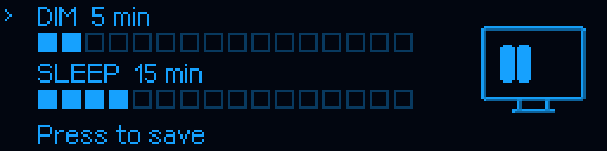

# M300 Classic RC22 · OLED timer sliders

On the panel open **Settings → OLED dim time** or **OLED sleep time**. Both pages show two 16-segment bars matching the brightness control. The marker on the left identifies the setting being edited. The number next to each label gives its exact value in minutes. Turn the encoder to adjust in one-minute steps, press to save or hold to go back. The icon on the right is animated.



In Fluidd open **OLED_TIMERS** or **ZORTRAX_OLED_TIMERS**. DIM controls dimming and SLEEP controls panel power-off. Use **Save** to store the pair. For example, DIM 5 and SLEEP 15 dim the panel five minutes after the last interaction and switch it off at fifteen. Both values are in the range 1–60 minutes with DIM ≤ SLEEP. Printing, pause and Ready share the same deadlines.

With the printer idle and Ready, run the following from your orange-pi checkout:

```bash
git pull --ff-only &&
sha256sum -c --quiet SHA256SUMS &&
python3 install-orange-pi.py &&
python3 install-orange-pi.py --update-fluidd --port 4480
```

The first installer invocation updates the host and physical OLED graphics. The second installs the new Fluidd controls. MCU 1.0.7 already supports storage of both settings. For older firmware the application is supplied in MCU/M300_SD.zip. The OLED image above was rendered from RC22. Historical manual illustrations show beta.20.
