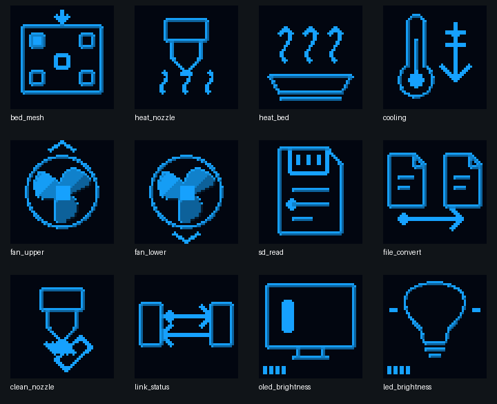
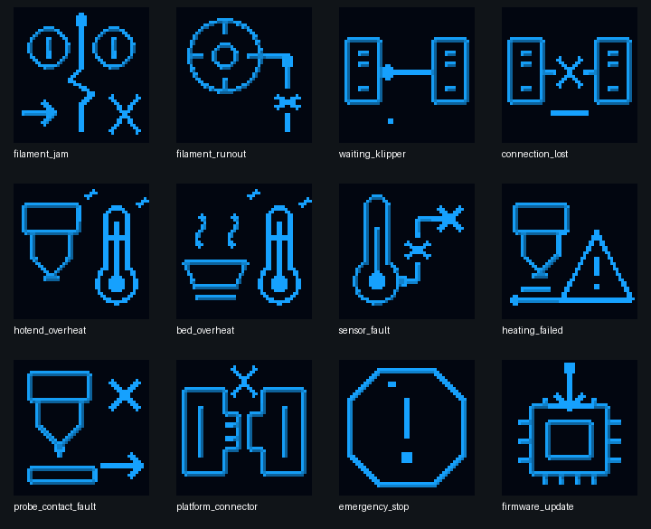

# M300 RC3 + MCU 1.0.1 — unified native OLED artwork

[Main guide](../../README.md) · [MCU installation](MCU_FIRMWARE_1.0.1.md) · [Shared controls](RC1_UI.md)

The former autonomous MCU used soft-edged activity icons while the host thresholded them to binary values. RC3 removes both transformations. The original firmware-derived OEM sprite file is unchanged: 37 descriptors, 61 frames and their original luminance levels. The 24 added activity symbols, with 96 native 50×50 frames, use explicitly designed interior bevels and semantic accents. Bright upper/left contours and darker lower/right contours remain inside the approved silhouette. Important motion indicators and warning marks remain bright. Fan blade planes use discrete tones, not a photographic gradient.

The added artwork palette is 0/4/8/11/14/15; individual icons use a subset. There is no Gaussian blur, dilation, resampling, external glow or runtime threshold. Original OEM sprites retain their own complete grayscale palette. Home/Move axis blinking, the Klipper logo, fonts, menu layout and all control functions are unchanged.




These are exact digital renders, not photographs or measured OLED luminance. [Animation](../assets/ui-symbols/preview.gif) · [Native PNG/GIF/SVG collection](../assets/ui-symbols/M300_ACTIVITY_SYMBOLS_24.zip).

## One master, no divergent display modes

`docs/assets/ui-symbols/native_frames.json` is the canonical raster. `ci/design_activity_artwork.py` defines explicit native-grid shading regions; `ci/export_activity_artwork.py` exports the master without modifying any pixel to host JSON, MCU scanline ROM and previews. MCU ROM contains only the autonomous waiting/link/error subset. During connected operation the MCU receives the host-composed screen, so no extra full frame buffer or runtime graphics filter is required. Its scanline buffer remains 128 bytes.

Fluidd receives the same 4-bit pixels in an indexed PNG. Existing integer pixel scaling, ×1/×2/×3 controls and navigation push remain unchanged. Equality is defined for corresponding icons at the same frame index; it is not a claim of synchronized independent animation clocks or calibrated equality between monitor brightness and OLED luminance. Physical panel contrast and transfer latency still apply.

Legacy `sharp_icons` configuration is consumed for compatibility but cannot select a different raster. `ZORTRAX_UI_STATUS` reports `icon_style: OEM_NATIVE_TONES_V1`.

## Install both components

Only while idle and Ready, with no active or paused print:

```bash
git -C "$HOME/m300-orange-pi" pull --ff-only &&
python3 "$HOME/m300-orange-pi/install-orange-pi.py" --port 4480
```

Hard-refresh Fluidd. Host version becomes `1.0.0-rc.3`. Separately flash application `1.0.1` from `M300_SD.zip` or the dedicated `M300_MCU_v1.0.1_SD.zip`, following the [MCU instructions](MCU_FIRMWARE_1.0.1.md). Git installation does not flash the MCU. An older MCU will retain its old autonomous artwork until that second step. The existing bootloader, saved UART 750000, Fluidd port 4480, qualified Z settings, mesh and PID do not need replacement or recalibration for this visual change. The upstream Klipper baseline, system packages and Moonraker are not updated.

Read `ZORTRAX_SETTINGS_STATUS`, `ZORTRAX_MCU_STATUS`, `ZORTRAX_UI_STATUS` and `ZORTRAX_OLED_STATUS`. Expect host `1.0.0-rc.3`, MCU `1.0.1`, common icon style, Ready and no communication fault.

## Verification and physical acceptance

Checks cover all 96 master/host frames, all 61 original OEM frames, lossless transport and unchanged PNG indices. The native C model exercises the production MCU renderer for 124 waiting/link/error screen phases, comparing 310000 icon pixels. MCU memory limits, M3B structure, configuration migration and 828 host regressions remain release gates. Obsolete tests demanding binary icons were replaced by exhaustive tests of the newly required appearance; safety tests were not removed.

Physical appearance still needs the operator's assessment at ordinary OLED brightness. Inspect nozzle, fan, mesh and normal startup waiting graphics, and compare with Fluidd at ×1/×3. Do not intentionally trigger faults or disconnect printer communication just to view artwork: fault screens were tested offline. Historical 65-screen beta.20 illustrations remain explicitly labeled historical, not silently republished as new captures. This remains an RC distribution and is not evidence of complete hardware acceptance.
