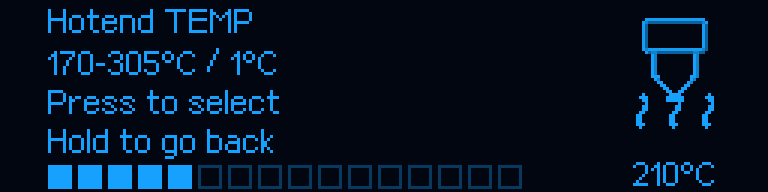
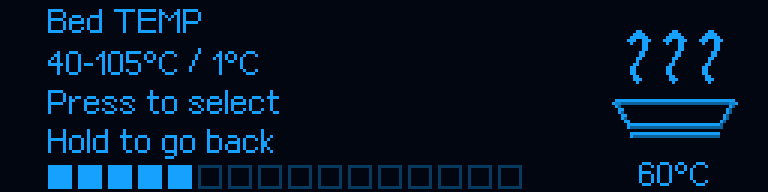

# M300 RC4 — OLED temperature editors

[Main guide](../../README.md) · [Menu and shared controls](RC1_UI.md) · [Unified artwork](RELEASE_v1.0.0-rc.3.md)

## Appearance

**Klipper → Hotend TEMP / Bed TEMP** now opens a segmented-bar editor instead
of a vertical preset list. The layout follows the existing LED/OLED brightness
control. The left area holds the title, range, operating hints and a 16-segment
bar; the right area holds the unchanged native 50×50 heater icon and an exact
numeric temperature. The bar is approximate; the number is the exact draft.





These are production-code renders, not photographs. Reproduce them with
`ci/render_temperature_editors.py`; [pixel provenance](../reports/TEMPERATURE_EDITORS_RC4.json)
records their hashes. No icon raster, shading, animation, transport, pixel zoom
or preview cadence is modified. The icon moves to y=0 solely to reserve the
last 13 rows for its value, without clipping or resampling.

## Interaction

Turn the encoder to adjust by **1°C**. Press to select and return to the
previous parent-menu row. Hold to return without accepting a change. Turning
below the minimum selects Back; clicking Back also cancels. Values clamp at
the ends, rather than wrapping. The initial draft uses the previous manual
selection, otherwise the current heater target when valid, otherwise the
minimum. Entering the screen never saves or activates a target.

**Selection does not start heating.** The existing separate **Heat hotend /
Heat bed** action applies the chosen value via the original guarded heater
command. No motion, printer-state transition, NVM write or alteration of
homing, filament-loading or calibration temperatures happens while editing.
Back is navigation, not an OFF value; the separate heat-off function is unchanged.

With the existing temperature policy, the normal displayed ranges are
170–305°C and 40–105°C. The old preset-list lower bounds are retained, and
stricter configured limits narrow the choice. The UI does not raise any limit
or measured-temperature shutdown threshold. Non-finite or empty ranges leave
Back available but no temperature choices.

The physical click must match the acknowledged OLED draft. Coalesced rotation
and click, a not-yet-acknowledged image or input from a stale page cannot accept
an unseen target. The actual range is checked again before accepting a value.
All existing heater ownership and procedure guards remain in place.

## Update

Only while idle and Ready, with no print running or paused:

```bash
git -C "$HOME/m300-orange-pi" pull --ff-only &&
python3 "$HOME/m300-orange-pi/install-orange-pi.py" --port 4480
```

Hard-refresh Fluidd. `ZORTRAX_SETTINGS_STATUS` should report host `1.0.0-rc.4`.
**No MCU flashing is required.** Firmware remains **1.0.2**, with its original
startup logo and unified artwork. The included `MCU/M300_SD.zip` is the
compatible application, not an obligatory update. UART 750000, port 4480,
mesh, PID, qualified Z, pinned upstream Klipper, Armbian and Moonraker are unchanged.

## Verification

Eighteen added tests cover every temperature, exact approved icon pixels,
segment geometry, lower limits, invalid/empty ranges, absence of heating or
NVM/motion changes, Back, hold, range clamping, delayed acknowledgements,
stale input and coalesced gestures. All previous regressions remain, for a
total of 846 host tests. Full CI retains ARM compilation, native Klippy,
transport, shared-artwork equality, installer migration and rollback gates.
The older 65 beta.20 illustrations remain explicitly historical. CI does not
exercise a physical printer; the user previously accepted the unified icon
appearance, whose raster is unchanged by this release.
