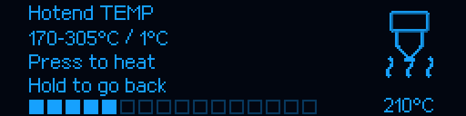
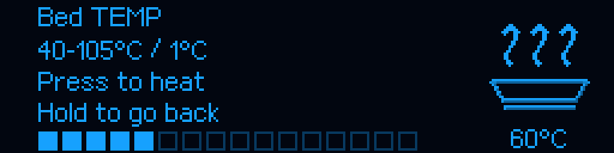

# M300 RC5 — temperature confirmation applies the heater target

[Main guide](../../README.md) · [Superseded RC4 behavior](RELEASE_v1.0.0-rc.4.md)

## Reported issue and correction

RC4 only saved a manual preset after confirming Hotend TEMP / Bed TEMP. Klipper
and Fluidd therefore kept their old heater targets until the separate Heat action.
RC5 makes **the acknowledged click apply the native Klipper target and start
heating**, using `SET_HEATER_TEMPERATURE`, never direct PWM.

Rotation remains draft-only in 1°C steps. Press accepts the exact acknowledged
OLED value and returns to the parent cursor. Hold/Back cancels without changing
existing heating. The hint now reads **Press to heat**. A second Heat command is
unnecessary; the existing Heat shortcuts remain compatible. Heater-off remains
an independent action.

Parent labels show the actual target or OFF. On entry the editor prefers a
currently active target, including values set by Fluidd/G-code. While off, the last
successful selection is only a proposed draft for a new confirmation. Existing
170–305°C / 40–105°C ranges and any stricter configured limits are unchanged.




These are programmatic renders, not hardware photos. Approved icon pixels,
shading, animation and OLED transport are unchanged.

## Guarded application

The command runs outside the OLED packet callback and takes the ordinary native
G-code mutex. Limits and the captured target are checked again after locking.
Navigation, restart and shutdown invalidate pending work. Disconnect, narrowed
limits, an intervening target change or existing heater-ownership refusal cannot
be bypassed. A refusal produces an OLED Notice. The last successful selection is
recorded only after the heater actually accepts the target.

No PID, sensor maps, MCU, cooling, homing, mesh, material-procedure temperatures,
NVM or axis movements are changed.

## Update

Only while idle and Ready, with no active or paused print:

```bash
git -C "$HOME/m300-orange-pi" pull --ff-only &&
python3 "$HOME/m300-orange-pi/install-orange-pi.py" --port 4480
```

Host **1.0.0-rc.5**; MCU **1.0.2**, no reflash. UART 750000, Fluidd 4480, mesh,
PID and qualified Z 2mm are preserved. Refresh Fluidd and check
`ZORTRAX_SETTINGS_STATUS`. Select and confirm a temperature while Ready, then
verify its appearance in the correct heater Target field. Rotation alone must
not change the target. Finish the check by disabling heater targets normally;
allow the hotend cooling system to run until the nozzle cools.

## Verification boundary

855 host regressions, including 27 temperature-editor cases, cover acknowledged
encoder input, native G-code dispatch, the actual pinned Heater.set_temp/get_status,
refusal notices, target/limit races, cancellation, no motion/NVM changes, unchanged
icons and legacy Heat compatibility. The pinned heaters.py reference retains its
original license. Existing tests are retained; successful-click expectations now
require application instead of a cached selection. CI does not heat the user's
printer; physical acceptance remains separate.

The included `MCU/M300_SD.zip` remains firmware 1.0.2, not a required flashing step.
Historical beta.20 illustrations retain their archival designation.
