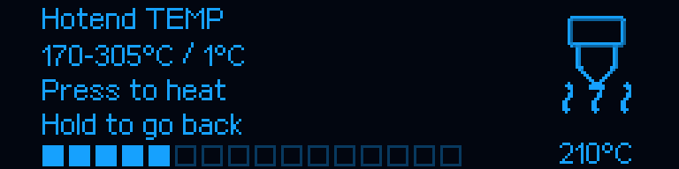
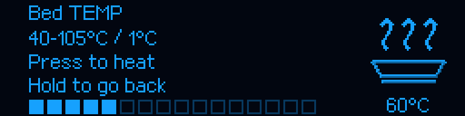

# M300 RC6 — restore approved menu icon animation

[Main guide](../../README.md) · [Approved RC3 shading](RELEASE_v1.0.0-rc.3.md) · [RC5 click-to-heat](RELEASE_v1.0.0-rc.5.md)

## Cause and scope

No replacement artwork is introduced. The 24 additional symbols, OEM atlas,
menu icon bank, axis renderer and Klipper logo remain byte-identical to the
accepted RC3 sources. Contours, shading, native sizes and frame timing remain.

The actual cause was selection logic: ordinary `menu_symbol` branches defaulted
to `animated=False`, and the fallback OEM menu path omitted the clock. Both paths
therefore selected frame zero despite an available multiframe sequence. This
is not evidence of a broken UART or of a chat interruption changing the files.

RC6 plays existing frames in ordinary navigation, including heater entries,
temperature editors, bed-mesh selection, settings, material, file navigation,
PID and brightness. Activity icons retain four 500 ms frames. OEM descriptors
retain their original periods and frame counts. Originally single-frame symbols
remain single-frame; no animation or shading is invented for them. Live fan-test
feedback and terminal procedures keep their real-state semantics. A decorative
menu preview does not execute the operation depicted by its icon.






These are actual OLED-code renders enlarged by integer ×3, not hardware photos.
The [pixel report](../reports/MENU_ANIMATION_RC6.json) records each example frame
and the unchanged source hashes. Fluidd receives the same raster, not a separate
animation set or a differently sharpened version.

## Acknowledged input during animation

RC5 behavior remains: rotate edits a draft, click applies the guarded Klipper
heater target, and Back/hold cancels. Animation can make the last acknowledged
image an earlier phase of the same icon. A bounded receipt history accepts that
image only for the same page, input epoch, generation and selected value.
Changing a draft still requires its own acknowledged image. Navigation, restart,
unready streams and old selections cannot authorize a new action. At most eight
frames are retained per editor. Heater limits, PID, cooling, motion, homing and
mesh are not changed.

## Update

Only while idle and Ready, without an active or paused print:

```bash
git -C "$HOME/m300-orange-pi" pull --ff-only &&
python3 "$HOME/m300-orange-pi/install-orange-pi.py" --port 4480
```

Refresh Fluidd and check `ZORTRAX_SETTINGS_STATUS` for host **1.0.0-rc.6**.
**MCU remains 1.0.2; do not reflash for this menu fix.** The included
`MCU/M300_SD.zip` is not a required update step. UART 750000, Fluidd 4480,
PID, saved mesh and qualified Z clearance 2 mm remain local printer settings.

## Validation boundary

867 host regressions include 12 new tests for unchanged RC3 hashes, native frame
progression across menu routes, no control effects from rendering, and safe
acceptance with animation or delayed ACKs. Earlier thermal-limit, cancellation
and heater-ownership tests remain enabled. `ci/check_menu_animation.py --check`
compares every GIF frame with the production renderer. The beta.20 illustrations
remain explicitly historical. No new physical printer operation is performed
by CI; software checks do not replace the operator's display acceptance.
