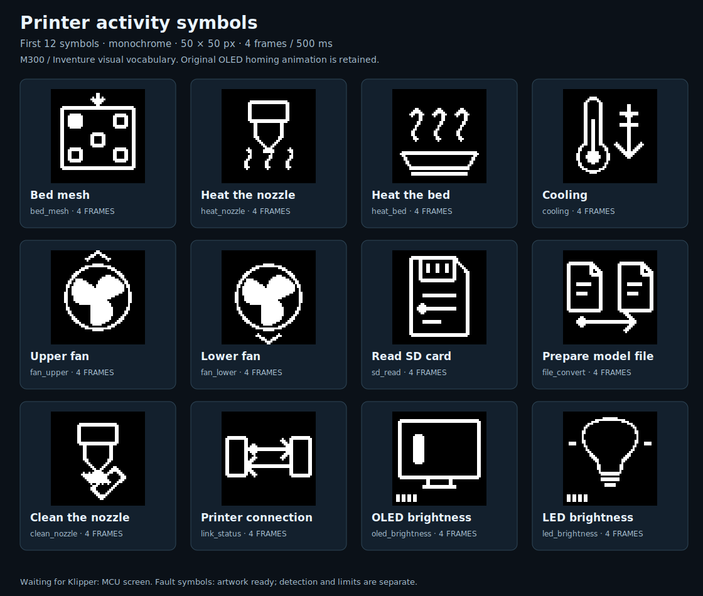
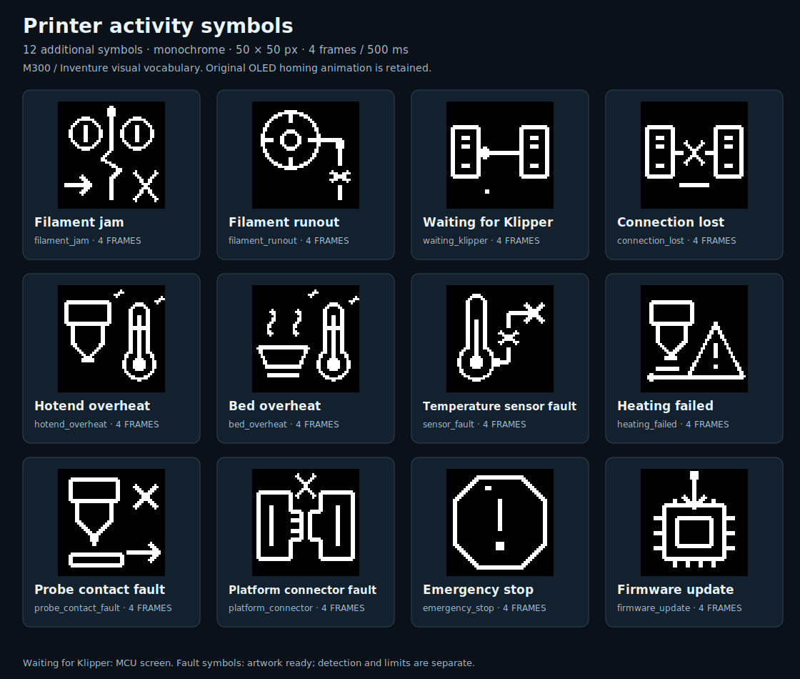

# Printer activity symbols

## Homing presentation

Fluidd uses its existing X, Y, XY, Z and All home buttons. The matching button
shows its normal busy indicator, including when a macro, the OLED or another
client starts homing. The phase text is attached to that button as a tooltip
or title. The circular control highlights the matching home symbol. Its Y
button uses the Y wait key. No homing procedure opens or closes a Fluidd
prompt dialog; native command errors remain visible in the console and the
standard error notification.

The state comes from existing Moonraker subscriptions to `m300_motion` and
`m300_procedures`. Phase text is accepted only for the current token and
phase. Completion, cancellation, a fault or a disconnected printer clears
the remote busy indication. Ordinary Fluidd waits continue to work for all
printers. No extra MCU query or display transfer is introduced.

OLED homing retains the original M300 Classic 1.3.1 four-frame hourglass
at `0x0801c2b8`, with its 500 ms frame interval. Original sprite bytes and
their SHA-256 checks are unchanged. The phase text still comes from the
same procedure view. Maintenance continues to contain Homing XY, Homing Z
and Homing ALL immediately below Autocalibration.

## Existing visual vocabulary

The M300 runtime contains 37 audited 50 × 50 descriptors. The Inventure r0323
reference atlas contains 45 resources, including 13 animated resources with
40 animation frames. The inspected reference sheets were
`01_ATLAS_45_ZASOBOW(1).png` and `03_ATLAS_40_KLATEK_ANIMACJI(1).png`.
The Inventure artwork is a visual reference; it is not installed into M300
by this update.

| Activity | Existing source vocabulary | Use |
| --- | --- | --- |
| Homing / waiting | Four-frame hourglass in both printers | Keep original M300 animation |
| Manual leveling | Platform, screw and circular direction arrows | Keep audited OEM screw instructions |
| Load / unload | Filament transport, spool and insertion/removal arrows | Reuse existing M300 animations |
| Printing | Nine-frame progress ring | Reuse original progress vocabulary |
| Pause / resume | Circled pause bars / play arrow | Reuse original symbols |
| Completion / cancel | Circled check / cross | Reuse original symbols |
| Warning / failure | Triangle or octagon with exclamation mark | Reuse original symbols |
| Sleep | Crescent moon | Keep existing OLED sleep behavior |
| Models / files | Cube, folder and file check | Keep existing menu symbols |
| Maintenance / settings | Crossed tools / gear | Keep existing menu symbols |
| Information | Circled lower-case i | Keep original information symbol |

## Activity symbol set

These are new project designs inspired by the two visual vocabularies.
They are not extracted OEM graphics. The set now contains 24 monochrome
50 × 50 symbols, each with four distinct frames at 500 ms (a two-second loop).
The downloadable pack includes 24 animated GIFs, 96 individual PNG frames,
24 animated SVGs, a catalog and native 4bpp frame data. No SVG rasterizer is
needed during printer operation.

[Download all 24 symbols](../assets/ui-symbols/M300_ACTIVITY_SYMBOLS_24.zip)

[Animated first set](../assets/ui-symbols/preview.gif)

| Symbol | Printer function | Proposed movement | Draft |
| --- | --- | --- | --- |
| Bed mesh | Native 25-contact map | Measurement dot visits platform pads | [SVG](../assets/ui-symbols/bed_mesh.svg) |
| Heat the nozzle | Hotend heating | Rising heat waves below the nozzle | [SVG](../assets/ui-symbols/heat_nozzle.svg) |
| Heat the bed | Bed heating | Heat waves rise from the platform | [SVG](../assets/ui-symbols/heat_bed.svg) |
| Cooling | Cooling after heating or a print | Temperature marker moves downward | [SVG](../assets/ui-symbols/cooling.svg) |
| Upper fan | Upper fan test and cooling status | Three blades rotate; upper marker stays fixed | [SVG](../assets/ui-symbols/fan_upper.svg) |
| Lower fan | Lower/model fan test | Three blades rotate; lower marker stays fixed | [SVG](../assets/ui-symbols/fan_lower.svg) |
| Read SD card | Physical SD listing and file import | Data marker moves across the card | [SVG](../assets/ui-symbols/sd_read.svg) |
| Prepare model file | File validation and Z-code preparation | Data marker moves between files | [SVG](../assets/ui-symbols/file_convert.svg) |
| Clean the nozzle | Operator cleaning instruction | Brush moves under the nozzle | [SVG](../assets/ui-symbols/clean_nozzle.svg) |
| Printer connection | Host–MCU connection status | Marker follows the link arrows | [SVG](../assets/ui-symbols/link_status.svg) |
| OLED brightness | Existing 16-level display setting | Display and segmented bar change together | [SVG](../assets/ui-symbols/oled_brightness.svg) |
| LED brightness | Existing 16-level lighting setting | Lamp rays and segmented bar change together | [SVG](../assets/ui-symbols/led_brightness.svg) |

## Twelve additional symbols

| Symbol | Movement | Current assignment |
| --- | --- | --- |
| Filament jam | Feed marker reaches a blocked path; rollers rock | Artwork prepared; no jam detector added |
| Filament runout | Marker approaches the broken feed path | Artwork prepared |
| Waiting for Klipper | Marker travels from the MCU to the host; dots accumulate | Local MCU waiting screen |
| Connection lost | Broken-link cross remains visible; underline expands | Local MCU lease expiry and shutdown screen |
| Hotend overheat | High-temperature marker and warning rays move | Artwork prepared; existing limits unchanged |
| Bed overheat | High-temperature marker and warning rays move | Artwork prepared; existing limits unchanged |
| Temperature sensor fault | Marker reaches the broken sensor lead | Artwork prepared |
| Heating failed | Low-temperature marker moves; warning remains visible | Artwork prepared |
| Probe contact fault | Contact marker approaches the pad; cross remains visible | Artwork prepared |
| Platform connector fault | Connector pins move toward the separated socket | Artwork prepared |
| Emergency stop | Indicator marks accumulate inside the fixed stop outline | Artwork prepared |
| Firmware update | Data marker moves into the memory chip | Artwork prepared; no new flashing mechanism added |

The first twelve symbols and ten unassigned fault/activity symbols are ready
assets, not new runtime capabilities. Inventure-style thermal thresholds and
fault-to-icon routing will be handled separately before integrating the thermal
symbols. Critical warning outlines, crosses and exclamation marks remain visible
in every frame.

## Local MCU animation in R14.15

The original local text-only waiting screen now includes the matching 50 × 50
symbol on the right. Startup and an explicit host display release use
`waiting_klipper`; a host lease timeout or MCU shutdown uses `connection_lost`.
Shutdown still says `MCU shutdown`; it never claims that the printer is ready.
The version line now identifies the compiled R14.15 image instead of the old
hard-coded R14.4 label.

The frames occupy 2,800 bytes of static flash, with the existing 128-byte
scanline buffer reused. After the initial screen, only a 52 × 50 SPI window
is updated: 1,300 pixel bytes plus seven command/address bytes per frame,
two frames per second. A task sends at most 26 pixel bytes per animation row,
with interrupts enabled. Between frames the timer sleeps until the deadline.
There is no host query, UART frame traffic, heap allocation or queued animation
backlog. The first host display claim cancels local work in every state, including
partway through the icon window. Existing OLED host rendering and the original
M300 homing hourglass are unchanged.

R14.15 adds only the local screen and its version label to the R14.14 MCU core.
It does not change X/Y hardware STEP timers, Z/E stepping, encoder capture,
UART rate or thermal guards. Hardware motion evidence remains that collected
for the R14.14 core; the new panel animation needs a printer check after flashing.

Do not show an animated activity symbol when its associated operation is
inactive. In particular, a connection symbol must not imply healthy motion
or hardware qualification, and fan artwork must not imply measured RPM on
hardware that has no tachometer. The artwork adds no controls or detection capabilities.

Reproduce the SVGs with `python3 ci/render_ui_symbols.py`. To regenerate the
complete pack, previews and MCU bitmap include, install CairoSVG 2.9.1 and
Pillow on the authoring machine, then run
`python3 ci/render_ui_symbols.py --raster`.
`python3 ci/check_ui_symbols.py -v` validates all 96 frames and download contents
using only the standard library. It also checks that the MCU's one-bit flash
frames exactly match the native 4bpp artwork. The panel model checks actual SPI
window addressing, four-frame wraparound, a maximum of 26 pixel bytes per task,
no idle 1 kHz wake, shutdown and host handover in every rendering phase.
