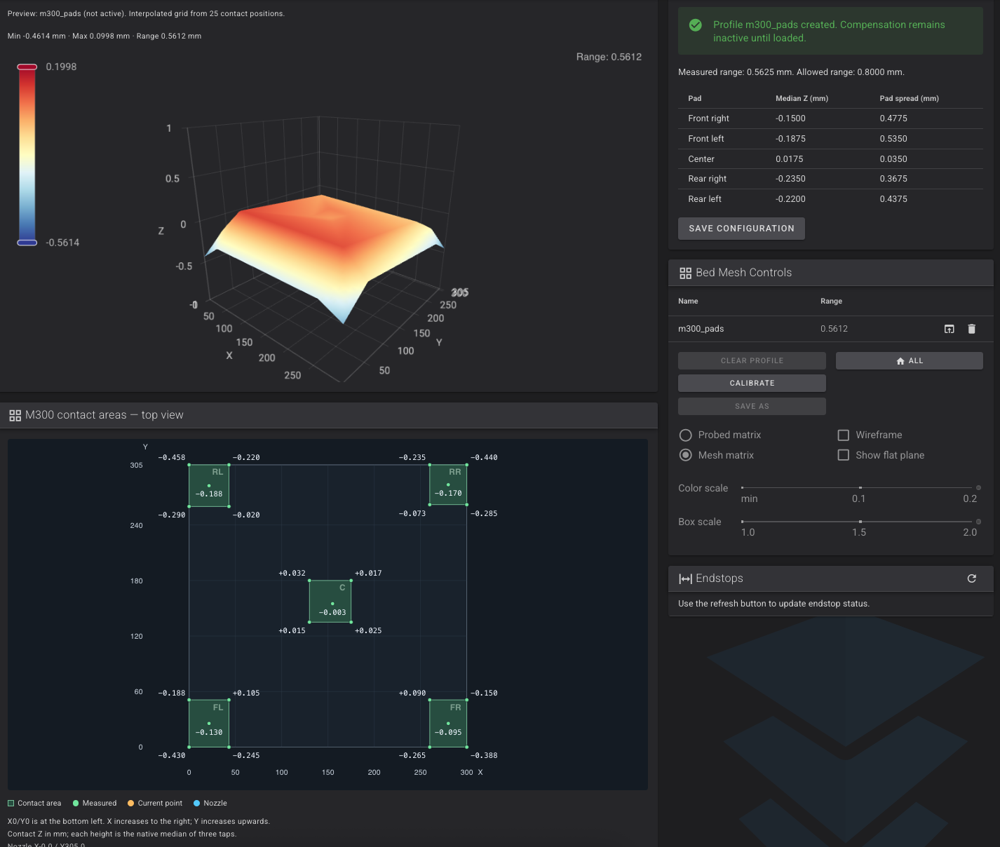
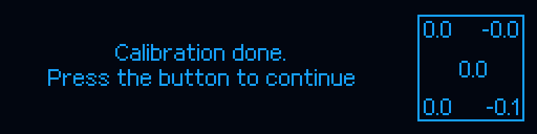

# Poziomowanie, pola kontaktowe i aktywacja mesh

[Spis dokumentacji](../../README_PL.md) · [Obsługa](USER_GUIDE.md) · [Menu OLED](OLED_MENU_REFERENCE.md) · [Parametry](TECHNICAL_REFERENCE.md)

> Dokumentacja dla **M300 Classic**, stan kodu **v1.0.0-beta.17**, commit `d6ddf9c3bee58dc2209946a0073f8a708d964073`. Nie dotyczy M300 Plus, M300 Dual ani Inventure.


## 1. Dwie odrębne procedury

| Funkcja | Autokalibracja OEM | Mesh Klippera |
|---|---|---|
| Polecenie | `ZORTRAX_LEVEL` | `BED_MESH` lub przechwycone `BED_MESH_CALIBRATE` |
| Cel | Mechaniczne ustawienie platformy śrubami | Pomiar wysokości i programowa kompensacja Z |
| Model | Odtworzony przebieg M07, pięć pól | 25 pozycji: po pięć w każdym z pięciu pól |
| Udział operatora | Potwierdzenia i regulacja śrub według ekranu | Potwierdzenie przygotowania; pomiar jest automatyczny |
| Temperatura proceduralna | Domyślnie 260°C | Domyślnie hotend 260°C i stół 60°C, z polityką zachowania wyższej temperatury hotendu |
| Wynik | Ocena ustawienia i instrukcja regulacji | Profil `m300_pads`, początkowo **nieaktywny** |

Nie utożsamiaj autokalibracji śrub, bazowania Z i mapy mesh. Bazowanie wyznacza odniesienie osi; mesh opisuje odchylenia powierzchni względem odniesienia. Żadna z tych procedur nie usuwa mechanicznego luzu ani zabrudzenia styku.

Źródła: [M07](../../host/klippy/extras/m300_calibration.py), [kontaktowe Z](../../host/klippy/extras/m300_native_z.py), [mesh](../../host/klippy/extras/m300_pad_mesh.py), [makra](../../host/config/m300_operations.cfg).

## 2. Warunki przed pomiarem

Platforma musi być prawidłowo osadzona, a metalowe pola kontaktowe dostępne. Dysza musi mieć zapewniony kontakt elektryczny z tymi polami; zalegający materiał, powłoka izolacyjna, szkło lub całkowicie zakrywająca pola nakładka zmieniają warunki pomiaru. Przy przebudowie na PEI czy inną płytę najpierw zweryfikuj geometrię i sposób uzyskania kontaktu, nie uruchamiaj bez nadzoru procedury przeznaczonej dla płyty fabrycznej.

Przed ruchem XY procedury kontaktowe ustanawiają wspólny **odstęp Z 5 mm**. To ruch w granicach dostępnego zakresu, a nie zgoda na pomijanie kontroli styku PC7 czy poruszanie niezbazowaną maszyną. Standardowy homing Z ma wymaganie grzania minimum 180°C i respektuje wyższy roboczy cel hotendu. Nie zmieniaj tej temperatury na podstawie samego opisu menu.

Przygotuj czystą dyszę, usuń model i przeszkody, sprawdź przewód kontaktu oraz nadzoruj pierwszy pomiar po aktualizacji lub zmianie platformy. Gorącej dyszy i stołu nie dotykaj ręką.

## 3. Geometria: pięć pól, a nie regularna siatka 5×5

Pola to **FR** (przód prawy), **FL** (przód lewy), **C** (środek), **RR** (tył prawy) i **RL** (tył lewy). Każde zawiera środek oraz cztery punkty narożne wybrane wewnątrz dozwolonego metalowego obszaru. Łącznie daje to 25 pozycji. Widok z góry ma **X0/Y0 w lewym dolnym rogu; X rośnie w prawo, Y do góry**.

Współrzędne wyznacza konfiguracja konkretnej platformy, margines metalu i dopasowanie do zakresu osi. Nie kopiuj do M300 wymiarów CR10S5. Wartości `probe_count: 3,3` z bazowej sekcji `[bed_mesh]` nie opisują liczby kontaktów procedury M300; przejmuje ją `[m300_pad_mesh]`.

Przed zmianą geometrii wykonaj wyłącznie podgląd:

```gcode
BED_MESH PREVIEW=1
```

Makro przekazuje między innymi `PROFILE`, `CORNER_PAD_WIDTH`, `CENTER_PAD_WIDTH`, `EDGE_MARGIN`, `TRAVEL_MARGIN`, `FIT_TRAVEL`, współrzędne poszczególnych pól i jawne `*_BOUNDS`. `PREVIEW=1` nie wykonuje grzania ani ruchu. Dozwolony jest zerowy margines, ale nie zwalnia to z konieczności pozostawienia rzeczywistego kontaktu na metalu. Nie włączaj dopasowania kosztem poszerzenia limitów ruchu.

## 4. Przebieg automatycznego mesh

1. Sprawdzenie bezczynności, profilu, geometrii, limitów i zasobów; wyłączenie dotychczasowej aktywnej kompensacji, bez usuwania zapisanych profili.
2. Przygotowanie grzania dyszy i platformy. Podany `HOTEND_TEMP` jest minimum uwzględnianym razem z aktualną temperaturą i celem; domyślny cel modułu to 260°C, dolna granica 180°C. Stół zachowuje istniejący dodatni cel albo przyjmuje domyślny 60°C, jeśli nie podano `BED_TEMP`.
3. Oczekiwanie na stabilizację i niezbędne bazowanie przez natywne procedury M300.
4. W każdej z 25 pozycji trzy kontakty, wynik pozycji jako mediana. Nominalnie jest to co najmniej 75 kontaktów; odrzucone próby i powtórzenia mogą zwiększyć liczbę.
5. Ocena pomiaru. Natywny rozrzut powtórzeń ma oddzielną kontrolę; domyślny dopuszczalny zakres całej platformy `max_bed_span` wynosi 0,80 mm. Opcjonalny limit rozrzutu całego pola to inny parametr.
6. Interpolacja i utworzenie profilu, następnie celowe pozostawienie go nieaktywnego. Fluidd pokazuje wynik i przycisk zapisu konfiguracji.
7. Po sukcesie przywrócenie wcześniejszych celów grzałek, także wyłączenia; po błędzie cele są wyłączane. Wynik nie jest zapisywany jako zaakceptowany, jeśli pomiar nie spełnia kontroli.


Dokumentacja nie zaleca jednej temperatury do wszystkich materiałów. Dobierz warunki do płyty i materiału; nie pozostawiaj tworzywa niepotrzebnie długo w gorącym hotendzie. Procedury i zabezpieczenia muszą pozostać zgodne z konfiguracją sprzętu.

## 5. Jak powstaje siatka kompensacji

Algorytm buduje **ciągłą powierzchnię odcinkami liniową na triangulacji 25 zmierzonych pozycji**. Następnie próbkuje ją na regularnej siatce **61×61 = 3721 węzłów**, przekazywanej do natywnego `ZMesh` Klippera w trybie `direct`. Te 3721 węzłów nie są dodatkowymi pomiarami. Punkt zerowego odniesienia jest związany z używanym punktem bazowania; typowa konfiguracja `home_xy` to X150/Y158.

Z tego powodu zakres wysokości z 25 pomiarów i zakres siatki prezentowanej po resamplingu nie muszą być identyczne. To także nie oznacza dokładnego poznania nierówności w niezmierzonych obszarach pomiędzy metalowymi polami. Mesh interpoluje tam model powierzchni, a nie wykonuje pomiaru.

## 6. Interpretacja dostarczonego zrzutu



*Zrzut użytkownika z 09.11.2026, zachowany jako przykład konkretnego pomiaru, nie wzorcowa geometria wszystkich M300. Tekst „Preview: m300_pads (not active)” oznacza brak aktywnej kompensacji.*

| Wartość widoczna na zrzucie | Znaczenie |
|---|---|
| Measured range 0,5625 mm | Rozpiętość zmierzonych kontaktów użytych do oceny |
| Allowed range 0,8000 mm | Ustawiony próg akceptacji tej procedury |
| Min −0,4614 / Max +0,0998 / Range 0,5612 mm | Zakres wyświetlanej, interpolowanej siatki |
| `m300_pads` w Bed Mesh Controls | Profil został utworzony |
| `not active` oraz komunikat „inactive until loaded” | Profil nie został włączony jako kompensacja ruchów |

Mediany pól na tym zrzucie: FR −0,1500, FL −0,1875, C +0,0175, RR −0,2350, RL −0,2200 mm. Wartość **Pad spread** dotyczy różnic pomiędzy pozycjami wewnątrz pola. Nie jest automatycznie odchyleniem trzech powtórzeń w jednej pozycji. Duży rozrzut wewnątrz pola wymaga oceny powierzchni i styków, nawet jeśli całkowity próg został spełniony.

## 7. Utworzenie, zapis i aktywacja to trzy etapy

**Utworzenie** zapisuje profil w pamięci uruchomionego Klippera i daje podgląd. **SAVE_CONFIG** utrwala dane w konfiguracji i powoduje restart Klippera; wykonuj go tylko po zakończeniu procedury, bez wydruku. **LOAD** wczytuje profil do aktywnej kompensacji.

Po zaakceptowanym pomiarze:

```gcode
SAVE_CONFIG
```

Po restarcie i właściwym bazowaniu, kiedy potrzebna jest ręczna aktywacja:

```gcode
BED_MESH_PROFILE LOAD=m300_pads
BED_MESH_OUTPUT
```

`BED_MESH_OUTPUT` jest poleceniem odczytowym. Sam kolorowy wykres nie dowodzi, że korekta Z działa podczas ruchu. Do wyłączenia aktywnej kompensacji służy `BED_MESH_CLEAR`; nie jest to polecenie usunięcia profilu z konfiguracji.

Źródła: [bed_mesh.py w przypiętym Klipperze](https://github.com/Klipper3d/klipper/blob/ee2c6fb6b00b2b5d097ef70d0868df7d74943b51/klippy/extras/bed_mesh.py) i [oficjalny opis Bed Mesh](https://www.klipper3d.org/Bed_Mesh.html).

## 8. Co robi START_PRINT

| Parametr | Zachowanie |
|---|---|
| Domyślne `MESH=AUTO`, jest `m300_pads` | Po bazowaniu wczytuje ten profil, przed czterema liniami startowymi |
| `MESH=AUTO`, nie ma `m300_pads` | Wybiera brak kompensacji i po bazowaniu usuwa ewentualny aktywny mesh |
| `MESH=m300_pads` | Wymaga tego profilu, przy braku zgłasza błąd |
| `MESH=inna_nazwa` | Wymaga wskazanego profilu; nie szuka najnowszego według daty |
| `MESH=NONE` | Celowo nie używa kompensacji |

M300 nie wykonuje nowego mesh przy każdym starcie. To różnica względem przedstawionego w projekcie CR10S5, gdzie start uruchamiał `BED_MESH_CALIBRATE`. W M300 ładowany jest profil, a ruchy linii startowych idą przez G-code, z aktywną transformacją mesh. Po zmianie mechaniki, powierzchni, temperatury pracy lub odtworzeniu bazowania oceń, czy stary profil nadal odpowiada rzeczywistości.

## 9. Autokalibracja OEM i rendery




Rendery przedstawiają wybrane stany kodu M07 na danych demonstracyjnych. Kierunku i liczby obrotów nie przepisuj z obrazka: wiążące jest wskazanie dla bieżącego pomiaru Twojej drukarki. Szczegółowy audyt OEM: [LEVELING](../en/LEVELING.md).
