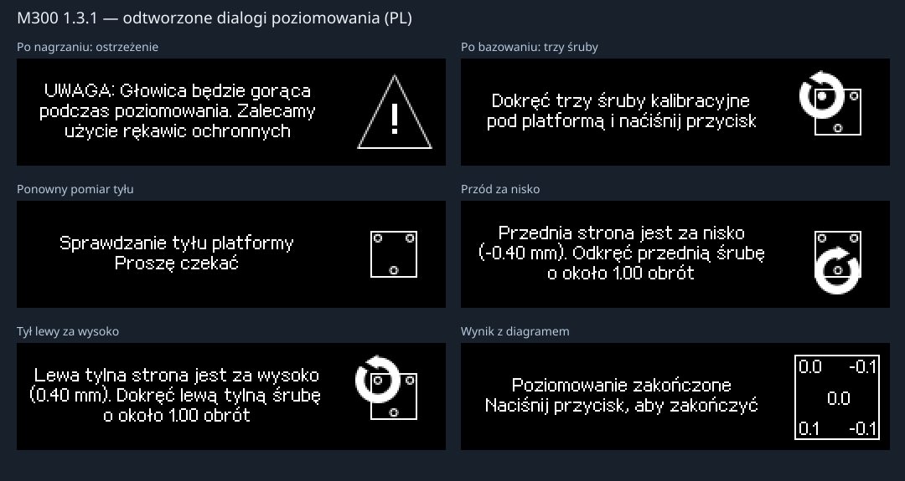

# Poziomowanie M07 — audyt R16.5

[Instalacja](INSTALL.md) · [English](../en/LEVELING.md)

R16.5 poprawia awarię pierwszego pomiaru z logu operatora z 2 listopada 2026
i odtwarza dialogi M300 Classic 1.3.1. Dotychczasowe MCU R14.5 pozostaje
zgodne. Zgodność obrazów w modelu nie oznacza odbioru na fizycznej drukarce.

## Przyczyna shutdown

Pierwszy błąd w `klippy(8).log` to `NO_RELEASE: PC7 remains active`.
Późniejsze `klipper_shutdown` / `Command request` są skutkiem zatrzymania
zażądanego przez hosta, a nie pierwotną awarią MCU lub grzałki.

| Czas monotoniczny | Zdarzenie |
|---|---|
| 6033.987265 | Z przy kontakcie: licznik 100185 |
| 6034.398805 | Cofnięcie z oczekiwaniem na rozwarcie, `pin_value=1` |
| 6034.934384–6034.935258 | Licznik 100126; PC7 otwarty |
| 6035.334100 | PC7 ponownie aktywny |

59 kroków to **0,1475 mm przy wykrytym Z400**. `HomingMove` zatrzymał się
na pierwszej krawędzi rozwarcia. Zadane `release_distance=1` nie oznaczało
wykonanego cofnięcia o 1 mm; po około 0,4 s zapytanie widziało już zwarcie.

R16.5 po krawędzi kończy cofnięcie do wcześniej sprawdzonego punktu
kontakt + 1 mm, czeka na opróżnienie kolejki i 50 ms ustalenia, następnie
sprawdza PC7. Rzeczywiście zwarty styk nadal zatrzymuje procedurę. Globalny
zakres Z pozostaje bez zmian. Test bez końca cofnięcia odtwarza awarię;
poprawny przebieg sprawdzono w modelu dla Z400 i Z800.

Usunięto też źródło wpisów `M300NativeMotion has no attribute panel_update`:
natywny właściciel przyjmuje telemetrię panelu bez uruchamiania ruchu.

## Oryginalne teksty i rysunki

Źródło: dostarczona aplikacja M300 1.3.1, 146392 B, baza `0x08008000`,
SHA-256 `11e2ea439d33436418bbeb51579cc7c12ef0a329019829bcf7e5eccbfc863b75`.
R16.3 używało dostosowanej czcionki 5×7 i własnych opisów etapów.
R16.5 przywraca glify 13 px, odstęp wierszy 12 px, pole tekstu 192×60
i grafikę od `(200,7)`. Zachowuje podziały wierszy, polskie znaki i literówki.



Tabela identyfikuje komunikaty. Pełne teksty w pięciu językach są w
[sprawdzonym manifeście](../../host/klippy/extras/m300_leveling_oem_131.json).
Sprite jest deskryptorem oryginalnej grafiki.

| Etap / skrót tekstu PL | ID | Deskryptor ekranu | Sprite |
|---|---:|---|---|
| Nagrzewanie ekstrudera / Proszę czekać | 123 | wywołanie grzania | `0x0801C2B8` |
| UWAGA: Głowica będzie gorąca… Zalecamy użycie rękawic ochronnych | 124 | `0x08021DB0` | `0x0801C434` |
| Proszę czekać — bazowanie i pierwsza czwórka | 108 | `0x08021C60` | `0x0801C2B8` |
| Dokręć trzy śruby kalibracyjne pod platformą i naćiśnij przycisk | 125 | `0x08021DBC` | `0x0801FE50` |
| Sprawdzanie tyłu platformy / Proszę czekać | 126 | `0x08021DC8` | `0x0801CA28` |
| Sprawdzanie przodu platformy / Proszę czekać | 127 | `0x08021DD4` | `0x0801CA28` |
| Sprawdzanie środka platformy / Proszę czekać | 128 | `0x08021DE0` | `0x0801CA28` |
| Lewa tylna strona jest za nisko / za wysoko… | 131 / 132 | `0x08021DEC` / `0x08021E10` | `0x0801E90C` / `0x0801F4C0` |
| Prawa tylna strona jest za nisko / za wysoko… | 133 / 134 | `0x08021DF8` / `0x08021E1C` | `0x0801ED14` / `0x0801F8B4` |
| Przednia strona jest za nisko / za wysoko… | 129 / 130 | `0x08021E04` / `0x08021E28` | `0x0801F0CC` / `0x0801FC6C` |
| Błąd #042 Niepowodzenie próbkowania platformy… | 136 | `0x08021E40` | `0x0801FE34` |
| Poziomowanie zakończone / Naciśnij przycisk, aby zakończyć | 137 | `0x08021E4C` i `0x0800F0D8` | diagram pięciu odchyłek |

Instrukcja śruby zawiera podpisaną odchyłkę do 0,01 mm i liczbę obrotów.
Angielski oryginał podaje CW/CCW, polski nazwę czynności. Zachowano tę
różnicę tłumaczeń i odmianę słowa „obrót”, także szczególną gałąź przodu:
liczba pojedyncza poniżej 2, również przy ułamkach.

OLED i Fluidd używają jednego `describe()` i języka z ustawień panelu.
Z okna operatora usunięto `WAIT_PREPARE: Wait Prepare`, sesję/fazę i własne
opisy. Token pozostaje w poleceniu przycisku; diagnostyka jest dostępna przez
`ZORTRAX_CALIBRATION_STATUS` i `ZORTRAX_PROCEDURE_STATUS`.

## Kolejność i algorytm

Start → grzanie 260°C → ostrzeżenie i klik → własny G28 XYZ → trzy śruby
i klik → pierwsza czwórka → regulacja tyłu → regulacja przodu → środek
→ diagram wyniku i potwierdzenie zapisu obserwacji.

| Punkt | XY [mm] | Rola |
|---:|---|---|
| 0 | 269,44 | Przód prawy, pierwszy pomiar |
| 1 | 35,44 | Przód lewy |
| 4 | 35,275 | Tył lewy |
| 3 | 269,275 | Tył prawy |
| 2 | 150,158 | Środek, mierzony na końcu |

Referencją jest **maksimum pierwszych czterech wysokości**, w kolejności
0,1,4,3. Nie zmienia się po regulacji. Dla `d_i=h_i−h_ref`, w licznikach:

- Tył: osobno `d_4` i `d_3`; przyjęcie obejmuje granice `−0,2…+0,1 mm`.
- Przód: `trunc0((d_0+d_1)/2)`; granice `−0,2` i `+0,1 mm` są odrzucane.
- Obroty: `ceil((abs(d)/S_Z)/0.5099999904632568*4)/4`.
- Za nisko: odkręć CW. Za wysoko: dokręć CCW. Każda instrukcja wymaga kliku.
- Obie tylne instrukcje wynikają z tej samej pary. Ponowny pomiar następuje
  po ostatnim potwierdzeniu. Kolejność par zmienia się według kursora OEM.
- Po regulacji przodu oryginał nie wraca do tyłu. Środek jest raportowany;
  w prześledzonym zakończeniu nie ma progu uruchamiającego tekst o wybrzuszeniu.

Ponownie wykonano oryginalny kreator `0x0800AD1C` i helper `0x0800B3F4`.
20002 wartości od −5000 do +5000 dla Z400/Z800 zgadzają się z portem.
Przypadek wzorcowy: 0,1,4,3 → tylna lewa 1 obrót → tylna prawa 0,75
→ pomiary 3,4 → przednia 0,5 → pomiary 1,0 → środek 2.

## Jawne różnice portu

Kreator używa fabrycznych 260°C; oryginalny próg nagrzania wynosi 258°C.
Load/Unload używają 240°C. Zwykły G28 Z ma oddzielną nastawę 180°C.
Oryginał stosował własne bazowanie Y/X/Z i pięć kontaktów. Port korzysta
z natywnego G28, trzech próbek/mediany, rozrzutu 0,05 mm i stałych punktów
bez losowego jittera ±3 mm. Nie jest to deklaracja identycznej trajektorii wykonania OEM.

Profil: `safe_z=5`, `probe_search_margin=1`, `approach_distance=6`,
`release_distance=1`. Po własnym G28 rama pomiarowa jest przesunięta o 1 mm
i przywracana po zakończeniu/spokojnym anulowaniu. Globalne Z0…315 i XY
pozostają bez zmian. Aktywny kontakt przed startem nadal powoduje odmowę.
`PROBE_ACCURACY` jest osobnym poleceniem i nie uruchamia M07 ani jego ekranów.

Diagram ma oryginalny układ i precyzję 0,1 mm. Wartości używają właściwej
skali 400/800, zamiast błędu OEM stałego dzielnika 800 przy Z400.
Zapis do NVM hosta i komunikaty ponowienia/anulowania są rozszerzeniami portu.
Nie zmieniają `probe.z_offset`, PID, kalibracji E ani nie tworzą bed_mesh.
Przerwanie w ruchu lub awaria powoduje shutdown bez częściowego zapisu.
Po shutdown panel przejmuje lokalny MCU `Waiting`; host nie wysyła nowych
obrazów. Fluidd zachowuje opis błędu bez aktywnych przycisków procedury.

## Walidacja i ponowna próba

203 testów hosta obejmuje 85 pełnych ekranów zgodnych bajtowo z wykonaniem
odzyskanego kodu w pięciu językach, pełne sesje przy obu skalach, ponowne
zwarcie, rzeczywiście zablokowany styk i klik dostarczony po zmianie etapu.
Przeszło też 13 scenariuszy rzeczywistego Klippy FILEOUTPUT. FILEOUTPUT
nie odtwarza fizycznego styku ani rzeczywistej temperatury.

Zasoby odtwarza `ci/extract_leveling_oem.py`, oryginalny renderer uruchamia
`ci/reproduce_leveling_screens.py`. Wzorce są w
`host/update_template/tests/reference/leveling_oem_frames.json`.
Pełny dump firmware nie jest częścią repozytorium.

Po instalacji sprawdź `STATUS`, `ZORTRAX_CALIBRATION_STATUS`, `QUERY_PROBE`.
Rewizja kalibracji: `0.13.16.5-OEM-MENU-SERVICES`. Uruchom **TEST M300 → TEST_ZORTRAX_LEVEL**
lub:

```gcode
ZORTRAX_PROCEDURE_START OP=LEVEL TEMP=260
```

Porównaj ostrzeżenie i ekran trzech śrub z podglądem powyżej. Krótki klik
potwierdza, przytrzymanie anuluje; Fluidd potwierdza ten sam etap. Sprawdź
cofnięcie po kontakcie, zakończenie pierwszego punktu, dalsze instrukcje
i diagram. Po kolejnym błędzie zachowaj nowy `klippy.log`.

R16.5 przywraca fabryczne nastawy procedur: kalibracja/poziomowanie 260°C, Load/Unload 240°C. Instalator aktualizuje także istniejące sekcje i makra z R16.3/R16.4. Zwykły G28 Z zachowuje osobne 180°C. Ręczne grzanie, PID oraz M600 z temperaturą pauzowanego wydruku zachowują dotychczasowe działanie. Status m300_calibration i m300_filament udostępnia procedure_temperature.

R16.5 wdraża menu Maintenance i Material oraz sześć powiązanych makr Fluidd.
Zobacz [obsługę, dowody z firmware i odbiór](MAINTENANCE_MATERIAL.md).
