# OLED — ilustrowana instrukcja funkcji

[Instrukcja główna](../../README_PL.md) · [Pełne drzewo menu](OLED_MENU_REFERENCE.md) · [Obsługa drukarki](USER_GUIDE.md) · [Dzisiejsze zmiany](UPDATE_2026-11-10.md)

**Stan: beta.20, 10 listopada 2026.** Każda ilustracja jest wykonana przez rzeczywisty renderer projektu na kontrolowanym stanie demonstracyjnym. To nie fotografia wyświetlacza i nie bieżący odczyt drukarki. Źródło ma 256×64 piksele; ilustracje poniżej są dokładnym powiększeniem 3×. Numery i wartości pomiarowe są przykładami, nie nastawami do przepisania.

## Jak korzystać

Obrót wybiera wiersz, krótki klik uruchamia jego akcję, Back wraca. Podgląd OLED we Fluidd jest odczytowy: ×1/×2/×3 zmieniają tylko rozmiar, nie pozycję menu. Nie wysyłaj starych potwierdzeń skopiowanych z konsoli — odnoszą się do wcześniejszej fazy. Długie przytrzymanie ma znaczenie kontekstowe; nie jest uniwersalnym Back.

Nazwy na OLED pozostają angielskie. **Home**, **Autocalibration**, **Bed mesh** i **Full platform preheating** to cztery różne czynności. Sam rysunek nie rozstrzyga, czy polecenie już się wykonało; odczytuj tekst, etap i status.

## Nawigacja po instrukcji

1. [Menu i status](#grupa-1) — [Status Ready](#status_ready), [Status Printing](#status_printing), [Klipper](#main_klipper), [Zortrax M300](#main_zortrax), [Pięć grup menu Zortrax](#zortrax_menu), [Print status](#print_details).
2. [Temperatury i grzanie](#grupa-2) — [Hotend TEMP](#klipper_temp_hotend), [Lista temperatur HOTEND](#temperature_hotend), [Bed TEMP](#klipper_temp_bed), [Lista temperatur BED](#temperature_bed), [Heat hotend](#klipper_heat_hotend), [Heat bed](#klipper_heat_bed), [Turn off heaters](#klipper_heaters_off), [Heat the extruder](#maintenance_heat), [Heat the platform](#maintenance_heat_bed).
3. [Bazowanie i ruch ręczny](#grupa-3) — [Home X](#klipper_home), [Home Y](#klipper_home_y), [Home Z](#klipper_home_z), [Home XY](#klipper_home_xy), [Home XYZ](#klipper_home_xyz), [Home Z w Maintenance](#maintenance_home_z), [Move axes](#move_axes), [Move X](#move_x), [Move Y](#move_y), [Move Z](#move_z), [Move the platform up](#maintenance_platform), [Move the platform down](#maintenance_platform_down).
4. [Poziomowanie i mesh](#grupa-4) — [Autocalibration](#maintenance_level), [M07](#level_prepare), [M07](#level_tighten), [M07](#level_heating), [M07](#level_adjust), [M07](#level_result), [Bed mesh](#klipper_mesh), [Bed mesh](#bed_mesh).
5. [Materiał i druk](#grupa-5) — [Load the material](#material_load), [Unload the material](#material_unload), [Models](#models), [Host files](#models_host), [PAUSE MENU](#pause), [STOP THE PRINT?](#cancel_confirmation), [Notice #101](#no_models).
6. [Wentylatory i PID](#grupa-6) — [Fans](#klipper_fans), [Print speed](#fan_controls), [Fan test](#maintenance_fan_test), [PID calibration](#klipper_pid), [Hotend PID 200C](#pid), [Bed PID 60C](#pid_bed), [Save calibration](#pid_save).
7. [Ustawienia, informacje i serwis](#grupa-7) — [Settings](#settings), [Full platform preheating](#settings_preheat), [Full platform preheating](#setting_preheat), [Light](#setting_light), [Buzzer](#setting_buzzer), [Sleep mode](#setting_sleep), [Księżyc](#sleep), [Language](#setting_language), [Models sorting](#setting_sort), [OLED brightness](#oled_brightness), [LED brightness](#led_brightness), [Information](#information), [Firmware version](#firmware), [Printer information](#printer_information), [Help](#help), [Service / Tests](#service_tests).

## Menu i status

### Status Ready — temperatury i stan

**Ścieżka:** Ekran statusu Klippera.

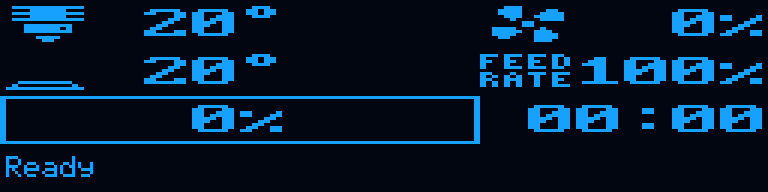

**Działanie:** Pokazuje temperatury, nawiew, mnożnik prędkości i komunikat statusu. Wartości są bieżącymi obserwacjami w działającej drukarce; tutaj użyto stanu demonstracyjnego.

**Obsługa i warunki:** Ready nie potwierdza samodzielnie, że wszystkie osie zostały zbazowane albo mesh jest aktywny. Sprawdź wymagane stany przed procedurą.

**Odpowiednik we Fluidd:** Thermals, Tool, Jobs i status Klippera.

**Znaczenie grafiki:** Symbole dyszy, platformy, wentylatora i czasu opisują odpowiednie pola.

[Natywne 256×64](../img/oled/status_ready.png) · [Źródło funkcji](../../host/klippy/extras/m300_klipper_status.py)

### Status Printing — postęp zadania

**Ścieżka:** Ekran statusu w trakcie wydruku.

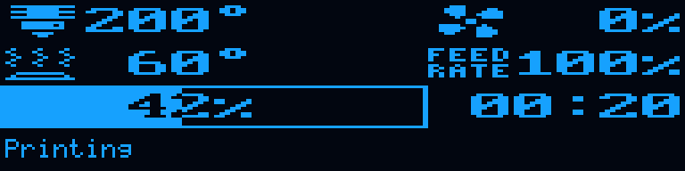

**Działanie:** Pokazuje temperatury, postęp, czas i komunikat. 42% oraz 200/60°C w renderze są wyłącznie przykładem.

**Obsługa i warunki:** Nie myl FEED 100% z maksymalnym przepływem filamentu. Szybkość wydruku nadal ograniczają przepływ, dynamika i konfiguracja. Sterowanie pauzą/zatrzymaniem korzysta ze wspólnego kontrolera druku.

**Odpowiednik we Fluidd:** Stan Jobs, wykresy i przyciski PAUSE/RESUME/CANCEL.

**Znaczenie grafiki:** Pasek oraz procent opisują postęp, a nie pomiar nierówności stołu.

[Natywne 256×64](../img/oled/status_printing.png) · [Źródło funkcji](../../host/klippy/extras/m300_klipper_status.py)

### Klipper — wejście do sterowania

**Ścieżka:** Menu główne → Klipper.

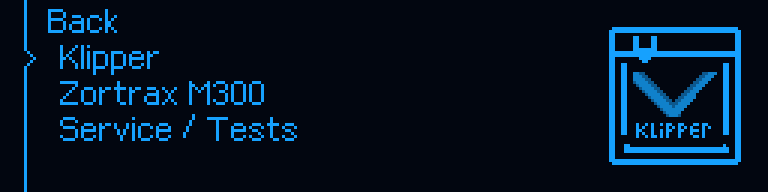

**Działanie:** Otwiera zestaw funkcji natywnych: wybór temperatur, grzanie, bazowanie, mesh, ręczne ruchy, wentylatory, PID i status druku. Samo wejście nie rozpoczyna procedury.

**Obsługa i warunki:** Obróć pokrętło, aby wskazać wiersz, i krótko naciśnij. Back wraca do statusu lub poprzedniego widoku. Czytaj etykietę, nie tylko symbol.

**Odpowiednik we Fluidd:** Sterowanie ruchem, Thermals, Tune i makra grupy Klipper.

**Znaczenie grafiki:** Obrys drukarki z logo Klippera oznacza grupę funkcji, nie rozpoczęcie wydruku.

[Natywne 256×64](../img/oled/main_klipper.png) · [Źródło funkcji](../../host/klippy/extras/m300_menu.py)

### Zortrax M300 — menu funkcji OEM

**Ścieżka:** Menu główne → Zortrax M300.

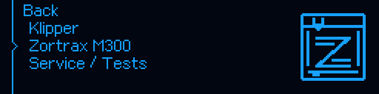

**Działanie:** Otwiera Models, Maintenance, Material, Settings oraz Information. Jest to gałąź obsługi charakterystycznej dla M300, a nie przełączenie z powrotem na fabryczny firmware.

**Obsługa i warunki:** Wybierz potrzebną grupę. Sam wybór tej gałęzi niczego nie nagrzewa ani nie przesuwa.

**Odpowiednik we Fluidd:** Makra grupy ZORTRAX M300.

**Znaczenie grafiki:** Obrys drukarki ze znakiem Z identyfikuje gałąź Zortrax.

[Natywne 256×64](../img/oled/main_zortrax.png) · [Źródło funkcji](../../host/klippy/extras/m300_menu.py)

### Pięć grup menu Zortrax

**Ścieżka:** Zortrax M300.

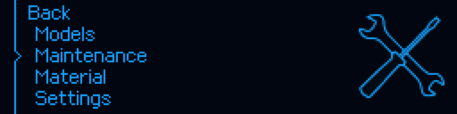

**Działanie:** Models obsługuje pliki, Maintenance czynności przy platformie i głowicy, Material filament, Settings preferencje, Information dane drukarki i pomoc.

**Obsługa i warunki:** Lista może przewijać się, ponieważ ekran nie mieści wszystkich pozycji jednocześnie. Zaznaczenie na renderze jest przykładowe.

**Odpowiednik we Fluidd:** Grupa ZORTRAX M300; konkretne odpowiedniki znajdują się przy funkcjach poniżej.

**Znaczenie grafiki:** Klucz i śrubokręt dotyczą zaznaczonej pozycji Maintenance.

[Natywne 256×64](../img/oled/zortrax_menu.png) · [Źródło funkcji](../../host/klippy/extras/m300_menu.py)

### Print status — szczegóły zadania

**Ścieżka:** Klipper → Print status.

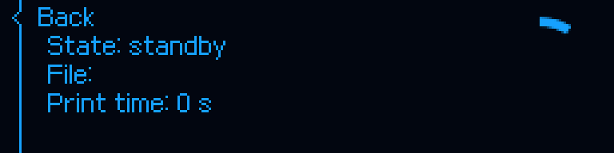

**Działanie:** Pokazuje stan zadania, nazwę pliku i czas. Przy aktywnym właścicielu m300_print_ui czynności pauzy i zatrzymania mają osobny kontekstowy ekran.

**Obsługa i warunki:** Nie myl napisu standby z błędem. Puste pole File w renderze wynika z danych demonstracyjnych. Odczyt nie rozpoczyna i nie wznawia zadania.

**Odpowiednik we Fluidd:** `PRINT_CONTROL_STATUS`, stan Jobs/drukarki.

**Znaczenie grafiki:** Zegar wskazuje czas zadania.

[Natywne 256×64](../img/oled/print_details.png) · [Źródło funkcji](../../host/klippy/extras/m300_menu.py)

## Temperatury i grzanie

### Hotend TEMP — wybór wartości

**Ścieżka:** Klipper → Hotend TEMP.

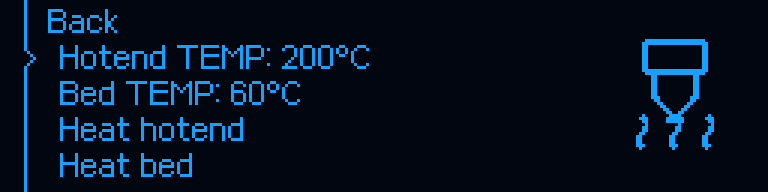

**Działanie:** Otwiera listę wartości do późniejszego polecenia grzania. Wskazana liczba jest nastawą menu, nie pomiarem aktualnej temperatury.

**Obsługa i warunki:** Wybór wartości tylko zapisuje ją w stanie menu. Aby rozpocząć grzanie, użyj osobno Heat hotend albo Heat bed. Temperatura musi odpowiadać materiałowi i ograniczeniom konfiguracji.

**Odpowiednik we Fluidd:** W Thermals zmiana celu działa bezpośrednio; nie jest tym samym co samo otwarcie listy TEMP na OLED.

**Znaczenie grafiki:** Dysza z falami ciepła oznacza hotend; platforma z falami ciepła — stół.

[Natywne 256×64](../img/oled/klipper_temp_hotend.png) · [Źródło funkcji](../../host/klippy/extras/m300_menu.py)

### Lista temperatur HOTEND

**Ścieżka:** Klipper → Hotend TEMP.

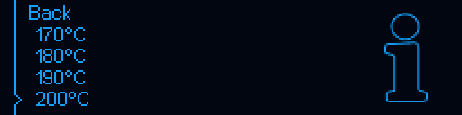

**Działanie:** Krótki klik na liczbie ustawia wartość używaną przez późniejsze Heat. Lista jest filtrowana limitami grzałki z konfiguracji; widoczne 200/60°C są przykładami.

**Obsługa i warunki:** Nie wybieraj temperatury tylko dlatego, że występuje na liście. Back rezygnuje z wyboru i wraca do menu. Sam wybór nie uruchamia grzania.

**Odpowiednik we Fluidd:** Docelowe temperatury w Thermals; odczyt aktualnej temperatury: `M105`.

**Znaczenie grafiki:** Symbol informacji towarzyszy wyborowi nastawy. Nie oznacza trwającego grzania.

[Natywne 256×64](../img/oled/temperature_hotend.png) · [Źródło funkcji](../../host/klippy/extras/m300_menu.py)

### Bed TEMP — wybór wartości

**Ścieżka:** Klipper → Bed TEMP.

**Działanie:** Otwiera listę wartości do późniejszego polecenia grzania. Wskazana liczba jest nastawą menu, nie pomiarem aktualnej temperatury.

**Obsługa i warunki:** Wybór wartości tylko zapisuje ją w stanie menu. Aby rozpocząć grzanie, użyj osobno Heat hotend albo Heat bed. Temperatura musi odpowiadać materiałowi i ograniczeniom konfiguracji.

**Odpowiednik we Fluidd:** W Thermals zmiana celu działa bezpośrednio; nie jest tym samym co samo otwarcie listy TEMP na OLED.

**Znaczenie grafiki:** Dysza z falami ciepła oznacza hotend; platforma z falami ciepła — stół.

[Natywne 256×64](../img/oled/klipper_temp_bed.png) · [Źródło funkcji](../../host/klippy/extras/m300_menu.py)

### Lista temperatur BED

**Ścieżka:** Klipper → Bed TEMP.

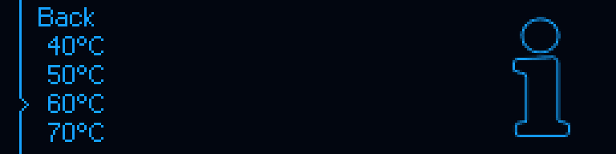

**Działanie:** Krótki klik na liczbie ustawia wartość używaną przez późniejsze Heat. Lista jest filtrowana limitami grzałki z konfiguracji; widoczne 200/60°C są przykładami.

**Obsługa i warunki:** Nie wybieraj temperatury tylko dlatego, że występuje na liście. Back rezygnuje z wyboru i wraca do menu. Sam wybór nie uruchamia grzania.

**Odpowiednik we Fluidd:** Docelowe temperatury w Thermals; odczyt aktualnej temperatury: `M105`.

**Znaczenie grafiki:** Symbol informacji towarzyszy wyborowi nastawy. Nie oznacza trwającego grzania.

[Natywne 256×64](../img/oled/temperature_bed.png) · [Źródło funkcji](../../host/klippy/extras/m300_menu.py)

### Heat hotend — bezpośrednie grzanie

**Ścieżka:** Klipper → Heat hotend.

**Działanie:** Wysyła natywne ustawienie celu grzałki extruder na temperaturę wybraną wcześniej w menu. Nie bazuje i nie uruchamia druku.

**Obsługa i warunki:** Dobierz właściwy cel, obserwuj temperaturę i chłodzenie. To proste ustawienie grzania, a nie kreator OEM Heat the extruder ani Full platform preheating.

**Odpowiednik we Fluidd:** `SET_HEATER_TEMPERATURE HEATER=extruder TARGET=...` lub pole celu w Thermals.

**Znaczenie grafiki:** Dysza/platforma z falami ciepła określa wybraną grzałkę.

[Natywne 256×64](../img/oled/klipper_heat_hotend.png) · [Źródło funkcji](../../host/klippy/extras/m300_menu.py)

### Heat bed — bezpośrednie grzanie

**Ścieżka:** Klipper → Heat bed.

**Działanie:** Wysyła natywne ustawienie celu grzałki heater_bed na temperaturę wybraną wcześniej w menu. Nie bazuje i nie uruchamia druku.

**Obsługa i warunki:** Dobierz właściwy cel, obserwuj temperaturę i chłodzenie. To proste ustawienie grzania, a nie kreator OEM Heat the extruder ani Full platform preheating.

**Odpowiednik we Fluidd:** `SET_HEATER_TEMPERATURE HEATER=heater_bed TARGET=...` lub pole celu w Thermals.

**Znaczenie grafiki:** Dysza/platforma z falami ciepła określa wybraną grzałkę.

[Natywne 256×64](../img/oled/klipper_heat_bed.png) · [Źródło funkcji](../../host/klippy/extras/m300_menu.py)

### Turn off heaters — wyłączenie celów grzałek

**Ścieżka:** Klipper → Turn off heaters.

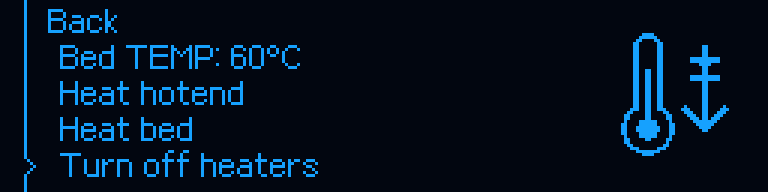

**Działanie:** Wywołuje TURN_OFF_HEATERS. Nie jest to polecenie CANCEL_PRINT i nie należy go używać zamiast anulowania zadania.

**Obsługa i warunki:** Wyłączenie celu nie chłodzi urządzenia natychmiast. Wentylator hotendu może nadal pracować zgodnie z polityką temperatury. Unikaj ręcznego wyłączenia grzania w trwającym wydruku.

**Odpowiednik we Fluidd:** `TURN_OFF_HEATERS`; do przerwania zadania użyj CANCEL_PRINT.

**Znaczenie grafiki:** Termometr i strzałka w dół oznaczają wyłączenie grzania/chłodzenie.

[Natywne 256×64](../img/oled/klipper_heaters_off.png) · [Źródło funkcji](../../host/klippy/extras/m300_menu.py)

### Heat the extruder — procedura OEM

**Ścieżka:** Zortrax M300 → Maintenance → Heat the extruder.

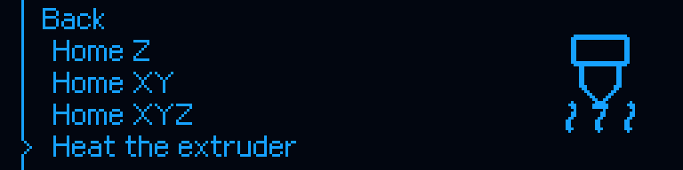

**Działanie:** Uruchamia wspólną procedurę ZORTRAX_HEAT z komunikatami dla operatora. Domyślny cel procedury to 260°C; nie myl go z przykładową nastawą 200°C w gałęzi Klipper.

**Obsługa i warunki:** Wykonuj tylko w odpowiednim stanie drukarki i z materiałem tolerującym temperaturę. Czytaj bieżące polecenia i potwierdzenia; nie pozostawiaj filamentu niepotrzebnie długo w gorącym hotendzie.

**Odpowiednik we Fluidd:** `ZORTRAX_HEAT`.

**Znaczenie grafiki:** Dysza z falami ciepła wskazuje operację grzania hotendu.

[Natywne 256×64](../img/oled/maintenance_heat.png) · [Źródło funkcji](../../host/klippy/extras/m300_native_maintenance.py)

### Heat the platform — procedura stołu

**Ścieżka:** Zortrax M300 → Maintenance → Heat the platform.

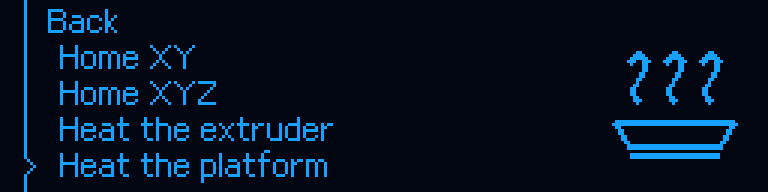

**Działanie:** Uruchamia wspólną procedurę grzania platformy, dostępną także z makra ZORTRAX_HEAT_PLATFORM.

**Obsługa i warunki:** Dobierz temperaturę parametrem makra, gdy potrzebna jest inna niż domyślna. Nie utożsamiaj tego z przełącznikiem dodatkowego wygrzewania przed START_PRINT.

**Odpowiednik we Fluidd:** `ZORTRAX_HEAT_PLATFORM TEMP=...`.

**Znaczenie grafiki:** Platforma z falami ciepła oznacza stół, nie dyszę.

[Natywne 256×64](../img/oled/maintenance_heat_bed.png) · [Źródło funkcji](../../host/klippy/extras/m300_native_maintenance.py)

## Bazowanie i ruch ręczny

### Home X — bazowanie

**Ścieżka:** Klipper → Home X.

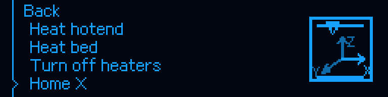

**Działanie:** Wyznacza odniesienie osi X. Nie wykonuje celowo bazowania Y ani pomiaru mesh.

**Obsługa i warunki:** Zapewnij wolny tor ruchu i miejsce na wstępne odsunięcie Z. Nie uruchamiaj bazowania w pauzie wydruku, który ma zostać wznowiony.

**Odpowiednik we Fluidd:** `ZORTRAX_HOME_X`; przyciski bazowania w Fluidd. Dla XYZ także All w Tune.

**Znaczenie grafiki:** Rama drukarki z układem XYZ wskazuje operację osi. Obraz jest jedną fazą animacji, nie potwierdzeniem ukończenia ruchu.

[Natywne 256×64](../img/oled/klipper_home.png) · [Źródło funkcji](../../host/klippy/extras/m300_menu.py)

### Home Y — bazowanie

**Ścieżka:** Klipper → Home Y.

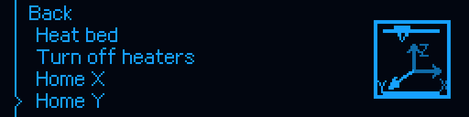

**Działanie:** Wyznacza odniesienie osi Y. Nie wykonuje celowo bazowania X ani pomiaru mesh.

**Obsługa i warunki:** Zapewnij wolny tor ruchu i miejsce na wstępne odsunięcie Z. Nie uruchamiaj bazowania w pauzie wydruku, który ma zostać wznowiony.

**Odpowiednik we Fluidd:** `ZORTRAX_HOME_Y`; przyciski bazowania w Fluidd. Dla XYZ także All w Tune.

**Znaczenie grafiki:** Rama drukarki z układem XYZ wskazuje operację osi. Obraz jest jedną fazą animacji, nie potwierdzeniem ukończenia ruchu.

[Natywne 256×64](../img/oled/klipper_home_y.png) · [Źródło funkcji](../../host/klippy/extras/m300_menu.py)

### Home Z — bazowanie

**Ścieżka:** Klipper → Home Z.

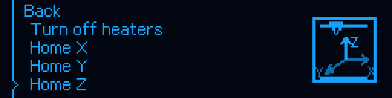

**Działanie:** Wyznacza odniesienie osi Z kontaktem dyszy z polem platformy; nie tworzy mapy nierówności.

**Obsługa i warunki:** Z wymaga wcześniej odniesionych X i Y, czystego styku oraz co najmniej 180°C na hotendzie; wyższy roboczy cel nie jest obniżany. Nadzoruj pierwszy kontakt.

**Odpowiednik we Fluidd:** `ZORTRAX_HOME_Z`; przyciski bazowania w Fluidd. Dla XYZ także All w Tune.

**Znaczenie grafiki:** Rama drukarki z układem XYZ wskazuje operację osi. Obraz jest jedną fazą animacji, nie potwierdzeniem ukończenia ruchu.

[Natywne 256×64](../img/oled/klipper_home_z.png) · [Źródło funkcji](../../host/klippy/extras/m300_menu.py)

### Home XY — bazowanie

**Ścieżka:** Klipper → Home XY.

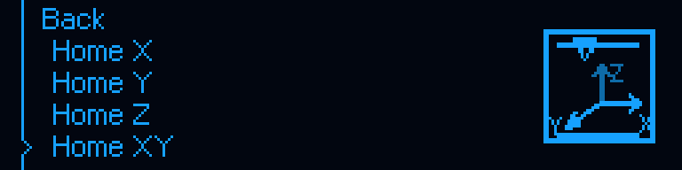

**Działanie:** Bazowanie obu osi poziomych odbywa się w kolejności Y, potem X. Nie jest to pełny homing Z.

**Obsługa i warunki:** Zapewnij wolny tor ruchu i miejsce na wstępne odsunięcie Z. Nie uruchamiaj bazowania w pauzie wydruku, który ma zostać wznowiony.

**Odpowiednik we Fluidd:** `ZORTRAX_HOME_XY`; przyciski bazowania w Fluidd. Dla XYZ także All w Tune.

**Znaczenie grafiki:** Rama drukarki z układem XYZ wskazuje operację osi. Obraz jest jedną fazą animacji, nie potwierdzeniem ukończenia ruchu.

[Natywne 256×64](../img/oled/klipper_home_xy.png) · [Źródło funkcji](../../host/klippy/extras/m300_menu.py)

### Home XYZ — bazowanie

**Ścieżka:** Klipper → Home XYZ.

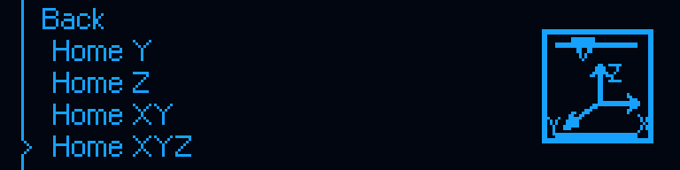

**Działanie:** Uruchamia wspólne bazowanie Y, X i kontaktowe Z. Pozostaje zwykłym bazowaniem, a nie nowym pomiarem 25 pozycji.

**Obsługa i warunki:** Zapewnij wolny tor i miejsce na odsunięcie platformy o 5 mm przed XY. Pełne XYZ obejmuje także grzanie wymagane przez kontaktowe Z.

**Odpowiednik we Fluidd:** `ZORTRAX_HOME_ALL`; przyciski bazowania w Fluidd. Dla XYZ także All w Tune.

**Znaczenie grafiki:** Rama drukarki z układem XYZ wskazuje operację osi. Obraz jest jedną fazą animacji, nie potwierdzeniem ukończenia ruchu.

[Natywne 256×64](../img/oled/klipper_home_xyz.png) · [Źródło funkcji](../../host/klippy/extras/m300_menu.py)

### Home Z w Maintenance

**Ścieżka:** Zortrax M300 → Maintenance → Home Z.

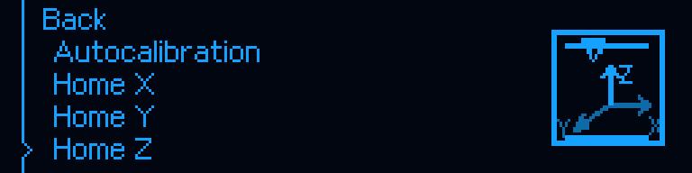

**Działanie:** Uruchamia tę samą chronioną procedurę Z co Home Z w Klipper. Nie jest inną, zimną wersją bazowania.

**Obsługa i warunki:** Najpierw odniesienie obu osi XY. Brak dopisku „180C” w etykiecie nie usuwa wymogu temperatury i poprawnego kontaktu.

**Odpowiednik we Fluidd:** `ZORTRAX_HOME_Z`.

**Znaczenie grafiki:** Układ osi w obrysie drukarki; podczas bazowania prezentowana jest odpowiednia aktywność Z.

[Natywne 256×64](../img/oled/maintenance_home_z.png) · [Źródło funkcji](../../host/klippy/extras/m300_menu.py)

### Move axes — wybór osi

**Ścieżka:** Klipper → Move axes.

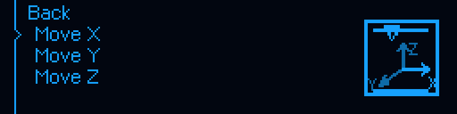

**Działanie:** Otwiera wybór X/Y/Z. Samo wejście nie wykonuje przejazdu.

**Obsługa i warunki:** Przed ruchem upewnij się, że oś ma poprawne odniesienie i nie ma przeszkód. Nie używaj podczas druku ani pauzy przeznaczonej do wznowienia.

**Odpowiednik we Fluidd:** Panel Tool w Fluidd; jednostki odległości i prędkości dobieraj świadomie.

**Znaczenie grafiki:** Układ współrzędnych oznacza ruch ręczny.

[Natywne 256×64](../img/oled/move_axes.png) · [Źródło funkcji](../../host/klippy/extras/m300_menu.py)

### Move X — kroki ręczne

**Ścieżka:** Klipper → Move axes → Move X.

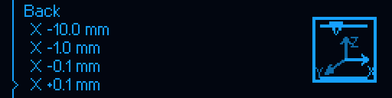

**Działanie:** Wybór wiersza wykonuje względny krok −10, −1, −0,1, +0,1, +1 albo +10 mm. Nie jest to bazowanie ani tryb nieprzerwanego ruchu.

**Obsługa i warunki:** Sprawdź znak i wielkość kroku. Dla Z dodatni ruch oddala platformę od dyszy. Etykieta osi i znak wiersza są ważniejsze niż pojedyncza faza ikony. Obowiązują zabezpieczenia i granice konfiguracji.

**Odpowiednik we Fluidd:** Przyciski ruchu osi X w Tool; brak osobnego wymaganego makra.

**Znaczenie grafiki:** Rysunek XYZ pokazuje kontekst osi; nie określa samodzielnie odległości.

[Natywne 256×64](../img/oled/move_x.png) · [Źródło funkcji](../../host/klippy/extras/m300_menu.py)

### Move Y — kroki ręczne

**Ścieżka:** Klipper → Move axes → Move Y.

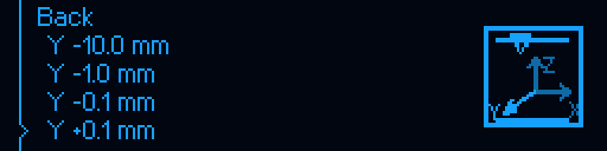

**Działanie:** Wybór wiersza wykonuje względny krok −10, −1, −0,1, +0,1, +1 albo +10 mm. Nie jest to bazowanie ani tryb nieprzerwanego ruchu.

**Obsługa i warunki:** Sprawdź znak i wielkość kroku. Dla Z dodatni ruch oddala platformę od dyszy. Etykieta osi i znak wiersza są ważniejsze niż pojedyncza faza ikony. Obowiązują zabezpieczenia i granice konfiguracji.

**Odpowiednik we Fluidd:** Przyciski ruchu osi Y w Tool; brak osobnego wymaganego makra.

**Znaczenie grafiki:** Rysunek XYZ pokazuje kontekst osi; nie określa samodzielnie odległości.

[Natywne 256×64](../img/oled/move_y.png) · [Źródło funkcji](../../host/klippy/extras/m300_menu.py)

### Move Z — kroki ręczne

**Ścieżka:** Klipper → Move axes → Move Z.

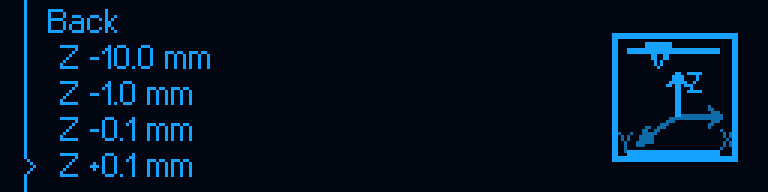

**Działanie:** Wybór wiersza wykonuje względny krok −10, −1, −0,1, +0,1, +1 albo +10 mm. Nie jest to bazowanie ani tryb nieprzerwanego ruchu.

**Obsługa i warunki:** Sprawdź znak i wielkość kroku. Dla Z dodatni ruch oddala platformę od dyszy. Etykieta osi i znak wiersza są ważniejsze niż pojedyncza faza ikony. Obowiązują zabezpieczenia i granice konfiguracji.

**Odpowiednik we Fluidd:** Przyciski ruchu osi Z w Tool; brak osobnego wymaganego makra.

**Znaczenie grafiki:** Rysunek XYZ pokazuje kontekst osi; nie określa samodzielnie odległości.

[Natywne 256×64](../img/oled/move_z.png) · [Źródło funkcji](../../host/klippy/extras/m300_menu.py)

### Move the platform up — ruch z przytrzymaniem

**Ścieżka:** Zortrax M300 → Maintenance → Move the platform up.

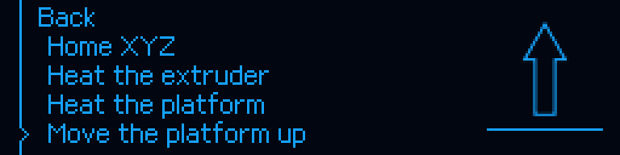

**Działanie:** Przesuwa platformę w stronę dyszy w kontrolowanej sesji przytrzymania przycisku. Zwolnienie przerywa ruch; obowiązują granice i kontrola styku.

**Obsługa i warunki:** Usuń przeszkody i nie wkładaj rąk w tor ruchu. To nie jest ten sam interfejs co pojedynczy krok ±1 mm w Move Z. Nie używaj do ręcznej zmiany pozycji w pauzie wydruku.

**Odpowiednik we Fluidd:** `ZORTRAX_PLATFORM_UP` otwiera własne sterowanie z parametrami; nie kopiuj czasu przytrzymania jako odległości.

**Znaczenie grafiki:** Duża strzałka pokazuje fizyczny kierunek platformy. Dodatnie Z w konfiguracji oddala platformę od dyszy.

[Natywne 256×64](../img/oled/maintenance_platform.png) · [Źródło funkcji](../../host/klippy/extras/m300_native_maintenance.py)

### Move the platform down — ruch z przytrzymaniem

**Ścieżka:** Zortrax M300 → Maintenance → Move the platform down.

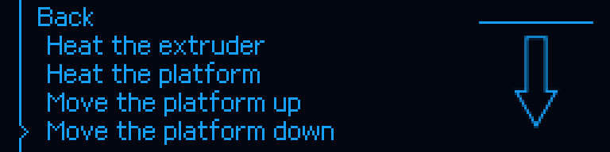

**Działanie:** Przesuwa platformę od dyszy w kontrolowanej sesji przytrzymania przycisku. Zwolnienie przerywa ruch; obowiązują granice i kontrola styku.

**Obsługa i warunki:** Usuń przeszkody i nie wkładaj rąk w tor ruchu. To nie jest ten sam interfejs co pojedynczy krok ±1 mm w Move Z. Nie używaj do ręcznej zmiany pozycji w pauzie wydruku.

**Odpowiednik we Fluidd:** `ZORTRAX_PLATFORM_DOWN` otwiera własne sterowanie z parametrami; nie kopiuj czasu przytrzymania jako odległości.

**Znaczenie grafiki:** Duża strzałka pokazuje fizyczny kierunek platformy. Dodatnie Z w konfiguracji oddala platformę od dyszy.

[Natywne 256×64](../img/oled/maintenance_platform_down.png) · [Źródło funkcji](../../host/klippy/extras/m300_native_maintenance.py)

## Poziomowanie i mesh

### Autocalibration — mechaniczne ustawienie platformy

**Ścieżka:** Zortrax M300 → Maintenance → Autocalibration.

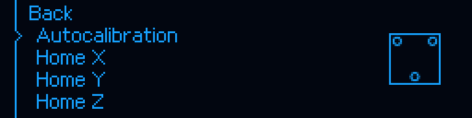

**Działanie:** Uruchamia kreator OEM M07, który mierzy odniesienia i prowadzi przez regulację śrub. Nie zastępuje 25-punktowego mesh.

**Obsługa i warunki:** Usuń model, oczyść dyszę i pola. Postępuj zgodnie z aktualnym ekranem; wymagane są potwierdzenia operatora. Nie stosuj wartości regulacji z przykładowych obrazów.

**Odpowiednik we Fluidd:** `ZORTRAX_LEVEL`.

**Znaczenie grafiki:** Platforma z polami kontaktowymi oznacza autokalibrację; nie jest kolorowym wykresem nierówności.

[Natywne 256×64](../img/oled/maintenance_level.png) · [Źródło funkcji](../../host/klippy/extras/m300_calibration.py)

### M07 — przygotowanie

**Ścieżka:** Autocalibration → etap kreatora.

**Działanie:** Wyświetla ostrzeżenie i warunki przygotowania autokalibracji.

**Obsługa i warunki:** Potwierdź dopiero po usunięciu modelu i przygotowaniu platformy; uwzględnij rozgrzanie głowicy.

**Odpowiednik we Fluidd:** Okno procedury ZORTRAX_LEVEL we Fluidd.

**Znaczenie grafiki:** Trójkąt ostrzegawczy: wymagana uwaga operatora.

[Natywne 256×64](../img/oled/level_prepare.png) · [Źródło funkcji](../../host/klippy/extras/m300_leveling_oem.py)

### M07 — pozycja wyjściowa śrub

**Ścieżka:** Autocalibration → etap kreatora.

**Działanie:** Prosi o dokręcenie trzech pokręteł regulacyjnych zgodnie z procedurą.

**Obsługa i warunki:** Wykonaj czynność wskazaną na żywo i dopiero wtedy naciśnij przycisk. Nie traktuj obrazka jako polecenia dokręcenia podczas każdej innej operacji.

**Odpowiednik we Fluidd:** Okno procedury ZORTRAX_LEVEL we Fluidd.

**Znaczenie grafiki:** Pokrętło/strzałka i rysunek platformy.

[Natywne 256×64](../img/oled/level_tighten.png) · [Źródło funkcji](../../host/klippy/extras/m300_leveling_oem.py)

### M07 — nagrzewanie

**Ścieżka:** Autocalibration → etap kreatora.

**Działanie:** Pokazuje etap nagrzewania ekstrudera w kreatorze.

**Obsługa i warunki:** Poczekaj na zmianę etapu; nie potwierdzaj starego okna z logu i nie dotykaj gorących części.

**Odpowiednik we Fluidd:** Okno procedury ZORTRAX_LEVEL we Fluidd.

**Znaczenie grafiki:** Pochylona głowica wskazuje obsługę rozgrzewanej dyszy.

[Natywne 256×64](../img/oled/level_heating.png) · [Źródło funkcji](../../host/klippy/extras/m300_leveling_oem.py)

### M07 — regulacja wskazanej śruby

**Ścieżka:** Autocalibration → etap kreatora.

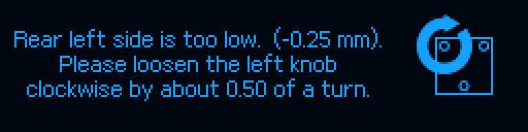

**Działanie:** Podaje narożnik, kierunek i przybliżony obrót potrzebny według bieżącego pomiaru.

**Obsługa i warunki:** Render pokazuje przykładowo tylną lewą śrubę i 0,50 obrotu. Nie przenoś tej wartości na swój stół; wykonaj tylko aktualne polecenie drukarki.

**Odpowiednik we Fluidd:** Okno procedury ZORTRAX_LEVEL we Fluidd.

**Znaczenie grafiki:** Platforma z wyróżnionym narożnikiem i kierunkiem regulacji.

[Natywne 256×64](../img/oled/level_adjust.png) · [Źródło funkcji](../../host/klippy/extras/m300_leveling_oem.py)

### M07 — wynik i zakończenie

**Ścieżka:** Autocalibration → etap kreatora.

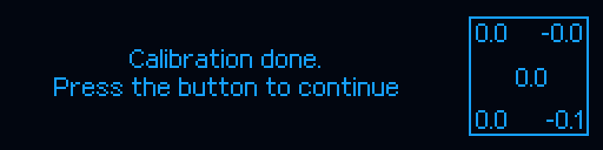

**Działanie:** Prezentuje wynik autokalibracji i przejście dalej po potwierdzeniu.

**Obsługa i warunki:** Sprawdź bieżący wynik. Zakończenie M07 nie oznacza automatycznie utworzenia lub aktywacji profilu m300_pads.

**Odpowiednik we Fluidd:** Okno procedury ZORTRAX_LEVEL we Fluidd.

**Znaczenie grafiki:** Liczby na platformie są przykładowymi odchyłkami tego widoku, nie wynikiem Twojej drukarki.

[Natywne 256×64](../img/oled/level_result.png) · [Źródło funkcji](../../host/klippy/extras/m300_leveling_oem.py)

### Bed mesh — wejście do podmenu

**Ścieżka:** Klipper → Bed mesh (25 points).

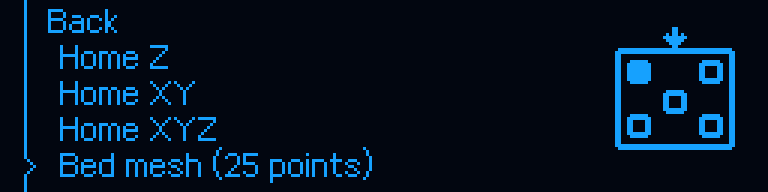

**Działanie:** Otwiera ekran przygotowania i stanu mesh. Uruchomienie jest oddzielną pozycją Measure 25 pad points.

**Obsługa i warunki:** Pole dyszy musi mieć kontakt z metalem. Po pomiarze utworzony profil jest nieaktywny do LOAD; SAVE_CONFIG zapisuje go trwale i restartuje Klippera. Nie myl podglądu z aktywną kompensacją.

**Odpowiednik we Fluidd:** `BED_MESH` lub Calibrate w Tune. All służy tylko bazowaniu; samo wejście ikoną Tune jest odczytowe.

**Znaczenie grafiki:** Pięć pól i znaczniki pomiarowe symbolizują strefy kontaktu, nie regularną siatkę 5×5.

[Natywne 256×64](../img/oled/klipper_mesh.png) · [Źródło funkcji](../../host/klippy/extras/m300_pad_mesh.py)

### Bed mesh — uruchomienie pomiaru

**Ścieżka:** Klipper → Bed mesh (25 points) → Measure 25 pad points.

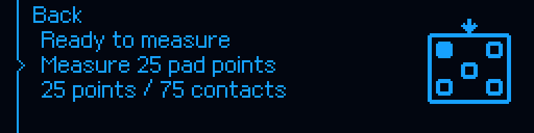

**Działanie:** Kliknięcie Measure 25 pad points uruchamia BED_MESH: przygotowanie temperatur i bazowania, 25 pozycji po trzy kontakty, interpolację oraz utworzenie profilu. Samo wejście do podmenu jeszcze nie mierzy.

**Obsługa i warunki:** Pole dyszy musi mieć kontakt z metalem. Po pomiarze utworzony profil jest nieaktywny do LOAD; SAVE_CONFIG zapisuje go trwale i restartuje Klippera. Nie myl podglądu z aktywną kompensacją.

**Odpowiednik we Fluidd:** `BED_MESH` lub Calibrate w Tune. All służy tylko bazowaniu; samo wejście ikoną Tune jest odczytowe.

**Znaczenie grafiki:** Pięć pól i znaczniki pomiarowe symbolizują strefy kontaktu, nie regularną siatkę 5×5.

[Natywne 256×64](../img/oled/bed_mesh.png) · [Źródło funkcji](../../host/klippy/extras/m300_pad_mesh.py)

## Materiał i druk

### Load the material — ładowanie

**Ścieżka:** Zortrax M300 → Material → Load the material.

**Działanie:** Uruchamia procedurę ładowania z nagrzewaniem, czynnościami operatora i podawaniem filamentu. Domyślna temperatura 240°C i długości wynikają z konfiguracji portu.

**Obsługa i warunki:** Włóż właściwy materiał w odpowiedniej fazie i sprawdź rzeczywisty wypływ. Nie wymuszaj podawania przy zatorze. Dane w renderze nie dobierają temperatury do Twojego filamentu.

**Odpowiednik we Fluidd:** `ZORTRAX_LOAD`.

**Znaczenie grafiki:** Strzałka w kierunku głowicy oznacza podawanie materiału.

[Natywne 256×64](../img/oled/material_load.png) · [Źródło funkcji](../../host/klippy/extras/m300_filament.py)

### Unload the material — rozładowanie

**Ścieżka:** Zortrax M300 → Material → Unload the material.

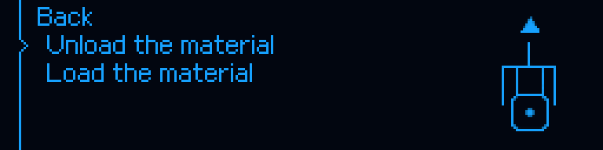

**Działanie:** Uruchamia rozgrzanie i kontrolowane wycofanie materiału zgodnie z fazami procedury.

**Obsługa i warunki:** Nie wyciągaj na siłę zimnego filamentu. Wykonuj bieżące wskazania operatora. Wymianę podczas druku rozpoczynaj w pauzie przez Change the material, nie przez przypadkowe ręczne ruchy E.

**Odpowiednik we Fluidd:** `ZORTRAX_UNLOAD`.

**Znaczenie grafiki:** Strzałka od głowicy oznacza wycofanie materiału.

[Natywne 256×64](../img/oled/material_unload.png) · [Źródło funkcji](../../host/klippy/extras/m300_filament.py)

### Models — źródło plików

**Ścieżka:** Zortrax M300 → Models.

**Działanie:** Pozwala wybrać oryginalną kartę SD albo pliki hosta. Dostępność SD zależy od zakwalifikowania jej obsługi, a nie samego obecnego w drukarce gniazda.

**Obsługa i warunki:** Sprawdź nazwę i zgodność pliku. Nie zakładaj obsługi każdego binarnego Z-code. Sam wybór źródła nie uruchamia druku; obowiązuje dalszy wybór/potwierdzenie.

**Odpowiednik we Fluidd:** Panel Jobs/pliki hosta; dla funkcji SD używaj dokumentowanych komend projektu.

**Znaczenie grafiki:** Karta pamięci identyfikuje SD.

[Natywne 256×64](../img/oled/models.png) · [Źródło funkcji](../../host/klippy/extras/m300_models.py)

### Host files — pliki na Orange Pi

**Ścieżka:** Zortrax M300 → Models → Host files.

**Działanie:** Przechodzi do katalogu modeli hosta obsługiwanego przez projekt. Plik nie jest automatycznie uruchamiany tylko przez wejście do listy.

**Obsługa i warunki:** Wybierz właściwe zadanie i czytaj potwierdzenie. Po zakończeniu wydruku ponowienie wymaga potwierdzenia usunięcia poprzedniego modelu.

**Odpowiednik we Fluidd:** Panel Jobs i przycisk wydruku; `ZORTRAX_REPRINT` dla dostępnego zakończonego zadania.

**Znaczenie grafiki:** Bryła sześcienna oznacza model/plik hosta.

[Natywne 256×64](../img/oled/models_host.png) · [Źródło funkcji](../../host/klippy/extras/m300_models.py)

### PAUSE MENU — wznowienie, wymiana, zatrzymanie

**Ścieżka:** Podczas natywnego wydruku → pauza.

**Działanie:** Resume the print wznawia zgodne zadanie; Change the material otwiera wymianę w pauzie; Stop the print przechodzi do jawnego potwierdzenia anulowania.

**Obsługa i warunki:** Nie wyłączaj silników, nie bazuj ponownie i nie przestawiaj osi ręcznie przed wznowieniem. Po wymianie filamentu może być wymagane potwierdzenie przepływu. Wybór Stop nie jest identyczny z RESUME.

**Odpowiednik we Fluidd:** `PAUSE`, `RESUME`, `ZORTRAX_CHANGE`, `CANCEL_PRINT` oraz przyciski Jobs.

**Znaczenie grafiki:** Symbol informacji towarzyszy wyborowi czynności w pauzie.

[Natywne 256×64](../img/oled/pause.png) · [Źródło funkcji](../../host/klippy/extras/m300_print_ui.py)

### STOP THE PRINT? — potwierdzenie anulowania

**Ścieżka:** Pauza → Stop the print.

**Działanie:** No pozostawia zadanie w pauzie; Yes, stop the print wywołuje CANCEL_PRINT. Anulowanie zamyka plik i usuwa stan pauzy, wyłącza cele grzałek, a parkowanie nie może blokować anulowania.

**Obsługa i warunki:** Po Yes nie jest to już zadanie do wznowienia. Wentylator hotendu może pracować do wystudzenia. M112 jest odrębnym awaryjnym zatrzymaniem, nie przyciskiem tego menu.

**Odpowiednik we Fluidd:** `CANCEL_PRINT`; przycisk Cancel we Fluidd.

**Znaczenie grafiki:** Krzyżyk w okręgu oznacza zatrzymanie zadania.

[Natywne 256×64](../img/oled/cancel_confirmation.png) · [Źródło funkcji](../../host/klippy/extras/m300_print_ui.py)

### Notice #101 — brak modeli

**Ścieżka:** Models / powiadomienie katalogu.

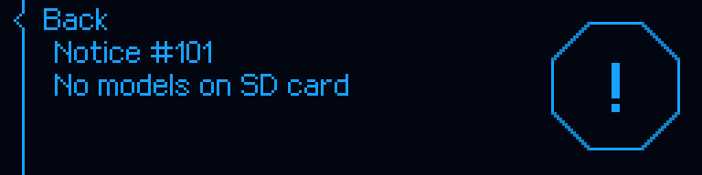

**Działanie:** Informuje o braku modeli w odczytywanym źródle. Nie jest sam w sobie błędem planera ruchu.

**Obsługa i warunki:** Sprawdź wybrane źródło SD/Host files i obsługiwane pliki. Nie zaczynaj od resetowania MCU ani kasowania konfiguracji.

**Odpowiednik we Fluidd:** Panel Jobs; sprawdzenie kwalifikacji SD i listy plików.

**Znaczenie grafiki:** Wykrzyknik oznacza komunikat; jego znaczenie wynika z tekstu i kodu.

[Natywne 256×64](../img/oled/no_models.png) · [Źródło funkcji](../../host/klippy/extras/m300_settings_ui.py)

## Wentylatory i PID

### Fans — stan i sterowanie nawiewem

**Ścieżka:** Klipper → Fans.

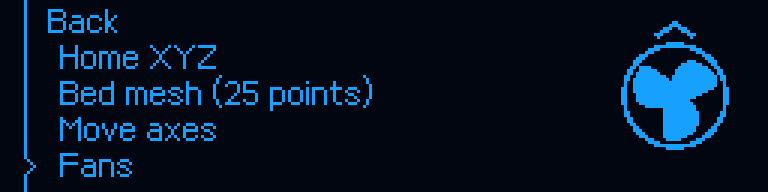

**Działanie:** Otwiera odczyt wentylatora modelu i automatycznego chłodzenia hotendu, z pozycjami prędkości nawiewu modelu.

**Obsługa i warunki:** Samo otwarcie jest odczytowe. Zmiana procentu dotyczy nawiewu modelu, a nie usunięcia termicznej ochrony hotendu.

**Odpowiednik we Fluidd:** `ZORTRAX_FANS`, sterowanie wentylatorem modelu w Fluidd.

**Znaczenie grafiki:** Wirnik wskazuje wentylatory.

[Natywne 256×64](../img/oled/klipper_fans.png) · [Źródło funkcji](../../host/klippy/extras/m300_fans.py)

### Print speed — prędkość wentylatora modelu

**Ścieżka:** Klipper → Fans → Print speed.

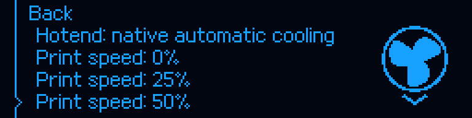

**Działanie:** Ustawia nawiew modelu na jeden z poziomów 0/25/50/75/100%. W tym podmenu słowo speed dotyczy wentylatora, nie prędkości drukowania.

**Obsługa i warunki:** Chłodzenie hotendu jest automatyczne. Brak zweryfikowanego sygnału tachometru oznacza, że stan procentowy nie jest pomiarem RPM. 50% na rysunku to demonstracja zaznaczenia.

**Odpowiednik we Fluidd:** `M106` / `M107` lub pole nawiewu; `ZORTRAX_FANS` odczytuje stan.

**Znaczenie grafiki:** Wirnik; etykieta Print speed rozstrzyga, który kanał jest regulowany.

[Natywne 256×64](../img/oled/fan_controls.png) · [Źródło funkcji](../../host/klippy/extras/m300_fans.py)

### Fan test — test serwisowy

**Ścieżka:** Zortrax M300 → Maintenance → Fan test.

**Działanie:** Uruchamia interaktywny test górnego i dolnego wentylatora. Kontroler przejmuje sterowanie wyjściami na czas tej jawnej sesji.

**Obsługa i warunki:** Nie uruchamiaj podczas druku. Sprawdź fizycznie pracę wentylatorów i zakończ test. Polityka chłodzenia hotendu ma pierwszeństwo: żądanie OFF może nie wyłączyć gorącej głowicy.

**Odpowiednik we Fluidd:** `ZORTRAX_FAN_TEST_START`, `ZORTRAX_FAN_UPPER`, `ZORTRAX_FAN_LOWER`, `ZORTRAX_FAN_TEST_END`.

**Znaczenie grafiki:** Wirnik oznacza uruchamiany test, nie potwierdzenie sprawnego chłodzenia.

[Natywne 256×64](../img/oled/maintenance_fan_test.png) · [Źródło funkcji](../../host/klippy/extras/m300_native_fans.py)

### PID calibration — wejście

**Ścieżka:** Klipper → PID calibration.

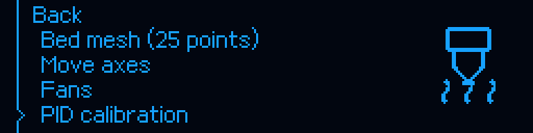

**Działanie:** Otwiera listę kalibracji PID. Samo otwarcie nie włącza grzałek.

**Obsługa i warunki:** Wykonuj tylko przy bezczynnej drukarce, z poprawnie działającym chłodzeniem. PID powoduje cykle grzania. Cele z OLED są stałe dla tych pozycji; inne temperatury podaje się świadomie przez polecenia/makra. SAVE_CONFIG nigdy w trakcie druku.

**Odpowiednik we Fluidd:** PID_HOTEND / PID_BED / PID_SAVE.

**Znaczenie grafiki:** Dysza/platforma oznacza kalibrowaną grzałkę; symbol układu przy zapisie nie oznacza wgrywania nowego firmware.

[Natywne 256×64](../img/oled/klipper_pid.png) · [Źródło funkcji](../../host/klippy/extras/m300_menu.py)

### Hotend PID 200C

**Ścieżka:** Klipper → PID calibration → Hotend PID 200C.

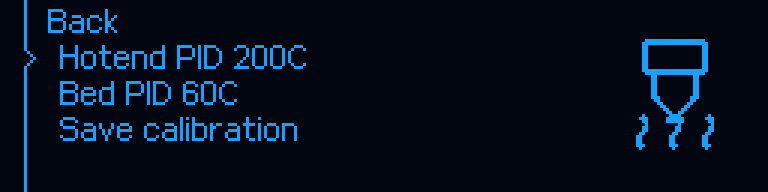

**Działanie:** Uruchamia PID_CALIBRATE dla extruder przy 200°C z tej pozycji menu.

**Obsługa i warunki:** Wykonuj tylko przy bezczynnej drukarce, z poprawnie działającym chłodzeniem. PID powoduje cykle grzania. Cele z OLED są stałe dla tych pozycji; inne temperatury podaje się świadomie przez polecenia/makra. SAVE_CONFIG nigdy w trakcie druku.

**Odpowiednik we Fluidd:** `PID_HOTEND` z odpowiednimi parametrami lub `PID_CALIBRATE HEATER=extruder TARGET=200`.

**Znaczenie grafiki:** Dysza/platforma oznacza kalibrowaną grzałkę; symbol układu przy zapisie nie oznacza wgrywania nowego firmware.

[Natywne 256×64](../img/oled/pid.png) · [Źródło funkcji](../../host/klippy/extras/m300_menu.py)

### Bed PID 60C

**Ścieżka:** Klipper → PID calibration → Bed PID 60C.

**Działanie:** Uruchamia PID_CALIBRATE dla heater_bed przy 60°C z tej pozycji menu.

**Obsługa i warunki:** Wykonuj tylko przy bezczynnej drukarce, z poprawnie działającym chłodzeniem. PID powoduje cykle grzania. Cele z OLED są stałe dla tych pozycji; inne temperatury podaje się świadomie przez polecenia/makra. SAVE_CONFIG nigdy w trakcie druku.

**Odpowiednik we Fluidd:** `PID_BED` lub `PID_CALIBRATE HEATER=heater_bed TARGET=60`.

**Znaczenie grafiki:** Dysza/platforma oznacza kalibrowaną grzałkę; symbol układu przy zapisie nie oznacza wgrywania nowego firmware.

[Natywne 256×64](../img/oled/pid_bed.png) · [Źródło funkcji](../../host/klippy/extras/m300_menu.py)

### Save calibration — zapis PID

**Ścieżka:** Klipper → PID calibration → Save calibration.

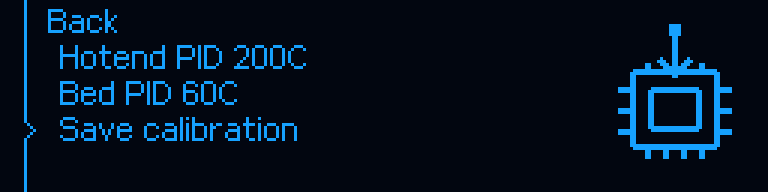

**Działanie:** Wywołuje SAVE_CONFIG, zapisując oczekujące wyniki kalibracji i restartując Klippera. To nie jest polecenie samego odczytu.

**Obsługa i warunki:** Wykonuj tylko przy bezczynnej drukarce, z poprawnie działającym chłodzeniem. PID powoduje cykle grzania. Cele z OLED są stałe dla tych pozycji; inne temperatury podaje się świadomie przez polecenia/makra. SAVE_CONFIG nigdy w trakcie druku.

**Odpowiednik we Fluidd:** `PID_SAVE` / `SAVE_CONFIG`.

**Znaczenie grafiki:** Dysza/platforma oznacza kalibrowaną grzałkę; symbol układu przy zapisie nie oznacza wgrywania nowego firmware.

[Natywne 256×64](../img/oled/pid_save.png) · [Źródło funkcji](../../host/klippy/extras/m300_menu.py)

## Ustawienia, informacje i serwis

### Settings — preferencje użytkownika

**Ścieżka:** Zortrax M300 → Settings.

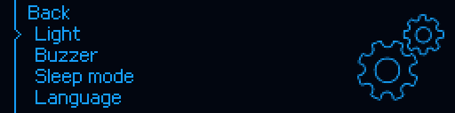

**Działanie:** Otwiera światło, dźwięk, uśpienie, język, sortowanie modeli, dodatkowe wygrzewanie platformy oraz jasność OLED i LED.

**Obsługa i warunki:** Ustawienie kosmetyczne nie usuwa kontroli bezpieczeństwa. Zmiany przeprowadzaj poprzez wspólny interfejs zamiast edycji przypadkowych danych MCU.

**Odpowiednik we Fluidd:** `ZORTRAX_SETTINGS` oraz odpowiadające mu makra ustawień.

**Znaczenie grafiki:** Koła zębate oznaczają preferencje, nie zmianę planera.

[Natywne 256×64](../img/oled/settings.png) · [Źródło funkcji](../../host/klippy/extras/m300_settings.py)

### Full platform preheating — wybór ustawienia

**Ścieżka:** Zortrax M300 → Settings → Full platform preheating.

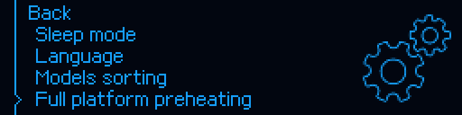

**Działanie:** Otwiera Enabled/Disabled dla dodatkowej stabilizacji platformy przed drukiem. Ta pozycja nie ustawia bezpośrednio temperatury stołu.

**Obsługa i warunki:** Zmiana dotyczy kolejnego startu; wymagany cel i czas bierze kontroler druku. Nie utożsamiaj z Heat the platform.

**Odpowiednik we Fluidd:** `ZORTRAX_FULL_PLATFORM_PREHEAT STATE=ENABLED` albo `STATE=DISABLED`.

**Znaczenie grafiki:** Koła zębate oznaczają jeszcze listę ustawień.

[Natywne 256×64](../img/oled/settings_preheat.png) · [Źródło funkcji](../../host/klippy/extras/m300_settings.py)

### Full platform preheating

**Ścieżka:** Zortrax M300 → Settings → Full platform preheating.

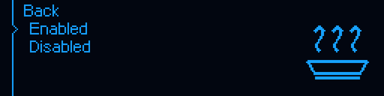

**Działanie:** Zapisuje opcję dodatkowej stabilizacji stołu przy następnym START_PRINT; domyślny czas wynika z konfiguracji, w tym porcie 60 s.

**Obsługa i warunki:** Samo Enabled nie rozpoczyna grzania i nie zmienia już rozpoczętej sesji START. Nie jest to pomiar ani aktywacja mesh.

**Odpowiednik we Fluidd:** `ZORTRAX_FULL_PLATFORM_PREHEAT`.

**Znaczenie grafiki:** Platforma z falami ciepła.

[Natywne 256×64](../img/oled/setting_preheat.png) · [Źródło funkcji](../../host/klippy/extras/m300_settings.py)

### Light

**Ścieżka:** Zortrax M300 → Settings → Light.

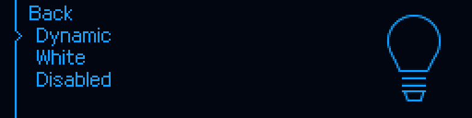

**Działanie:** DYNAMIC: światło zależne od stanu; WHITE: białe; Disabled: wyłączone według polityki projektu.

**Obsługa i warunki:** Kolor stanu jest informacją pomocniczą, nie pomiarem temperatury. Obsługa błędów i zabezpieczeń pozostaje odrębna.

**Odpowiednik we Fluidd:** `ZORTRAX_LIGHT`.

**Znaczenie grafiki:** Żarówka.

[Natywne 256×64](../img/oled/setting_light.png) · [Źródło funkcji](../../host/klippy/extras/m300_settings.py)

### Buzzer

**Ścieżka:** Zortrax M300 → Settings → Buzzer.

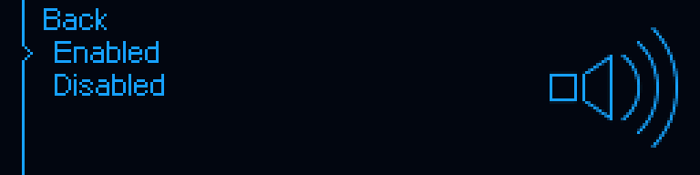

**Działanie:** Włącza albo wyłącza sygnalizację dźwiękową użytkownika.

**Obsługa i warunki:** Brak dźwięku nie jest potwierdzeniem braku błędu. Sprawdzaj OLED/Fluidd.

**Odpowiednik we Fluidd:** `ZORTRAX_BUZZER`.

**Znaczenie grafiki:** Głośnik z falami.

[Natywne 256×64](../img/oled/setting_buzzer.png) · [Źródło funkcji](../../host/klippy/extras/m300_settings.py)

### Sleep mode

**Ścieżka:** Zortrax M300 → Settings → Sleep mode.

**Działanie:** Włącza albo wyłącza mechanizm bezczynności ekranu.

**Obsługa i warunki:** Czas wynika z konfiguracji display. Historyczna nazwa 15MIN w danych nie gwarantuje rzeczywistych 15 minut. Wybudzenie nie jest poleceniem ruchu.

**Odpowiednik we Fluidd:** `ZORTRAX_SLEEP_MODE`.

**Znaczenie grafiki:** Księżyc.

[Natywne 256×64](../img/oled/setting_sleep.png) · [Źródło funkcji](../../host/klippy/extras/m300_settings.py)

### Księżyc — ekran bezczynności

**Ścieżka:** Sleep mode / timeout wyświetlacza.

**Działanie:** Pokazuje przejście panelu w uśpienie zgodnie z polityką wyświetlacza.

**Obsługa i warunki:** Wybudzenie przywraca obsługę panelu; nie jest potwierdzeniem wykonania homingu ani gotowości termicznej. Żadna część tego obrazu nie steruje przeglądarkową skalą ×1/×2/×3.

**Odpowiednik we Fluidd:** `ZORTRAX_SCREEN` do odczytu; `ZORTRAX_SLEEP_MODE` do ustawienia preferencji.

**Znaczenie grafiki:** Księżyc identyfikuje uśpienie.

[Natywne 256×64](../img/oled/sleep.png) · [Źródło funkcji](../../host/klippy/extras/m300_display_oem.py)

### Language

**Ścieżka:** Zortrax M300 → Settings → Language.

**Działanie:** W tej wersji udostępnia język English.

**Obsługa i warunki:** Polska instrukcja nie oznacza polskiej wersji wszystkich etykiet OLED. Nie dopisuj nieobsługiwanego języka do NVM.

**Odpowiednik we Fluidd:** `ZORTRAX_LANGUAGE`.

**Znaczenie grafiki:** Dymek rozmowy.

[Natywne 256×64](../img/oled/setting_language.png) · [Źródło funkcji](../../host/klippy/extras/m300_settings.py)

### Models sorting

**Ścieżka:** Zortrax M300 → Settings → Models sorting.

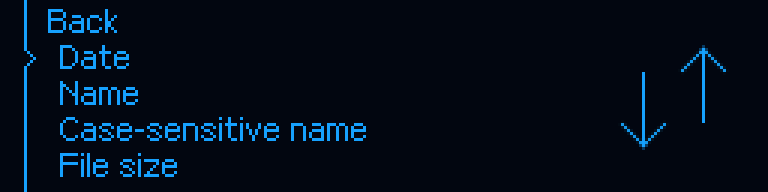

**Działanie:** Zmienia kolejność prezentacji plików: data, nazwa, nazwa z rozróżnianiem wielkości liter albo wielkość pliku.

**Obsługa i warunki:** Nie zmienia zawartości pliku ani kolejki druku i nie usuwa modeli.

**Odpowiednik we Fluidd:** `ZORTRAX_MODELS_SORT`.

**Znaczenie grafiki:** Strzałki kierunku sortowania.

[Natywne 256×64](../img/oled/setting_sort.png) · [Źródło funkcji](../../host/klippy/extras/m300_settings.py)

### OLED brightness

**Ścieżka:** Zortrax M300 → Settings → OLED brightness.

**Działanie:** Zmienia jasność oryginalnego wyświetlacza w 16 dostępnych poziomach. Ekran regulacji pokazuje podgląd poziomu i polecenia obsługi.

**Obsługa i warunki:** Obrót reguluje, klik zapisuje, przytrzymanie wraca zgodnie z ekranem. To jasność sprzętu; powiększenie ×1/×2/×3 we Fluidd jest niezależną funkcją przeglądarki.

**Odpowiednik we Fluidd:** Odpowiedni widok w `ZORTRAX_SETTINGS`.

**Znaczenie grafiki:** Monitor lub żarówka oraz pasek poziomu jasności; ten pasek nie jest postępem druku.

[Natywne 256×64](../img/oled/oled_brightness.png) · [Źródło funkcji](../../host/klippy/extras/m300_settings_ui.py)

### LED brightness

**Ścieżka:** Zortrax M300 → Settings → LED brightness.

**Działanie:** Zmienia jasność oświetlenia drukarki w 16 dostępnych poziomach. Ekran regulacji pokazuje podgląd poziomu i polecenia obsługi.

**Obsługa i warunki:** Obrót reguluje, klik zapisuje, przytrzymanie wraca zgodnie z ekranem. To jasność sprzętu; powiększenie ×1/×2/×3 we Fluidd jest niezależną funkcją przeglądarki.

**Odpowiednik we Fluidd:** Odpowiedni widok w `ZORTRAX_SETTINGS`.

**Znaczenie grafiki:** Monitor lub żarówka oraz pasek poziomu jasności; ten pasek nie jest postępem druku.

[Natywne 256×64](../img/oled/led_brightness.png) · [Źródło funkcji](../../host/klippy/extras/m300_settings_ui.py)

### Information — dane drukarki i pomoc

**Ścieżka:** Zortrax M300 → Information.

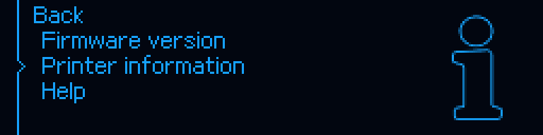

**Działanie:** Udostępnia wersje, model/revizję sprzętu/numer seryjny i czas pracy oraz pomoc. Dane dostępne są według aktualnej identyfikacji i zapamiętanych liczników.

**Obsługa i warunki:** Wyświetlanie może odświeżyć dane informacyjne, ale nie jest aktualizacją MCU. Parametry DEMO w renderze nie identyfikują sprzętu użytkownika.

**Odpowiednik we Fluidd:** `ZORTRAX_INFORMATION` / `ZORTRAX_INFO`.

**Znaczenie grafiki:** Litera i oznacza informacje.

[Natywne 256×64](../img/oled/information.png) · [Źródło funkcji](../../host/klippy/extras/m300_settings.py)

### Firmware version — wersje komponentów

**Ścieżka:** Zortrax M300 → Information → Firmware version.

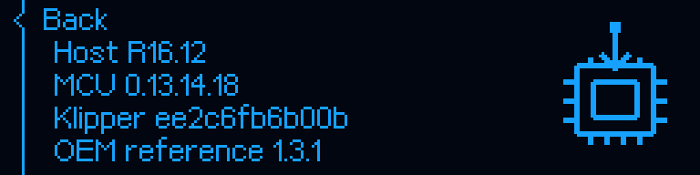

**Działanie:** Pokazuje R16.12, wersję MCU, przypięty commit Klippera i odniesienie do OEM 1.3.1. Sam odczyt niczego nie wgrywa.

**Obsługa i warunki:** Numer beta dystrybucji jest oddzielny od rewizji MCU/hosta. Po zmianie samego Fluidd nie wszystkie te liczby rosną. Wersję beta sprawdzaj także w BUILD_PROVENANCE.json.

**Odpowiednik we Fluidd:** Plik BUILD_PROVENANCE.json na Orange Pi; `ZORTRAX_MCU_STATUS`.

**Znaczenie grafiki:** Układ elektroniczny ze strzałką jest symbolem kategorii firmware, nie aktywnym procesem flashowania.

[Natywne 256×64](../img/oled/firmware.png) · [Źródło funkcji](../../host/klippy/extras/m300_settings.py)

### Printer information — identyfikacja

**Ścieżka:** Zortrax M300 → Information → Printer information.

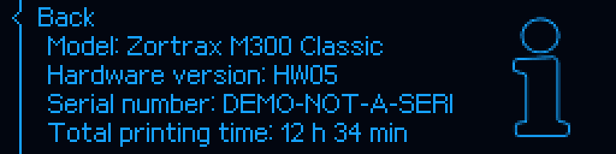

**Działanie:** Wyświetla model, wersję sprzętu, numer seryjny i sumę czasu według dostępnych danych fabrycznych oraz liczników portu.

**Obsługa i warunki:** DEMO-NOT-A-SERIAL i HW05 na obrazie są przykładami. Nie ustalaj na ich podstawie rewizji swojej osi Z. Brak danych wymaga diagnostyki, nie zgadywania.

**Odpowiednik we Fluidd:** `ZORTRAX_INFORMATION` / `ZORTRAX_HARDWARE_STATUS`.

**Znaczenie grafiki:** Litera i oznacza odczyt danych.

[Natywne 256×64](../img/oled/printer_information.png) · [Źródło funkcji](../../host/klippy/extras/m300_settings.py)

### Help — katalog komunikatów

**Ścieżka:** Zortrax M300 → Information → Help.

**Działanie:** Prowadzi do Errors i wskazuje adres dokumentacji projektu. Kody komunikatów mają opisy, a nie każdy komunikat jest krytycznym wyłączeniem.

**Obsługa i warunki:** Zapisz pełną treść i kod. Nie potwierdzaj alarmu bez ustalenia przyczyny. Adres projektu jest dzielony na krótkie wiersze z powodu szerokości ekranu.

**Odpowiednik we Fluidd:** `ZORTRAX_HELP` i katalog błędów w dokumentacji.

**Znaczenie grafiki:** Znak zapytania to pomoc.

[Natywne 256×64](../img/oled/help.png) · [Źródło funkcji](../../host/klippy/extras/m300_settings.py)

### Service / Tests — narzędzia kontrolne

**Ścieżka:** Menu główne → Service / Tests.

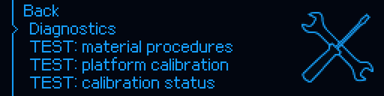

**Działanie:** Zawiera odczyt diagnostyki i statusów, ale także wywołania testów materiału, kalibracji i przejazdów XY.

**Obsługa i warunki:** Nie traktuj całej gałęzi jako odczytowej. TEST XY wykonuje ruch, a materiał/kalibracja mogą nagrzewać. Używaj wyłącznie konkretnej opisanej funkcji przy bezczynnej maszynie.

**Odpowiednik we Fluidd:** Grupa TEST M300; `TEST_ZORTRAX_STATUS` jest odczytem, `TEST_ZORTRAX_XY` wykonuje test ruchu.

**Znaczenie grafiki:** Narzędzia serwisowe, nie symbol gotowości produkcyjnej.

[Natywne 256×64](../img/oled/service_tests.png) · [Źródło funkcji](../../host/klippy/extras/m300_menu.py)

## Podgląd w przeglądarce a fizyczny OLED

W beta.20 ekran jest wycentrowany, przyciski ×1/×2/×3 są przy prawej krawędzi pod HIDE, a ich wspólna wysokość odpowiada ×1. Obraz w przeglądarce pochodzi z renderera hosta; może nieznacznie wyprzedzać zakończenie transmisji do fizycznego OLED. Lokalny ekran awaryjny MCU nie zawsze może być odtworzony po utracie połączenia. Kolor przycisków odpowiada palecie obrazu, nie jest pomiarem barwy emisji panelu.

[Skalowanie, kolory i aktualizacja](UPDATE_2026-11-10.md) · [Parametry łącza i mapy temperatur](TECHNICAL_REFERENCE.md) · [Komendy i makra](MACRO_REFERENCE.md).
