# Menu OLED — struktura, funkcje i rendery z kodu

[Spis dokumentacji](../../README_PL.md) · [Obsługa](USER_GUIDE.md) · [Menu OLED](OLED_MENU_REFERENCE.md) · [Parametry](TECHNICAL_REFERENCE.md)

> Dokumentacja dla **M300 Classic**, stan kodu **v1.0.0-beta.17**, commit `d6ddf9c3bee58dc2209946a0073f8a708d964073`. Nie dotyczy M300 Plus, M300 Dual ani Inventure.


## 1. Zasada zgodności

OLED w drukarce i jego podgląd w Fluidd korzystają z tego samego obrazu przygotowanego przez host. Nie jest to niezależna imitacja menu w przeglądarce. Nazwy interfejsu są **angielskie**, tak jak w kodzie tego portu. Polska jest niniejsza instrukcja; pozycja Language nie oznacza istnienia polskiego tłumaczenia ekranu.

Poniższe tabele pobrano programowo z rzeczywistych metod `rows()` modułów menu i ustawień na bezpiecznym stanie demonstracyjnym. Dane dynamiczne (temperatury, nazwa pliku, stan SD, druk) zależą od konfiguracji i bieżącej procedury. Pełny zapis wierszy, akcji i pochodzenia renderów: [OLED_RENDER_MANIFEST.json](../reports/OLED_RENDER_MANIFEST.json).

## 2. Nawigacja i bezpieczeństwo akcji

Obrót pokrętła zmienia zaznaczenie; krótki klik wybiera dostępną akcję. Back wraca z podmenu, a wybór w menu nadrzędnym jest pamiętany. Ruchy i grzanie nie są wykonywane przez sam podgląd Fluidd: obowiązują wspólne kontrolery, blokady zasobów i potwierdzenia bieżącego widoku. Przyciski okna procedury odnoszą się do konkretnego identyfikatora widoku; nie należy odtwarzać starych poleceń potwierdzenia z logu.

Dłuższe przytrzymanie ma znaczenie zależne od kontekstu. Podczas wydruku i na ekranie zakończenia istnieją akcje przytrzymania około 10 s (pauza / ponowny wydruk z potwierdzeniem usunięcia modelu). Ruch platformy przez przytrzymanie jest ograniczany i zatrzymywany po zwolnieniu. Nie traktuj długiego kliknięcia jako uniwersalnego skrótu Back na wszystkich ekranach.

## 3. Drzewo funkcjonalne

```text
Status Klippera ↔ Menu główne
├─ Klipper
│  ├─ Hotend TEMP / Bed TEMP, Heat hotend / Heat bed / Turn off heaters
│  ├─ Home X / Home Y / Home Z / Home XY / Home XYZ
│  ├─ Bed mesh (25 points)
│  ├─ Move axes → Move X / Move Y / Move Z → ±10 / ±1 / ±0.1 mm
│  ├─ Fans
│  ├─ PID calibration → hotend / bed / save
│  └─ Print status
├─ Zortrax M300
│  ├─ Models → SD card / Host files → lista → wybór / potwierdzenie
│  ├─ Maintenance → Autocalibration, Home X/Y/Z/XY/XYZ,
│  │                 Heat the extruder/platform, platform up/down, Fan test
│  ├─ Material → Unload the material / Load the material
│  ├─ Settings → Light, Buzzer, Sleep mode, Language, Models sorting,
│  │              Full platform preheating, OLED brightness, LED brightness
│  └─ Information → Firmware version / Printer information / Help → Errors
└─ Service / Tests → Diagnostics / procedury testowe / odczyty / ruchy XY

Kontekst druku: Printing → Pause menu → Resume / Change material / Stop
               Stop → No / Yes; Done → usuń model / ponowny wydruk
```

**Change material nie jest trzecią statyczną pozycją Material w tym wydaniu** — jest akcją kontekstową pauzy i dostępna przez `ZORTRAX_CHANGE`. Autocalibration nie jest tym samym co Bed mesh. Home Z wymaga odpowiedniego odniesienia XY i przygotowania styku; opis bez dopisku „180C” nie usuwa wymogu nagrzania.

## 4. Szczegółowe wiersze

Numeracja zaczyna się od 0 (Back). Wartości 200/60°C, HW05, 12 h 34 min i zastępczy numer seryjny w poniższych tabelach są wyłącznie danymi demonstracyjnymi. Nie są odczytem z Twojej drukarki. Długie listy zajmują wiele widoków, a długie napisy mogą być przewijane.

### Menu główne

Kolejność | Pozycja na OLED
|---:|---|
| 0 | Back |
| 1 | Klipper |
| 2 | Zortrax M300 |
| 3 | Service / Tests |

### Zortrax M300

Kolejność | Pozycja na OLED
|---:|---|
| 0 | Back |
| 1 | Models |
| 2 | Maintenance |
| 3 | Material |
| 4 | Settings |
| 5 | Information |

### Klipper

Kolejność | Pozycja na OLED
|---:|---|
| 0 | Back |
| 1 | Hotend TEMP: 200°C |
| 2 | Bed TEMP: 60°C |
| 3 | Heat hotend |
| 4 | Heat bed |
| 5 | Turn off heaters |
| 6 | Home X |
| 7 | Home Y |
| 8 | Home Z |
| 9 | Home XY |
| 10 | Home XYZ |
| 11 | Bed mesh (25 points) |
| 12 | Move axes |
| 13 | Fans |
| 14 | PID calibration |
| 15 | Print status |

### Maintenance

Kolejność | Pozycja na OLED
|---:|---|
| 0 | Back |
| 1 | Autocalibration |
| 2 | Home X |
| 3 | Home Y |
| 4 | Home Z |
| 5 | Home XY |
| 6 | Home XYZ |
| 7 | Heat the extruder |
| 8 | Heat the platform |
| 9 | Move the platform up |
| 10 | Move the platform down |
| 11 | Fan test |

### Material

Kolejność | Pozycja na OLED
|---:|---|
| 0 | Back |
| 1 | Unload the material |
| 2 | Load the material |

### Settings

Kolejność | Pozycja na OLED
|---:|---|
| 0 | Back |
| 1 | Light |
| 2 | Buzzer |
| 3 | Sleep mode |
| 4 | Language |
| 5 | Models sorting |
| 6 | Full platform preheating |
| 7 | OLED brightness |
| 8 | LED brightness |

### Light

Kolejność | Pozycja na OLED
|---:|---|
| 0 | Back |
| 1 | Dynamic |
| 2 | White |
| 3 | Disabled |

### Buzzer

Kolejność | Pozycja na OLED
|---:|---|
| 0 | Back |
| 1 | Enabled |
| 2 | Disabled |

### Sleep mode

Kolejność | Pozycja na OLED
|---:|---|
| 0 | Back |
| 1 | Enabled |
| 2 | Disabled |

### Language

Kolejność | Pozycja na OLED
|---:|---|
| 0 | Back |
| 1 | English |

### Models sorting

Kolejność | Pozycja na OLED
|---:|---|
| 0 | Back |
| 1 | Date |
| 2 | Name |
| 3 | Case-sensitive name |
| 4 | File size |

### Full platform preheating

Kolejność | Pozycja na OLED
|---:|---|
| 0 | Back |
| 1 | Enabled |
| 2 | Disabled |

### Information

Kolejność | Pozycja na OLED
|---:|---|
| 0 | Back |
| 1 | Firmware version |
| 2 | Printer information |
| 3 | Help |

### Firmware version

Kolejność | Pozycja na OLED
|---:|---|
| 0 | Back |
| 1 | Host R16.12 |
| 2 | MCU 0.13.14.18 |
| 3 | Klipper ee2c6fb6b00b |
| 4 | OEM reference 1.3.1 |

### Printer information

Kolejność | Pozycja na OLED
|---:|---|
| 0 | Back |
| 1 | Model: Zortrax M300 Classic |
| 2 | Hardware version: HW05 |
| 3 | Serial number: DEMO-NOT-A-SERIAL |
| 4 | Total printing time: 12 h 34 min |

### Help

Kolejność | Pozycja na OLED
|---:|---|
| 0 | Back |
| 1 | Errors |
| 2 | github.com/ |
| 3 | MarcinKowalik-AGH/ |
| 4 | Zortrax-m300-Klipper |
| 5 | Project documentation and issues |

### Move axes

Kolejność | Pozycja na OLED
|---:|---|
| 0 | Back |
| 1 | Move X |
| 2 | Move Y |
| 3 | Move Z |

### Move X

Kolejność | Pozycja na OLED
|---:|---|
| 0 | Back |
| 1 | X -10.0 mm |
| 2 | X -1.0 mm |
| 3 | X -0.1 mm |
| 4 | X +0.1 mm |
| 5 | X +1.0 mm |
| 6 | X +10.0 mm |

### Move Z

Kolejność | Pozycja na OLED
|---:|---|
| 0 | Back |
| 1 | Z -10.0 mm |
| 2 | Z -1.0 mm |
| 3 | Z -0.1 mm |
| 4 | Z +0.1 mm |
| 5 | Z +1.0 mm |
| 6 | Z +10.0 mm |

### PID calibration

Kolejność | Pozycja na OLED
|---:|---|
| 0 | Back |
| 1 | Hotend PID 200C |
| 2 | Bed PID 60C |
| 3 | Save calibration |

### Models

Kolejność | Pozycja na OLED
|---:|---|
| 0 | Back |
| 1 | SD card |
| 2 | Host files |

### Bed mesh

Kolejność | Pozycja na OLED
|---:|---|
| 0 | Back |
| 1 | Ready to measure |
| 2 | Measure 25 pad points |
| 3 | 25 points / 75 contacts |

### Service / Tests

Kolejność | Pozycja na OLED
|---:|---|
| 0 | Back |
| 1 | Diagnostics |
| 2 | TEST: material procedures |
| 3 | TEST: platform calibration |
| 4 | TEST: calibration status |
| 5 | TEST: OEM print / SD |
| 6 | Current test procedure |
| 7 | Read test status |
| 8 | TEST XY 50 mm/s |
| 9 | TEST XY 60 mm/s |

## 5. Ustawienia i stany szczególne

Jasność OLED/LED ma 16 poziomów. W widoku regulacji pojawia się właściwy pasek jasności; nie należy używać go jako ogólnego paska postępu innych procedur. Buzzer można wyłączyć; nie zmienia to kontroli ruchu ani temperatury. Światło Dynamic jest powiązane ze stanem: Ready zielone, grzanie czerwone, pauza fioletowa, druk/aktywna praca białe; błędy mają odrębną sygnalizację. White i Disabled są ustawieniami preferencji, nie zniesieniem zabezpieczeń.

Sleep mode włącza istniejący mechanizm bezczynności. Bieżący czas wynika z konfiguracji display (domyślnie 300 s w tej warstwie), a historyczny identyfikator zapisu `15MIN` nie powinien być interpretowany jako potwierdzenie rzeczywistego timeoutu 15 minut. Na uśpieniu wyświetlany jest księżyc. Wybudzenie nie oznacza wydania polecenia grzania lub ruchu.

Full platform preheating włącza dodatkową stabilizację platformy przed drukiem; samo przełączenie ustawienia nie jest poleceniem natychmiastowego rozgrzania stołu. Menu Models zależy od dostępności i kwalifikacji SD; `sd_qualified: False` nie należy obchodzić przypadkowym ustawieniem bez testu. Puste miejsce listy lub komunikat „No models on SD card” nie jest awarią planera.

**Service / Tests nie jest całe odczytowe.** Odczyt diagnostyki nie porusza drukarką, ale test XY, materiał i kalibracja mogą wykonywać ruchy/grzanie. Zobacz [katalog komend](MACRO_REFERENCE.md) i warunki bezpieczeństwa każdej procedury.

## 6. Jak wykonano obrazy

Uruchomiono oryginalne funkcje rysowania `menu_frame`, `brightness_frame`, `notice_frame`, selektory symboli i bitmapową czcionkę projektu. Dla statusu użyto przypiętego silnika wyświetlacza Klippera, a dla M07 i pauzy odpowiednich rendererów produkcyjnych. Stan drukarki zastępują obiekty demonstracyjne; skrypt **nie tworzy połączenia z MCU i nie wykonuje G-code**.

Każdy ekran ma PNG **256×64** i podgląd **768×192**, powiększony metodą nearest-neighbour dokładnie 3×. To obrazy statyczne wybranych faz, nie pomiar synchroniczności ani pełne nagranie animacji. Ekran komunikatu braku modeli demonstruje istniejący prezenter komunikatów; nie jest fotografią chwilowego błędu na sprzęcie.

Odtwarzanie (ze sprawdzonego katalogu repozytorium, z Pythonem i zależnościami testów):

```bash
python ci/prepare_upstream.py
python docs/tools/render_oled_manual.py --klipper .ci/pristine
python docs/tools/check_manual.py
```

Zmiana kodu menu może świadomie zmienić rendery — wtedy trzeba ponownie przejrzeć obrazy i odnowić manifest, zamiast podmieniać je ręcznymi szkicami.

## 7. Galeria — 43 ekrany

### 1. Menu główne: Klipper

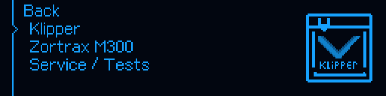

[Obraz natywny 256×64](../img/oled/main_klipper.png). Stan demonstracyjny: `{"page":"main","selected":1,"sprite":"project-klipper"}`.

### 2. Menu główne: Zortrax

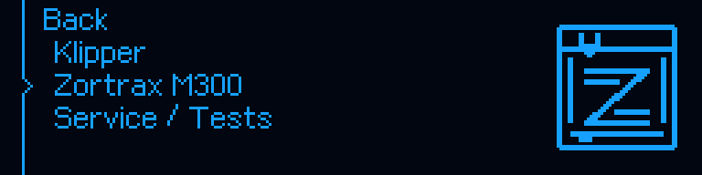

[Obraz natywny 256×64](../img/oled/main_zortrax.png). Stan demonstracyjny: `{"page":"main","selected":2,"sprite":"project-zortrax"}`.

### 3. Menu Zortrax M300

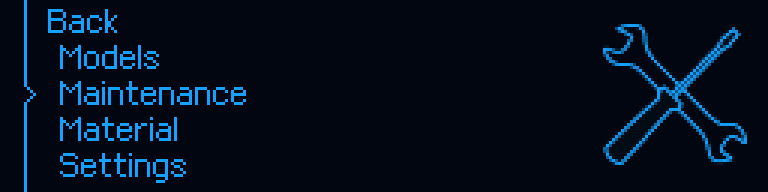

[Obraz natywny 256×64](../img/oled/zortrax_menu.png). Stan demonstracyjny: `{"page":"zortrax","selected":2,"sprite":"0x0801c958"}`.

### 4. Klipper: bazowanie X

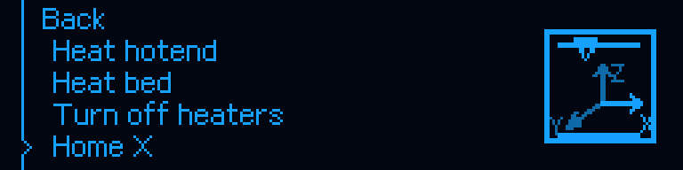

[Obraz natywny 256×64](../img/oled/klipper_home.png). Stan demonstracyjny: `{"page":"klipper","selected":6,"sprite":"cartesian:home_x"}`.

### 5. Klipper: mesh

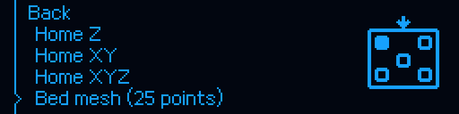

[Obraz natywny 256×64](../img/oled/klipper_mesh.png). Stan demonstracyjny: `{"page":"klipper","selected":11,"sprite":"activity:bed_mesh"}`.

### 6. Klipper: PID

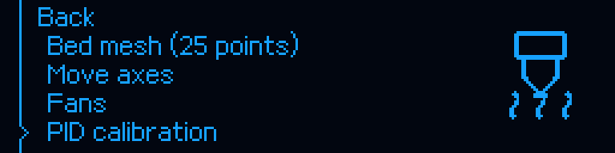

[Obraz natywny 256×64](../img/oled/klipper_pid.png). Stan demonstracyjny: `{"page":"klipper","selected":14,"sprite":"activity:heat_nozzle"}`.

### 7. Maintenance: autokalibracja

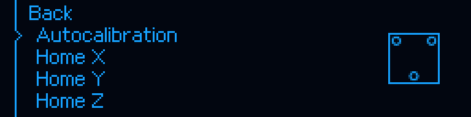

[Obraz natywny 256×64](../img/oled/maintenance_level.png). Stan demonstracyjny: `{"page":"maintenance","selected":1,"sprite":"0x0801ca28"}`.

### 8. Maintenance: Home Z

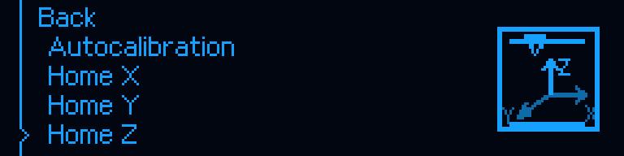

[Obraz natywny 256×64](../img/oled/maintenance_home_z.png). Stan demonstracyjny: `{"page":"maintenance","selected":4,"sprite":"cartesian:home_z"}`.

### 9. Maintenance: grzanie

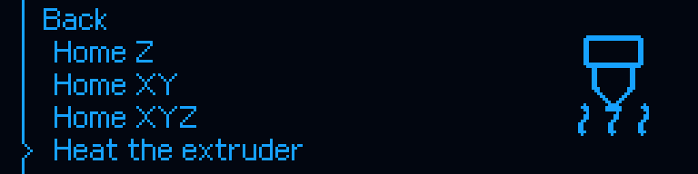

[Obraz natywny 256×64](../img/oled/maintenance_heat.png). Stan demonstracyjny: `{"page":"maintenance","selected":7,"sprite":"activity:heat_nozzle"}`.

### 10. Maintenance: platforma

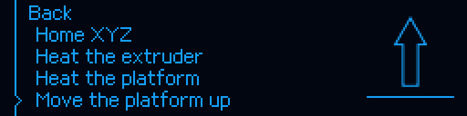

[Obraz natywny 256×64](../img/oled/maintenance_platform.png). Stan demonstracyjny: `{"page":"maintenance","selected":9,"sprite":"0x0801cb24"}`.

### 11. Material: ładowanie

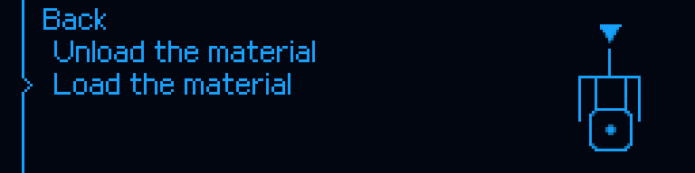

[Obraz natywny 256×64](../img/oled/material_load.png). Stan demonstracyjny: `{"page":"material","selected":2,"sprite":"0x0801d0b8"}`.

### 12. Settings: ustawienia


[Obraz natywny 256×64](../img/oled/settings.png). Stan demonstracyjny: `{"page":"settings","selected":1,"sprite":"0x0801d3bc"}`.

### 13. Settings: wygrzewanie platformy


[Obraz natywny 256×64](../img/oled/settings_preheat.png). Stan demonstracyjny: `{"page":"settings","selected":6,"sprite":"0x0801d3bc"}`.

### 14. Light

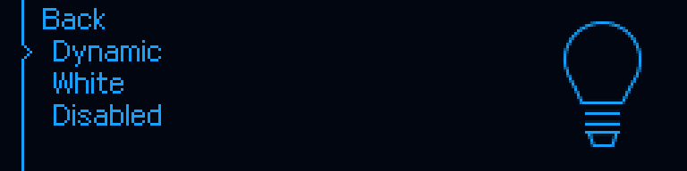

[Obraz natywny 256×64](../img/oled/setting_light.png). Stan demonstracyjny: `{"page":"setting_light_mode","selected":1,"sprite":"0x0801d55c"}`.

### 15. Buzzer


[Obraz natywny 256×64](../img/oled/setting_buzzer.png). Stan demonstracyjny: `{"page":"setting_sound","selected":1,"sprite":"0x0801d72c"}`.

### 16. Sleep mode


[Obraz natywny 256×64](../img/oled/setting_sleep.png). Stan demonstracyjny: `{"page":"setting_sleep_mode","selected":1,"sprite":"0x0801d908"}`.

### 17. Language: English


[Obraz natywny 256×64](../img/oled/setting_language.png). Stan demonstracyjny: `{"page":"setting_language","selected":1,"sprite":"0x0801dab4"}`.

### 18. Models sorting

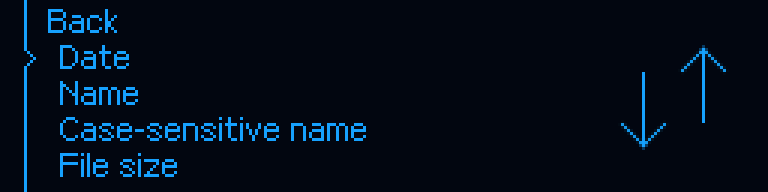

[Obraz natywny 256×64](../img/oled/setting_sort.png). Stan demonstracyjny: `{"page":"setting_sort_mode","selected":1,"sprite":"0x0801c4f4"}`.

### 19. Full platform preheating


[Obraz natywny 256×64](../img/oled/setting_preheat.png). Stan demonstracyjny: `{"page":"setting_full_platform_preheat","selected":1,"sprite":"activity:heat_bed"}`.

### 20. Information


[Obraz natywny 256×64](../img/oled/information.png). Stan demonstracyjny: `{"page":"information","selected":2,"sprite":"0x0801dc08"}`.

### 21. Firmware version

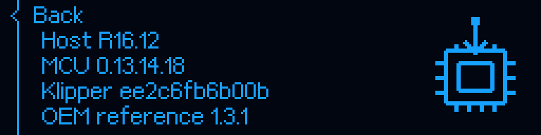

[Obraz natywny 256×64](../img/oled/firmware.png). Stan demonstracyjny: `{"page":"info_firmware","selected":0,"sprite":"activity:firmware_update"}`.

### 22. Printer information — dane demonstracyjne

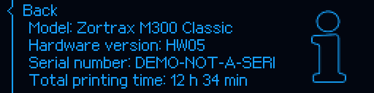

[Obraz natywny 256×64](../img/oled/printer_information.png). Stan demonstracyjny: `{"page":"info_printer","selected":0,"sprite":"0x0801dc08"}`.

### 23. Help


[Obraz natywny 256×64](../img/oled/help.png). Stan demonstracyjny: `{"page":"help","selected":0,"sprite":"0x0801de00"}`.

### 24. Move axes

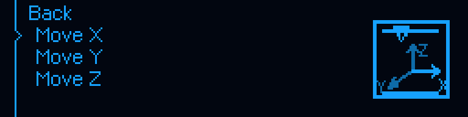

[Obraz natywny 256×64](../img/oled/move_axes.png). Stan demonstracyjny: `{"page":"native_moves","selected":1,"sprite":"cartesian:move_x"}`.

### 25. Move X

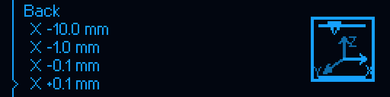

[Obraz natywny 256×64](../img/oled/move_x.png). Stan demonstracyjny: `{"page":"native_move_x","selected":4,"sprite":"cartesian:move_x"}`.

### 26. Move Z

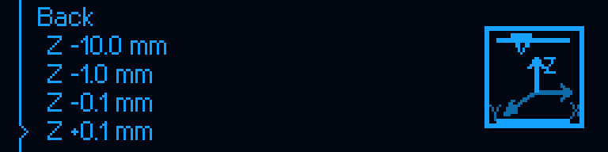

[Obraz natywny 256×64](../img/oled/move_z.png). Stan demonstracyjny: `{"page":"native_move_z","selected":4,"sprite":"cartesian:move_z"}`.

### 27. PID calibration

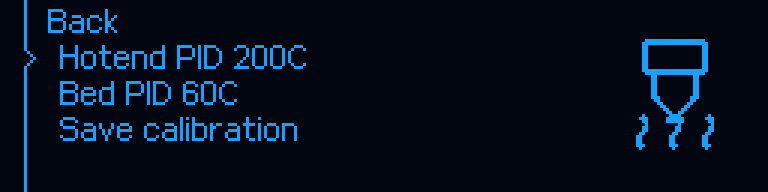

[Obraz natywny 256×64](../img/oled/pid.png). Stan demonstracyjny: `{"page":"native_pid","selected":1,"sprite":"activity:heat_nozzle"}`.

### 28. Models


[Obraz natywny 256×64](../img/oled/models.png). Stan demonstracyjny: `{"page":"models","selected":1,"sprite":"activity:sd_read"}`.

### 29. Bed mesh

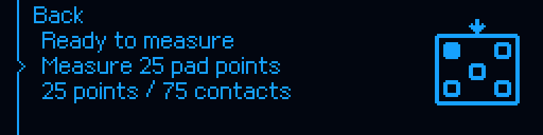

[Obraz natywny 256×64](../img/oled/bed_mesh.png). Stan demonstracyjny: `{"page":"bed_mesh","selected":2,"sprite":"activity:bed_mesh"}`.

### 30. Service / Tests

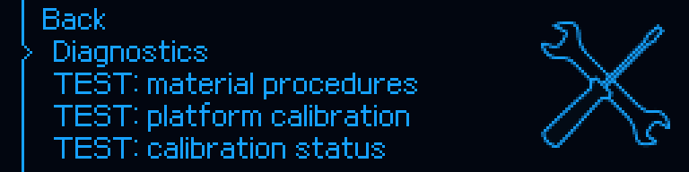

[Obraz natywny 256×64](../img/oled/service_tests.png). Stan demonstracyjny: `{"page":"tests","selected":1,"sprite":"0x0801c958"}`.

### 31. Jasność OLED


[Obraz natywny 256×64](../img/oled/oled_brightness.png). Stan demonstracyjny: `{"level":12,"demonstration":true}`.

### 32. Jasność LED


[Obraz natywny 256×64](../img/oled/led_brightness.png). Stan demonstracyjny: `{"level":12,"demonstration":true}`.

### 33. M07: przygotowanie


[Obraz natywny 256×64](../img/oled/level_prepare.png). Stan demonstracyjny: `{"state":"WAIT_PREPARE","can_confirm":true}`.

### 34. M07: dokręcenie


[Obraz natywny 256×64](../img/oled/level_tighten.png). Stan demonstracyjny: `{"state":"WAIT_TIGHTEN","can_confirm":true}`.

### 35. M07: nagrzewanie


[Obraz natywny 256×64](../img/oled/level_heating.png). Stan demonstracyjny: `{"state":"HEATING"}`.

### 36. M07: regulacja


[Obraz natywny 256×64](../img/oled/level_adjust.png). Stan demonstracyjny: `{"state":"ADJUST","instruction":{"screw":"rear_left","action":"LOOSEN","delta_mm":-0.25,"turns":0.5}}`.

### 37. M07: wynik

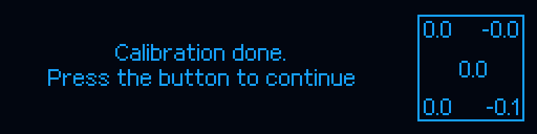

[Obraz natywny 256×64](../img/oled/level_result.png). Stan demonstracyjny: `{"state":"REVIEW","review":[-0.05,0.0,0.02,-0.03,0.01]}`.

### 38. Pauza druku


[Obraz natywny 256×64](../img/oled/pause.png). Stan demonstracyjny: `{"state":"PAUSED","demonstration":true}`.

### 39. Potwierdzenie zatrzymania


[Obraz natywny 256×64](../img/oled/cancel_confirmation.png). Stan demonstracyjny: `{"state":"STOP_CONFIRM","demonstration":true}`.

### 40. Przykładowy komunikat braku modeli

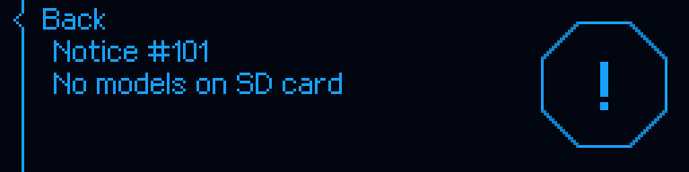

[Obraz natywny 256×64](../img/oled/no_models.png). Stan demonstracyjny: `{"state":"illustrative_notice","demonstration":true}`.

### 41. Uśpienie: księżyc


[Obraz natywny 256×64](../img/oled/sleep.png). Stan demonstracyjny: `{"state":"ENTERING_SLEEP"}`.

### 42. Natywny status Klipper: Ready

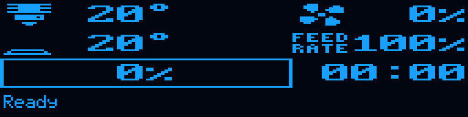

[Obraz natywny 256×64](../img/oled/status_ready.png). Stan demonstracyjny: `{"temperatures":[20.2,20.4],"targets":[0,0],"demonstration":true}`.

### 43. Natywny status Klipper: druk

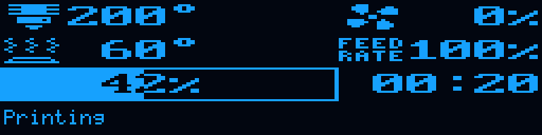

[Obraz natywny 256×64](../img/oled/status_printing.png). Stan demonstracyjny: `{"progress":0.42,"demonstration":true}`.
