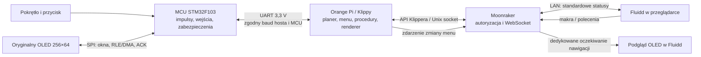

# Architektura i zakres funkcjonalny

[Spis dokumentacji](../../README_PL.md) · [Obsługa](USER_GUIDE.md) · [Menu OLED](OLED_MENU_REFERENCE.md) · [Ilustrowane funkcje](OLED_FUNCTIONS.md) · [Parametry](TECHNICAL_REFERENCE.md)

> Dokumentacja dla **M300 Classic**, wydanie **1.0.0-rc.1**. Historyczne ilustracje mają jawny punkt odniesienia beta.20. Nie dotyczy M300 Plus, M300 Dual ani Inventure.

## Warstwy systemu

**Host** przyjmuje G-code, prowadzi bufor ruchów, wyznacza ich przebieg i sekwencje kroków, utrzymuje menu, procedury i profile. **MCU** odtwarza czasowo zaplanowane polecenia, odczytuje wejścia i ADC, obsługuje oryginalny ekran oraz lokalną politykę awarii/chłodzenia. **Moonraker** udostępnia API; **Fluidd** jest interfejsem, nie planerem ruchu. Zamknięcie strony nie jest poleceniem anulowania druku.

Karta SD drukarki i katalog G-code hosta są dwoma różnymi źródłami. Obsługa Models wczytuje dopuszczone pliki do istniejącego mechanizmu zadania; nie dodaje drugiego, niezależnego strumienia kroków.

Źródła: [moduły hosta](../../host/klippy/extras), [kod MCU](../../mcu/SOURCE_MCU), [polityka plików](../en/MODELS_SD.md), [opis planera Klippera](https://www.klipper3d.org/Kinematics.html).

## Co jest natywne dla Klippera, a co odtworzono

| Warstwa / funkcja | Realizacja | Istotna granica |
|---|---|---|
| XYZE, PID, G-code, zapis konfiguracji | Natywne obiekty przypiętego Klippera | Nie należy podmieniać ich niezależnie na przypadkowy upstream |
| Z i contact probe | Adapter M300 i natywna obsługa krańcówki PC7 | Kontakt fizyczny i skala osi muszą odpowiadać egzemplarzowi |
| M07 Autocalibration | Odtworzona logika OEM, kolejność i obliczenia regulacji śrub | Ograniczone wyszukiwanie, limity czasu i powtórzeń są świadomymi zabezpieczeniami portu |
| Menu i grafika | Zasoby OEM 1.3.1, oryginalna czcionka oraz nowe ikony portu | Interfejs operacyjny EN; stare atlasowe tłumaczenia nie oznaczają aktywnej obsługi wszystkich języków |
| Temperatura | Odzyskane charakterystyki ADC–temperatura w `adc_temperature` | Nie są niezależnym certyfikatem kalibracji sprzętu |
| START/END i pauza | Wspólny kontroler wokół natywnego `virtual_sdcard` i `pause_resume` | Parkowanie uwzględnia dostępne miejsce; nie wolno wyłączać osi i potem wymuszać RESUME |
| Bed mesh | Port mierzy pola kontaktu, tworzy profil natywnego `bed_mesh` | Interpolacja pomiędzy polami nie jest pomiarem każdego miejsca perforowanej płyty |
| Z-code | Odczyt dopuszczonego podzbioru Classic 1.3.1 | Plus/Dual/Inventure i nieznane rekordy nie stają się automatycznie obsługiwane |

## OLED a podgląd

W normalnej pracy MCU przekazuje zdarzenia pokrętła i przycisku. To host zna strukturę menu i renderuje klatkę. Ten sam gotowy obraz trafia do transportu fizycznego OLED oraz do podglądu. Podgląd nie jest optycznym odczytem ekranu i nie odpytuje MCU o jego framebuffer; może nieznacznie wyprzedzić fizyczny wyświetlacz o czas transmisji.

Od beta.16 zmiana menu budzi osobny, wyłącznie odczytowy punkt `m300/oled_preview/wait`. Nie przechodzi przez cykl `objects/query` co 250 ms. Beta.17 uzbraja następne oczekiwanie przed zakończeniem dekodowania poprzedniego PNG. Jedno zapytanie, jeden dekoder i najwyżej jedna oczekująca najnowsza klatka ograniczają zużycie zasobów. Ikony, temperatury i standardowe statusy zachowują wcześniejszy rytm.

Po utracie połączenia MCU może pokazywać własne lokalne ekrany oczekiwania lub awarii. Nie są one automatycznie dostępne jako podgląd hosta; interfejs powinien wtedy pokazać niedostępność, nie udawać aktualnego obrazu.

Źródła: [podgląd hosta](../../host/klippy/extras/m300_oled_preview.py), [frontend](../../frontend/fluidd/navigation), [beta.17](https://github.com/MarcinKowalik-AGH/Zortrax-m300-Klipper/blob/v1.0.0-beta.20/docs/pl/RELEASE_v1.0.0-beta.20.md).

## Uzupełnienia interfejsu beta.18–20

Beta.18 ujednoliciła Tune przed pomiarem: przygotowanie w IDLE, osobny postęp All i stały schemat nad heatmapą. Beta.19 dodała wybór ×1/×2/×3, a beta.20 dopasowała jego kolory i umieściła przyciski pod HIDE, z wysokością ×1 oraz niezależnym centrowaniem OLED. Są to zmiany frontendu, nie nowe procedury termiki ani firmware MCU. [Szczegóły i obrazy](UPDATE_2026-11-10.md).

## Bezpieczeństwo i stan funkcjonalny

Właściciele zasobów zapobiegają nakładaniu się procedur korzystających z grzałek, ruchu i materiału. Wybranie opcji na starym ekranie nie może zatwierdzić nowej fazy procedury. Restart i awaria unieważniają zgody, referencję ruchu i poprzednie cele grzania; ponowne połączenie nie oznacza samoczynnego wznowienia zadania.

Autonomiczna polityka MCU obejmuje nadzór hosta, ważność próbek ADC, blokowanie nieuzbrojonych wyjść i lokalne chłodzenie. Utrata łączności nie jest usuwana bezwarunkowo: istnieje ograniczona procedura odzyskania poprzedniej sesji hosta; inne błędy wymagają usunięcia przyczyny. Szczegóły: [chłodzenie](../en/COOLING.md), [połączenie](../en/CONNECTION.md), [katalog błędów](../en/ERRORS.md).

Nie zadeklarowano fabrycznego czujnika braku filamentu jako działającego automatycznie: standardowe ustawienia mają `use_filament_sensor: False` i `filament_pause: False`. Skrypt, przycisk lub operator mogą wywołać wymianę. Obsługa dowolnego doposażenia wymaga osobnej konfiguracji i testu.

**Potwierdzone programowo:** budowa pełnego portu, reakcje stanów, zgodność renderów, planowanie natywnego Klippy, ochrona instalatora. **Wymagające odbioru na konkretnym sprzęcie:** skala i kierunki osi, pola kontaktu, grzanie i czujniki, powtarzalność Z, poprawna pierwsza warstwa i maksymalny stabilny przepływ.
