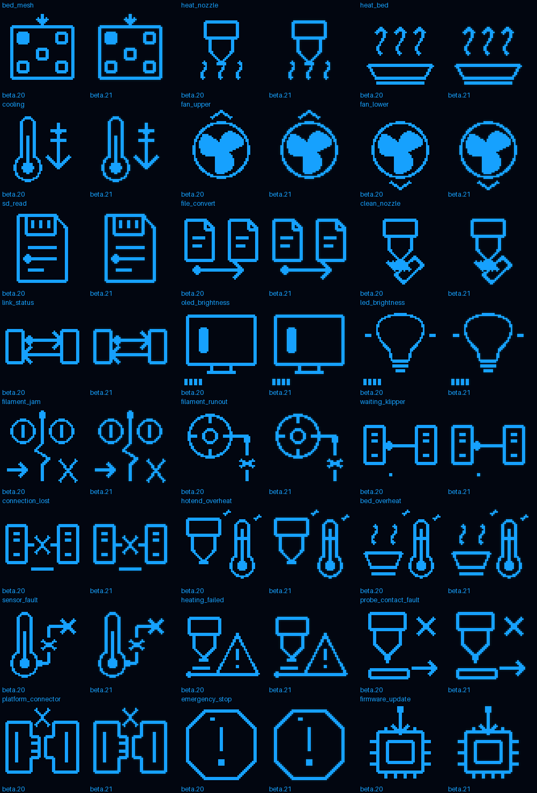

# M300 Classic beta.21 — cieniowane ikony OLED na hoście i MCU

Wersja zastępuje beta.20. Host nadal R16.12; aplikacja MCU **0.13.14.19-TONED-OLED-UART8**. Zmiana prezentacji, bez zmian ruchu, grzania, zabezpieczeń, protokołu UART ani bootloadera.

## Zakres

24 ikony aktywności/procedur (96 klatek) zachowują kształt, jasny rdzeń, rozmiar 50×50 i rytm 500 ms, a otrzymują subtelne odcienie krawędzi. Używane są przede wszystkim wartości 0, 2, 4, 15, w jednej ikonie także 6. To nadal natywne 4 bity na piksel, nie rozmycie CSS.



Po lewej poprzedni obraz, po prawej nowy. To render danych, nie fotografia drukarki ani pomiar fizycznej jasności. Cieniowane są dysza, stół, wentylatory, mesh, pliki/SD, połączenie i komunikaty. Oryginalne bitmapy OEM, osobne Home/Move oraz trójtonowe logo Klippera pozostają niezmienione — nie twierdzimy, że zmodyfikowano wszystkie ikony.

Podczas pracy Klippera Orange Pi wysyła te same 4-bitowe klatki na fizyczny OLED i do podglądu Fluidd. Osobno aplikacja MCU ma teraz 4-bitowe zasoby swoich ekranów oczekiwania, utraty połączenia i błędów. Powtarzające się wiersze przechowuje tylko raz w pamięci Flash i bezstratnie kompresuje ich 4-bitowe wartości. Dekoder przetwarza najwyżej 50 tokenów na wiersz; nie oblicza filtrów ani nie zmienia odcieni. Pozostaje bufor jednej linii **128 bajtów**, bez pełnego bufora obrazu 8192 bajty w MCU. Nie zmieniono klasyfikacji błędów ani obsługi zatrzymania.

## Aktualizacja istniejącej drukarki

Przy bezczynnej drukarce w stanie **Ready**, bez wstrzymanego wydruku, na Orange Pi:

```bash
git -C "$HOME/m300-orange-pi" pull --ff-only &&
python3 "$HOME/m300-orange-pi/install-orange-pi.py"
```

Instalator rozpoznaje dokładną sumę poprzedniego pliku ikon. Nie wymuszaj nadpisywania nieznanych lokalnych zmian. Odśwież Fluidd przez **Cmd+Shift+R**.

To wystarcza do nowych ikon w menu, na fizycznym OLED podczas połączenia z hostem oraz we Fluidd; MCU R14.18 już obsługuje przesyłane 4-bitowe piksele. **Aby zmienić także autonomiczne ekrany MCU**, wykonaj osobne wgranie aplikacji R14.19:

1. Zachowaj kopię konfiguracji i dotychczasowej aplikacji. W katalogu aktualizacji sprawdź `sha256sum -c --quiet SHA256SUMS`.
2. Użyj `MCU/M300APP.M3B` z beta.21 (albo tego samego pliku z `MCU/M300_R14_19_SD.zip`). Skopiuj go do katalogu głównego karty SD zgodnej z już zainstalowanym bootloaderem M300.
3. Przy bezczynnej drukarce zatrzymaj Klippera: `sudo systemctl stop klipper`. Wgraj **aplikację** przez używaną już procedurę bootloadera M300. Nie kasuj całego Flash, nie podmieniaj bootloadera i nie zmieniaj zachowanej prędkości UART.
4. Po potwierdzeniu poprawnego wgrania usuń plik aktualizacji z karty lub wyjmij kartę. Uruchom `sudo systemctl start klipper` i sprawdź `ZORTRAX_MCU_STATUS` oraz stan Ready.

Plik M3B jest przeznaczony tylko dla M300 Classic i aplikacji od **0x08008000**. Instalator hosta nie programuje MCU. [Procedura pierwszego wgrywania](FIRST_INSTALL.md#4-wgranie-aplikacji-mcu).

## Testy i granice potwierdzenia

Publikacja wymaga pełnego CI: 741 testów hosta, testy instalatora i rozpoznawania poprzednich wersji, 96 klatek i ich sumy, zgodność wszystkich pikseli hosta z danymi MCU, odczyt rzeczywistych poziomów w natywnym modelu C, startup/handover, kompilacja ARM z kontrolą **64 KiB Flash i 20 KiB SRAM**, natywny Klippy, Fluidd i kontrola paczki.

Raport `REPORTS/OLED_TONES.json` porównuje bezstratny transport RLE. Dodatkowe odcienie zwiększają wielkość skompresowanych danych: w teście samych 96 ikon średnia wzrosła z około 498 do 625 bajtów ładunku na klatkę (bez narzutu protokołu, nie pełny pomiar menu). Nie zmieniono limitów pakietów ani rytmu animacji. Nie obiecujemy braku dodatkowego kosztu transmisji ani idealnego wyglądu na każdym fizycznym wyświetlaczu bez oględzin.

Pełna instrukcja 65 ekranów jest nadal oznaczonym punktem odniesienia beta.20; te rendery nie są potajemnie zastępowane. Nową zmianę wyglądu przedstawia ten dodatek. Po instalacji oceniaj czytelność także przy ×1, nie tylko na powiększeniu. Nie wykonano fizycznego testu drukarki w CI.
