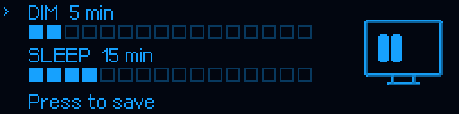

# M300 Classic RC22 · suwaki czasu OLED

Na panelu wybierz **Settings → OLED dim time** albo **OLED sleep time**. Na obu ekranach widać dwa 16-segmentowe paski w stylu regulatora jasności. Znacznik po lewej wskazuje edytowany czas, a liczba przy etykiecie podaje dokładną wartość w minutach. Obracaj pokrętłem, aby zmieniać wartość co minutę. Krótkie naciśnięcie zapisuje wybór, długie wraca do menu. Ikona po prawej jest animowana.



W Fluidd otwórz **OLED_TIMERS** lub **ZORTRAX_OLED_TIMERS**. Górny suwak DIM ustawia przygaszenie, dolny SLEEP ustawia całkowite wyłączenie. Przycisk **Save** zapisuje oba czasy razem. Dla DIM 5 i SLEEP 15 ekran przygasa po pięciu minutach od ostatniej obsługi i gaśnie po piętnastu. Dopuszczalny zakres to 1–60 min oraz DIM ≤ SLEEP. Te same progi obowiązują podczas druku, pauzy i w stanie Ready.

Przy bezczynnej drukarce w stanie Ready, z katalogu gałęzi orange-pi uruchom kolejno:

```bash
git pull --ff-only &&
sha256sum -c --quiet SHA256SUMS &&
python3 install-orange-pi.py &&
python3 install-orange-pi.py --update-fluidd --port 4480
```

Pierwsze wywołanie instalatora aktualizuje host i grafikę OLED, drugie instaluje nowy interfejs Fluidd. Przy MCU 1.0.7 to cała aktualizacja. Dla starszej wersji firmware pakiet MCU/M300_SD.zip zawiera aplikację z zapisem obu progów. Obraz OLED powstał z kodu RC22. Historyczne ilustracje podręcznika pochodzą z beta.20.
