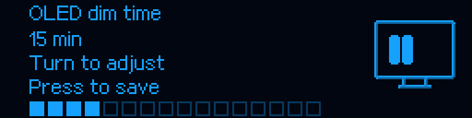
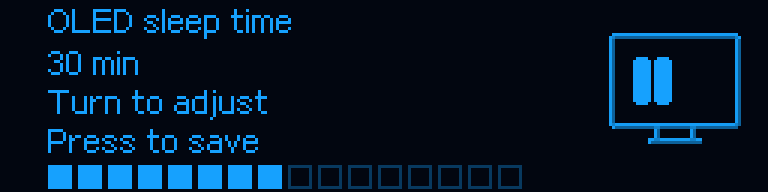

# M300 Classic RC23 · Ustawianie czasu OLED

W menu **Settings → OLED dim time** pokrętło ustawia czas przygaszenia, a w **OLED sleep time** czas wyłączenia wyświetlacza. Każdy ekran ma jeden suwak z dokładną liczbą minut i animowaną ikoną po prawej. Obróć pokrętło i kliknij, aby zapisać. Przytrzymanie w edytorze opuszcza go bez zapisu. Po powrocie do listy kursor wskazuje pozycję, z której wszedłeś.




Oba czasy liczone są od ostatniej obsługi i mają zakres 1–60 minut. Gdy wybrany DIM wynosi 15 minut, skrócenie SLEEP do 5 minut ogranicza DIM do 5. Wydłużenie SLEEP do 10 minut daje DIM 10, a wydłużenie do 20 przywraca DIM 15. SLEEP może rosnąć dalej do 60 minut. Wybór nowego DIM zastępuje poprzednią preferencję. Przy równych progach OLED gaśnie po upływie wspólnego czasu. Reguła obowiązuje podczas drukowania, w pauzie i w Ready.

Na Orange Pi, z katalogu gałęzi `orange-pi`, wykonaj przy bezczynnej drukarce w stanie Ready:

```bash
git pull --ff-only &&
sha256sum -c --quiet SHA256SUMS &&
python3 install-orange-pi.py &&
python3 install-orange-pi.py --update-fluidd --port 4480
```

Do zapamiętania preferowanego DIM na samej płycie wgraj aplikację MCU 1.0.8 z `MCU/M300_SD.zip`. Na MCU 1.0.7 skrócony próg jest zapisany na płycie, a pierwotny DIM pamięta Orange Pi. Stan odczytu i zapisu można obejrzeć poleceniem `ZORTRAX_DISPLAY_STATUS`. Obrazy powyżej pochodzą z renderera RC23. Starsze ilustracje podręcznika pochodzą z beta.20.
