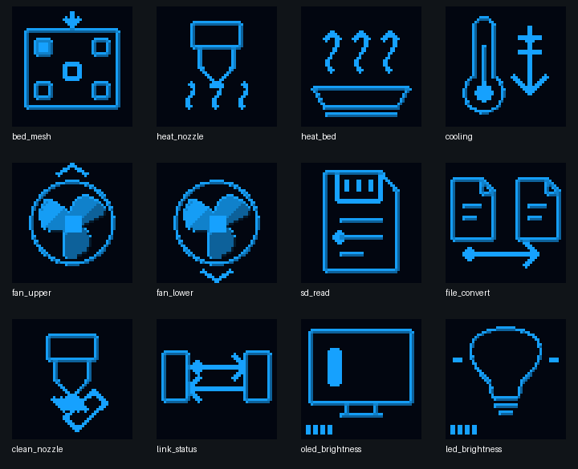
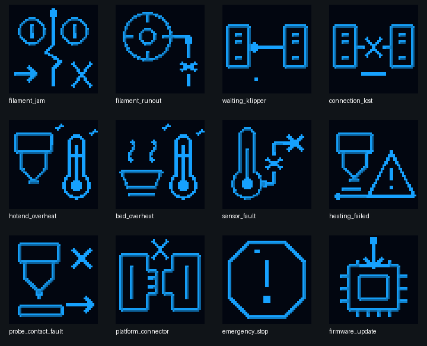

# M300 RC3 + MCU 1.0.1 — jednolite ikony OLED

[Instrukcja główna](../../README_PL.md) · [Wgrywanie MCU](MCU_FIRMWARE_1.0.1.md) · [Makra i menu](RC1_UI.md)

## Co zostało naprawione

Poprzednie wydania miały dwa różne tory: autonomiczny MCU korzystał z ikon z dodaną miękką krawędzią, natomiast host progował ikony do jasności 0/15. RC3 usuwa oba zabiegi. Oryginalny plik 37 zestawów ikon OEM (61 klatek) pozostaje bitowo niezmieniony i jest ponownie wyświetlany z fabrycznymi odcieniami. Nowe dodatkowe 24 symbole (96 klatek) mają wspólny, natywny raster 50×50, cztery klatki i dotychczasowy rytm 500 ms.

Odcienie nowych ikon zaprojektowano wewnątrz istniejących kształtów: pojedynczy jasny brzeg górny/lewy, ciemniejszy brzeg dolny/prawy, wydzielone płaszczyzny łopatek wentylatora i jasne znaki aktywności lub ostrzeżenia. Paleta nowych symboli to 0/4/8/11/14/15; nie każda ikona wykorzystuje wszystkie te poziomy. Nie ma Gaussian blur, rozszerzania konturu, pikseli poświaty ani późniejszego progowania. Nie jest to filtr uruchamiany przy kręceniu pokrętłem. Fabryczne OEM zachowują własną pełną paletę, bez kwantyzacji do sześciu poziomów.





To rendery danych pikselowych, nie fotografie drukarki. [Animowane porównanie klatek](../assets/ui-symbols/preview.gif) · [Wszystkie natywne PNG, GIF i SVG](../assets/ui-symbols/M300_ACTIVITY_SYMBOLS_24.zip).

## Jedno źródło danych

Wspólnym wzorcem jest `docs/assets/ui-symbols/native_frames.json`. `ci/design_activity_artwork.py` dokumentuje jawne obszary cieniowania na siatce natywnej, a `ci/export_activity_artwork.py` eksportuje bez zmiany wartości pikseli dane hosta, obie tablice MCU oraz wizualizacje. MCU przechowuje tylko symbole potrzebne bez hosta (oczekiwanie, utrata łącza, błędy); podczas zwykłego menu odbiera już złożony obraz hosta. Nie ładuje wszystkich ikon do dodatkowego bufora RAM. Pozostaje jedna linia 128 bajtów.

Fluidd koduje te same 4-bitowe piksele do PNG i zachowuje dotychczasowe skalowanie ×1/×2/×3 oraz szybki kanał nawigacji. Przy tym samym indeksie klatki odpowiadające ikony MCU i hosta są identyczne. Nie oznacza to synchronizacji faz dwóch niezależnych zegarów ani laboratoryjnej zgodności jasności monitora z fizycznym OLED. Ustawienia jasności, właściwości panelu i opóźnienie transportu nadal mają znaczenie.

Opcja `sharp_icons` ze starszych konfiguracji jest rozpoznawana, ale nie zmienia już obrazu. `ZORTRAX_UI_STATUS` pokazuje `icon_style: OEM_NATIVE_TONES_V1`. Układ osi Home/Move, miganie, logo Klippera, czcionki i pozycje menu pozostają bez zmian.

## Aktualizacja: potrzebne są host i MCU

Przy bezczynnej drukarce Ready, bez aktywnego ani wstrzymanego wydruku:

```bash
git -C "$HOME/m300-orange-pi" pull --ff-only &&
python3 "$HOME/m300-orange-pi/install-orange-pi.py" --port 4480
```

Odśwież Fluidd przez Cmd+Shift+R. To wdraża host `1.0.0-rc.3`. Osobno wgraj aplikację `1.0.1` z `M300_SD.zip` lub `M300_MCU_v1.0.1_SD.zip`, zgodnie z [instrukcją MCU](MCU_FIRMWARE_1.0.1.md). Sam Git nie programuje MCU. Bez tej drugiej aktualizacji autonomiczne ekrany starego MCU nadal będą miały poprzednie ikony. Nie trzeba wymieniać bootloadera. UART 750000, port 4480, mesh, PID, kwalifikowane Z i ustawienia materiału pozostają zachowane.

Po obu aktualizacjach odczytaj:

```gcode
ZORTRAX_SETTINGS_STATUS
ZORTRAX_MCU_STATUS
ZORTRAX_UI_STATUS
ZORTRAX_OLED_STATUS
```

Oczekiwane: host `1.0.0-rc.3`, MCU `1.0.1`, wspólny styl, Ready, brak błędu komunikacji. W tej wersji nie aktualizowano bazy upstream Klippera, systemu ani Moonrakera.

## Walidacja i odbiór

Testy porównują wszystkie 96 ramek hosta z masterem, wszystkie 61 oryginalnych ramek OEM, bezstratny transport i indeksy PNG. Natywny model kompiluje rzeczywisty renderer MCU i sprawdza 124 ekrany oczekiwania/utraty połączenia/błędów w czterech fazach: 310 000 pikseli ikon. Sprawdzane są granice Flash/RAM, format M3B, migracja i 828 regresji hosta. Dawne testy wymagające binarnego wyglądu zastąpiono testami nowego wymaganego stylu; zabezpieczeń i kontroli błędów nie wyłączano.

Ocena na fizycznej drukarce pozostaje osobnym odbiorem: obejrzyj dyszę, wentylator, mesh i ekran oczekiwania przy zwykłej jasności OLED, następnie przy ×1 i ×3 we Fluidd. Nie wywołuj awarii ani odłączenia MCU wyłącznie po to, żeby obejrzeć ikonę; błędy sprawdzono programowo. Dawne 65 ilustracji beta.20 pozostaje oznaczonym materiałem historycznym. Wydanie jest kandydatem RC, nie deklaracją zakończenia całego odbioru sprzętowego.
