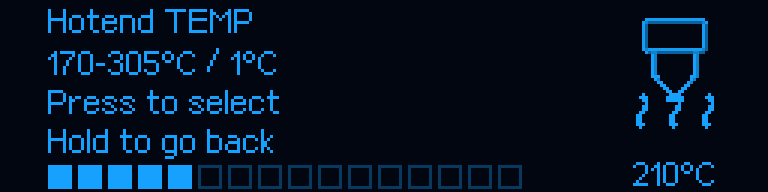
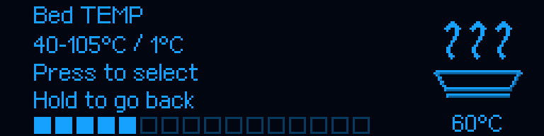

# M300 RC4 — regulatory temperatury na OLED

> Historia RC4: opisany niżej wybór bez grzania zastąpiono w [RC5](RELEASE_v1.0.0-rc.5.md). W RC5 klik ustawia cel grzałki.

[Instrukcja główna](../../README_PL.md) · [Ustawienia i menu](RC1_UI.md) · [Wspólne ikony](RELEASE_v1.0.0-rc.3.md)

## Zakres

W menu **Klipper → Hotend TEMP / Bed TEMP** pionowe listy kilku temperatur
zastąpiono regulatorem w tym samym układzie co jasność LED/OLED. Po lewej są
nazwa, zakres, wskazówki obsługi i pasek z 16 segmentami. Po prawej znajduje się
zatwierdzona ikona dyszy lub stołu w rozmiarze 50×50 oraz dokładna wartość w °C.
Pasek jest orientacyjny; liczba pokazuje dokładną wybraną temperaturę.





To rendery aktualnego kodu OLED, nie zdjęcia drukarki. Są generowane przez
`ci/render_temperature_editors.py`; wzorzec pikseli i sumy zapisano w
[raporcie](../reports/TEMPERATURE_EDITORS_RC4.json). Ikony nie zostały ponownie
cieniowane, przeskalowane ani wyostrzone. Podgląd Fluidd używa tych samych danych.

## Obsługa i znaczenie wartości

Obrót pokrętła zmienia wersję roboczą wartości co **1°C**. Klik zatwierdza ją
i wraca do poprzedniej pozycji menu. Przytrzymanie przycisku wraca bez przyjęcia
zmiany. Obrót poniżej minimum wybiera **Back**; ponowny klik również anuluje.
Nie ma zawijania z maksimum na minimum. Wejście pokazuje ostatnią wartość
wybraną w tym menu, a przed pierwszym wyborem bieżący cel grzałki, jeśli mieści
się w zakresie; w innym przypadku pokazuje minimum. Samo wejście niczego nie zapisuje.

**To nadal wybór temperatury dla osobnego polecenia Heat hotend / Heat bed.**
Obrót i zatwierdzenie nie uruchamiają ani nie przerywają grzania, wydruku czy
innej procedury. Nie zapisują temperatury do NVM i nie zmieniają temperatur
ładowania materiału, homingu, poziomowania ani ustawień slicera. Polecenie Heat
korzysta z tego samego chronionego `SET_HEATER_TEMPERATURE` co przed RC4.
Wyłączenie grzania pozostaje osobną funkcją; Back nie oznacza 0°C/OFF.

Przy aktualnej polityce pracy zakresy wynoszą **170–305°C** dla dyszy i
**40–105°C** dla stołu. Zachowano dolne granice poprzednich list. Ostrzejsze
limity użytkownika zawężają wybór. Regulator nie zmienia limitów konfiguracyjnych
ani progów awaryjnych czujników. Wyświetla bieżący dozwolony zakres zamiast
bezwarunkowo zakładać 305/105. Nieprawidłowy lub pusty zakres zostawia tylko Back.

Klik zatwierdza wyłącznie wersję roboczą z potwierdzonej transmisji OLED. Klik
odebrany razem z obrotem, przed potwierdzeniem nowego obrazu lub po zmianie strony
nie zatwierdzi niewidzianej wartości. Ograniczenia są ponownie sprawdzane przy
zatwierdzaniu. Dotychczasowe reguły przejmowania grzałek przez procedury pozostają.

## Instalacja

Wyłącznie przy bezczynnej drukarce Ready, bez aktywnego ani wstrzymanego zadania:

```bash
git -C "$HOME/m300-orange-pi" pull --ff-only &&
python3 "$HOME/m300-orange-pi/install-orange-pi.py" --port 4480
```

Odśwież Fluidd przez Cmd+Shift+R. Odczyt `ZORTRAX_SETTINGS_STATUS` powinien pokazać
host `1.0.0-rc.4`. **Nie trzeba wgrywać MCU:** aplikacja pozostaje **1.0.2**, z
oryginalnym logo i wspólnymi ikonami. `MCU/M300_SD.zip` jest dołączonym obrazem
zgodnym z pakietem, nie obowiązkowym krokiem tej aktualizacji. UART 750000,
port 4480, mesh, PID i nastawy kwalifikowanego Z nie są zmieniane. Baza upstream
Klippera, system Armbian i Moonraker również pozostają bez zmian.

## Testy i odbiór

Dodano 18 testów regulacji: pełne zakresy, niższe limity, nieprawidłowe granice,
obraz każdej wartości, brak zmiany grzałek/ruchu/NVM, dokładne piksele ikon,
obsługę Back i przytrzymania, przepełnienie zakresu, opóźnione potwierdzenia oraz
połączony obrót i klik. Wszystkie wcześniejsze regresje pozostają uruchamiane;
łączna liczba testów hosta wynosi 846. Pełny CI sprawdza także kompilację MCU,
niezmienną grafikę, protokół, proces Klippy, aktualizację i wycofanie konfiguracji.
Historyczne 65 ilustracji beta.20 pozostaje opisanym archiwum, nie zrzutami RC4.
Nie wykonano nowego testu fizycznej drukarki w CI. Użytkownik potwierdził wcześniej,
że wygląd wspólnych ikon jest dobry; RC4 nie zmienia ich rastra.
