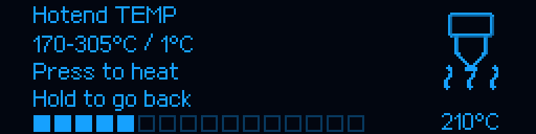
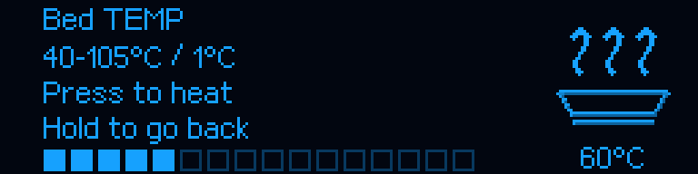

# M300 RC5 — zatwierdzenie temperatury uruchamia grzanie

[Instrukcja główna](../../README_PL.md) · [Poprzednia logika RC4](RELEASE_v1.0.0-rc.4.md)

## Poprawka zgłoszonego zachowania

W RC4 Hotend TEMP / Bed TEMP zapisywały tylko wartość menu. Cel grzałki i wykres
Fluidd pozostawały bez zmian, dopóki operator nie wybrał osobnego Heat. RC5 usuwa
ten dodatkowy krok: **zatwierdzony klik ustawia rzeczywisty cel Klippera i zaczyna
grzanie**, przez standardowe `SET_HEATER_TEMPERATURE`, nie przez bezpośrednie PWM.

Obrót pokrętła nadal zmienia tylko podgląd co 1°C. Krótki klik zatwierdza dokładnie
wartość z potwierdzonego obrazu OLED i wraca do poprzedniej pozycji menu.
Przytrzymanie / Back anuluje bez zmiany istniejącego grzania. Podpowiedź mówi teraz
**Press to heat**. Nie trzeba dodatkowo wybierać Heat hotend / Heat bed; stare
skróty pozostają zgodne. Wyłączenie grzania pozostaje osobną funkcją.

Menu nadrzędne pokazuje aktualny cel lub OFF. Po ponownym wejściu edytor preferuje
aktywny cel Klippera, także ustawiony z Fluidd/G-code. Gdy grzałka jest wyłączona,
ostatnia poprawnie zastosowana wartość jest jedynie propozycją do nowego kliknięcia.
Zakresy pozostają 170–305°C / 40–105°C, zawężane przez bardziej restrykcyjną
konfigurację; nie podniesiono żadnych limitów temperatury.




Ikony, odcienie, animacje i transmisja pozostają bez zmian. To rendery, nie zdjęcia.

## Zabezpieczenia

Polecenie wykonuje się w zwykłej kolejce Klippera z blokadą G-code, poza obsługą
pakietu OLED. Ponownie sprawdza granice i cel po uzyskaniu blokady. Nawigacja,
restart lub shutdown unieważniają oczekującą operację. Rozłączenie panelu,
zmienione ograniczenia, zmiana celu przed wykonaniem albo odmowa istniejącego
właściciela grzałek nie są obchodzone. Odmowa pojawia się jako Notice na OLED.
Ostatnia pomyślnie zastosowana wartość jest zapisywana dopiero po rzeczywistym
przyjęciu celu. Nie zmieniono PID, map czujników, MCU, chłodzenia, homingu, mesh,
temperatur procedur materiałowych ani NVM. Nie wykonuje się żadnego ruchu osi.

## Aktualizacja

Przy bezczynnej drukarce Ready, bez aktywnego ani wstrzymanego wydruku:

```bash
git -C "$HOME/m300-orange-pi" pull --ff-only &&
python3 "$HOME/m300-orange-pi/install-orange-pi.py" --port 4480
```

Host: **1.0.0-rc.5**. MCU: **1.0.2**, bez ponownego wgrywania. UART 750000,
Fluidd 4480, zapisany mesh, PID i kwalifikowane odsunięcie Z 2 mm są zachowane.
Po instalacji odśwież Fluidd i sprawdź `ZORTRAX_SETTINGS_STATUS`. Przy drukarce
Ready wybierz temperaturę, kliknij i sprawdź jej pojawienie się w polu Target
odpowiedniej grzałki. Sam obrót nie powinien zmieniać tego pola. Po próbie wyłącz
grzanie zwykłą funkcją i pozostaw chłodzenie do ostygnięcia dyszy.

## Walidacja i jej granice

855 testów hosta, w tym 27 przypadków edytora, obejmuje rzeczywistą ścieżkę
pokrętło → ACK → klik → natywny parser G-code → Heater.set_temp/get_status.
Użyta referencja heaters.py pochodzi z przypiętej bazy i zachowuje oryginalną
licencję. Testy sprawdzają odmowy, zmianę limitów i zewnętrznego celu, anulowanie,
brak ruchu / zapisu NVM, niezmienione piksele ikon i zgodność starego Heat.
Wcześniejsze testy zostały zachowane; zmieniono oczekiwanie dla potwierdzonego
kliknięcia z „tylko zapisz” na „zastosuj cel”. Nie wykonano grzania na drukarce
użytkownika. Testy programowe nie zastępują tego odbioru sprzętowego.

Dołączony `MCU/M300_SD.zip` pozostaje obrazem 1.0.2, a nie wymaganym krokiem aktualizacji.
Historyczne ilustracje beta.20 zachowują oznaczenie archiwalne.
