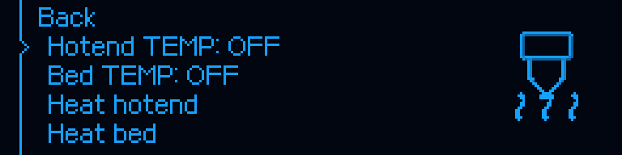
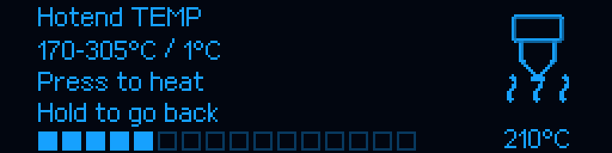
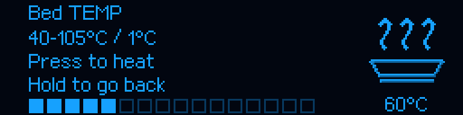
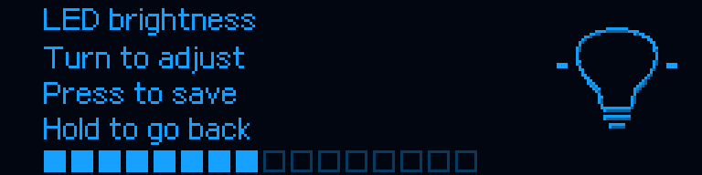

# M300 RC6 — animacja zatwierdzonych ikon menu

[Instrukcja główna](../../README_PL.md) · [Zatwierdzone cieniowanie RC3](RELEASE_v1.0.0-rc.3.md) · [Grzanie po kliknięciu RC5](RELEASE_v1.0.0-rc.5.md)

## Przyczyna i zakres poprawki

To nie jest nowy zestaw grafik. Pliki 24 dodatkowych symboli, fabrycznych ikon,
ikon menu, osi i logo pozostają identyczne z zatwierdzonym RC3. Zachowano
kontury, rozmiary, wszystkie poziomy jasności, kolejność i czas klatek.

Przyczyna zatrzymanych ikon była w kodzie: `menu_symbol` zwracał zwykle
`animated=False`, a zapasowa ścieżka ikon OEM nie przekazywała czasu do dekodera.
Obie ścieżki wybierały zatem pierwszą klatkę mimo dostępnej animacji. Nie ma
podstaw do przypisywania tego błędowi transmisji lub przerwaniu odpowiedzi czatu.

RC6 odtwarza istniejące klatki w zwykłym menu, m.in. przy temperaturach, grzaniu,
mesh, ustawieniach, materiale, plikach, PID i jasności. Dodatkowe ikony mają
4 klatki po 500 ms; OEM zachowują okres zapisany w ich deskryptorach. Oryginalne
jednoklatkowe grafiki pozostają statyczne — nie dodano im wymyślonych animacji.
Rzeczywisty test wentylatorów i zakończone procedury nadal odzwierciedlają stan
urządzenia; animowany podgląd polecenia w menu sam nie uruchamia tej czynności.






To rendery kodu OLED w powiększeniu ×3 bez interpolacji, nie fotografie drukarki.
[Raport pikselowy](../reports/MENU_ANIMATION_RC6.json) zapisuje sumy wszystkich
klatek przykładów oraz niezmiennych źródeł grafik. Podgląd Fluidd korzysta z tych
samych danych, nie z osobnego zestawu animacji.

## Kliknięcia podczas animacji

Zachowano działanie RC5: obrót zmienia propozycję, klik ustawia cel Klippera
przez chronione polecenie grzania, a Back/przytrzymanie anuluje. Przy animacji
ostatnia potwierdzona klatka może być poprzednią fazą tej samej ikony. Ograniczona
historia potwierdzeń rozpoznaje ją wyłącznie dla tej samej strony, generacji,
epoki wejścia i wartości. Nowa wartość nadal wymaga własnego potwierdzonego
obrazu. Nawigacja, zmiana wartości, utrata gotowości lub restart nie pozwalają
potwierdzić starego wyboru. Bufor przechowuje najwyżej 8 obrazów na regulator.
Nie zmieniono limitów grzania, PID, chłodzenia, ruchu, homingu ani mesh.

## Aktualizacja

Przy bezczynnej drukarce Ready, bez aktywnego ani wstrzymanego wydruku:

```bash
git -C "$HOME/m300-orange-pi" pull --ff-only &&
python3 "$HOME/m300-orange-pi/install-orange-pi.py" --port 4480
```

Odśwież Fluidd i sprawdź `ZORTRAX_SETTINGS_STATUS`: host **1.0.0-rc.6**.
**MCU pozostaje 1.0.2; nie trzeba go wgrywać.** Dołączony `MCU/M300_SD.zip`
nie jest krokiem wymaganym przez tę aktualizację. UART 750000, port 4480, mesh,
PID i kwalifikowane odsunięcie Z 2 mm pozostają lokalnymi ustawieniami drukarki.

## Sprawdzenia

867 testów hosta obejmuje 12 nowych testów animacji, zgodność z niezmiennymi
sumami RC3, przechodzenie klatek na ścieżkach menu, brak ruchu lub grzania od
samego rysowania oraz zatwierdzanie podczas opóźnionych ACK. Poprzednie testy
ograniczeń temperatur, anulowania i przejęcia grzałek pozostają aktywne.
`ci/check_menu_animation.py --check` porównuje każdą klatkę GIF z rzeczywistym
rendererem. Historyczne ilustracje beta.20 pozostają opisanym archiwum.
Testy programowe nie są nowym testem na fizycznej drukarce użytkownika.
