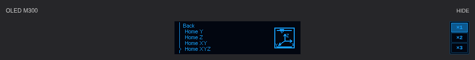
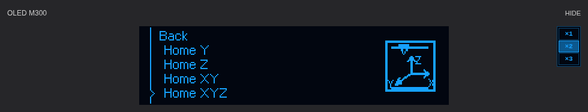
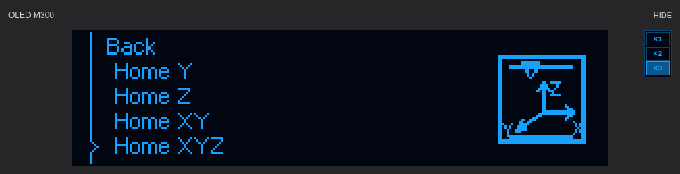

# Zmiany z 10 listopada 2026 — instrukcja dla beta.20

[Instrukcja główna](../../README_PL.md) · [65 funkcji OLED](OLED_FUNCTIONS.md) · [Menu](OLED_MENU_REFERENCE.md) · [Poziomowanie](BED_MESH_AND_LEVELING.md)

**Wersja użytkowa: v1.0.0-beta.20.** Kod odniesienia: `4828a9da9d5fd8b0b93eb2ac267732ee7e49d506`. Dzisiejsza publikacja dokumentacji nie tworzy beta.21, nie zmienia MCU ani ustawień drukarki. Wcześniejsze wydania pozostają niezmiennymi archiwami.

## 1. Co zmieniło się dzisiaj

| Wydanie | Zmiana | Co pozostało bez zmian |
|---|---|---|
| beta.18 — `TUNE-PREPARE-1` | Tune pokazuje przygotowanie w IDLE przed pomiarem; All pokazuje bazowanie; Calibrate wywołuje BED_MESH; schemat pól zawsze nad heatmapą | Metoda pomiaru, profil m300_pads, ruch/grzanie, kontroler druku i szybki OLED |
| beta.19 — `OLED-ZOOM-1` | Przyciski ×1/×2/×3, zapamiętanie wyboru w przeglądarce, przerysowanie zdekodowanej klatki | Brak nowych zapytań o klatkę przy zmianie skali; brak sterowania fizycznym ekranem |
| beta.20 — `OLED-ZOOM-2` | OLED pośrodku całej karty; przyciski przy prawej krawędzi pod HIDE; wspólna wysokość ×1; kolory z palety obrazu | `NAV-EVENT-1`, `NAV-PIPELINE-2`, animacje, UART/SPI, MCU, temperatura, mesh i START/PAUSE/CANCEL |

Szybka nawigacja menu została wprowadzona wcześniej: zdarzenie zmiany zaznaczenia trafia osobnym odczytowym kanałem, a odbiór nie czeka na koniec rysowania poprzedniej klatki. Normalny cykl temperatur i pozostałych statusów pozostał standardowy. Powiększanie nie jest kolejnym zwiększeniem szybkości UART.

Źródła: [beta.18](RELEASE_v1.0.0-beta.18.md), [beta.19](RELEASE_v1.0.0-beta.19.md), [beta.20](RELEASE_v1.0.0-beta.20.md), [manifest](../../PORT.json).

## 2. Podgląd ×1 / ×2 / ×3

Poniższe trzy ilustracje to **demonstracyjne rendery przeglądarkowe**. Używają rzeczywistego arkusza stylów komponentu beta.20, funkcji rysującej i bitmapy OLED projektu, ale nie są zrzutami żywej sesji drukarki. Nie przedstawiają zmierzonego opóźnienia na komputerze użytkownika.

### ×1 — natywna wielkość treści



### ×2 — dwukrotna wielkość treści



### ×3 — trzykrotna wielkość treści



| Wybór | Treść przy DPR 1 albo 2 | Cały canvas przy DPR 1 | Cały canvas przy DPR 2 |
|---|---:|---:|---:|
| ×1 | 256×64 CSS px | 260×68 CSS px | 258×66 CSS px |
| ×2 | 512×128 CSS px | 516×132 CSS px | 514×130 CSS px |
| ×3 | 768×192 CSS px | 772×196 CSS px | 770×194 CSS px |

Różnica to ramka po 2 **piksele urządzenia** na każdej krawędzi. DPR opisuje liczbę pikseli urządzenia przypadających na piksel CSS. Nie należy odczytywać podanych rozmiarów CSS jako fizycznej liczby punktów ekranu Retina.

Przy ułamkowym DPR lub powiększeniu strony zachowujemy całkowity kwadrat N×N pikseli urządzenia; rozmiar CSS może wtedy odbiegać od tabeli. Nie gwarantujemy niezmienionego rastra po powiększeniu lupą systemową, skalowaniu pulpitu zdalnego albo chwilowym przetwarzaniu gestu pinch przez przeglądarkę.

**Cała kolumna trzech przycisków ma stale wysokość aktualnego ×1**, a nie wysokość ×2 lub ×3. OLED jest wycentrowany niezależnie od przycisków. Jeżeli obraz jest szerszy od środkowej kolumny, przewijana jest ta kolumna; przyciski nadal pozostają pod HIDE. Wyboru skali nie przenosi się do MCU. HIDE/SHOW ukrywa tylko podgląd w przeglądarce.

Kolor tekstu i aktywnego obrysu to `#16A1FE`; ciemny obrys `#0A436C`, wypełnienie zaznaczenia `#0C588E`, tło `#020610`. Są to rzeczywiste wartości z cyfrowej 16-poziomowej palety PNG, nie kalibracja barwy fizycznego OLED. [Źródło koloru](../../host/klippy/extras/m300_oled_preview.py) · [Komponent](../../frontend/fluidd/navigation/M300OledPreview.vue) · [Piksele](../../frontend/fluidd/navigation/m300-oled-pixels.ts).

## 3. Tune: otwarcie, All, Calibrate

Samo wejście ikoną suwaków jest odczytowe i pokazuje przygotowanie przed pierwszym pomiarem. **All** uruchamia `ZORTRAX_HOME_ALL`, nie mesh. **Calibrate** uruchamia `BED_MESH` i korzysta z jego nagrzewania oraz bazowania. Nie trzeba uruchamiać All jako osobnego obowiązkowego etapu.

Schemat pól jest na górze, heatmapa poniżej w każdym stanie. Brak kolorowej powierzchni przed pomiarem jest poprawny. Widoczny zapisany profil może być tylko nieaktywnym podglądem. Nie wprowadzono automatycznego LOAD przy samym wejściu do Tune.

Po nowym pomiarze są trzy różne działania: utworzenie profilu w pamięci, zapis `SAVE_CONFIG` i aktywacja przez `BED_MESH_PROFILE LOAD=...` albo START_PRINT. Domyślne `MESH=AUTO` używa m300_pads, gdy istnieje, a przy braku kontynuuje bez kompensacji. [Pełna instrukcja mesh](BED_MESH_AND_LEVELING.md).

## 4. Aktualizacja istniejącej instalacji

Tylko przy **Ready**, bez aktywnego/wstrzymanego wydruku i innej procedury:

```bash
git -C "$HOME/m300-orange-pi" pull --ff-only &&
python3 "$HOME/m300-orange-pi/install-orange-pi.py"
```

Potem odśwież Fluidd przez **Cmd+Shift+R**. Nie trzeba wgrywać MCU, kasować siatki, wykonywać nowego pomiaru ani zmieniać baud tylko z powodu beta.18–20. Nie używaj `reset --hard` do omijania ochrony lokalnych zmian. Utrzymuj własną kopię konfiguracji.

Odczyt wersji paczki na Orange Pi:

```bash
python3 - <<'PY'
import json
from pathlib import Path
p = Path.home() / 'm300-orange-pi' / 'BUILD_PROVENANCE.json'
d = json.loads(p.read_text())
print('Wydanie:', d.get('distribution_version'))
print('Commit:', d.get('github_commit'))
print('Walidacja:', d.get('release_stage'))
PY
```

Zwróć uwagę na rozdział warstw: API hosta nadal `NAV-EVENT-1`, pipeline `NAV-PIPELINE-2`, układ przycisków `OLED-ZOOM-2`, Tune `TUNE-PREPARE-1`. Numer beta nie jest numerem każdego z tych modułów.

## 5. Odbiór interfejsu i granice potwierdzenia

Bez uruchamiania procedur sprawdź ×1/×2/×3, podświetlenie wyboru, powrót ustawienia po odświeżeniu, położenie pod HIDE oraz układ Tune. Porównanie nawigacji wykonuj przy zwykłym obracaniu pokrętłem. All/Calibrate są już operacjami z ruchem i możliwym grzaniem — nadzoruj je fizycznie.

**Użytkownik potwierdził 10.11.2026 poprawny efekt beta.20 („jest ok”).** To potwierdzenie zgłoszonego wyglądu i obsługi, nie nowy pomiar termiczny, dokładności Z, maksymalnego przepływu ani całego układu na każdym komputerze.

Pełny build beta.20: [42798305380](https://github.com/MarcinKowalik-AGH/Zortrax-m300-Klipper/actions/runs/42798305380). Sprawdzono 741 testów hosta, 140 frontendu, 84 przypadki rastra i 54 przypadki geometrii układu w Chromium/Firefoksie, kompilację i integralność pakietu. Dokumentacja ma osobną kontrolę kompletności oraz odtwarzalności ekranów.

Mail o błędzie dotyczy konkretnej próby CI. Historia poprzedniej nieudanej próby pozostaje nawet po poprawce. Za gotowe wydanie uznaje się poprawną paczkę po zakończonej walidacji; nie sam otwarty PR. Błąd programu wymaga poprawienia kodu, a nie bezwarunkowego ponawiania. Nie deklarujemy nowego stale działającego automatu naprawiającego kod.
