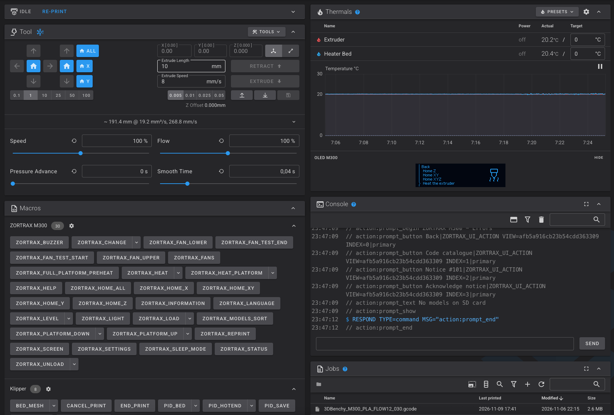
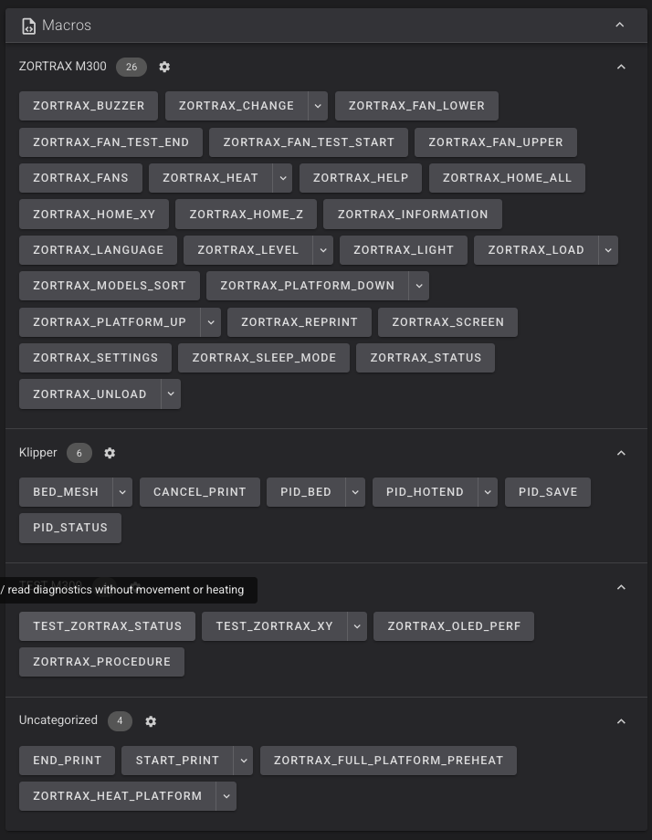
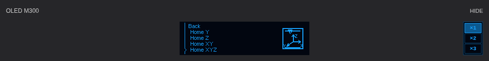
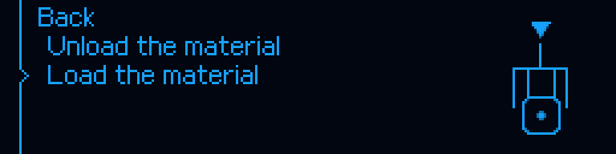

# Instrukcja codziennej obsługi

[Spis dokumentacji](../../README_PL.md) · [Obsługa](USER_GUIDE.md) · [Menu OLED](OLED_MENU_REFERENCE.md) · [Ilustrowane funkcje](OLED_FUNCTIONS.md) · [Parametry](TECHNICAL_REFERENCE.md)

> Dokumentacja dla **M300 Classic**, wydanie **1.0.0-rc.1**. Historyczne ilustracje mają jawny punkt odniesienia beta.20. Nie dotyczy M300 Plus, M300 Dual ani Inventure.


## 1. Kontrola przed pracą

Sprawdź mocowanie płyty i hotendu, czystość dyszy oraz metalowych pól kontaktowych, prowadzenie filamentu, działanie chłodzenia i wolną przestrzeń ruchu. Rozgrzana dysza i stół mogą spowodować oparzenie; nie dotykaj ich podczas bazowania i pomiaru. Pierwsze próby po instalacji wykonuj pod nadzorem.

W Fluidd oczekuj stanu **Ready**. Do odczytu bez celowego ruchu i grzania służą:

```gcode
ZORTRAX_MCU_STATUS
ZORTRAX_LINK_STATUS
ZORTRAX_OLED_STATUS
ZORTRAX_HARDWARE_STATUS
PRINT_CONTROL_STATUS
M105
QUERY_ENDSTOPS
QUERY_PROBE
```

Stan krańcówek i PC7 musi odpowiadać fizycznej sytuacji. Sam napis Ready nie potwierdza wolnego toru ruchu, poprawności dyszy ani pomiaru temperatury zewnętrznym termometrem.

## 2. Fluidd i makra



*Zrzut użytkownika z 10.11.2026 sprzed beta.20; nie przedstawia obecnego położenia przycisków skalowania. Sterowanie osią znajduje się po lewej, temperatury i podgląd OLED po prawej. Poniżej są makra, konsola i pliki.*

Grupa **ZORTRAX M300** zbiera funkcje specyficzne dla drukarki. **Klipper** zawiera m.in. START/END, CANCEL, BED_MESH i PID. Laboratoryjna grupa **TEST M300** nie jest częścią RC1. Odczyty daje `ZORTRAX_DIAGNOSTICS`; OEM-owy test wentylatorów pozostaje w Maintenance. Jasność otwierają `ZORTRAX_OLED_BRIGHTNESS` i `ZORTRAX_LED_BRIGHTNESS`. Rozwijana strzałka przy makrze otwiera parametry; kliknięcie głównej części wykonuje wariant domyślny. [Pełny katalog](MACRO_REFERENCE.md).

<details>
<summary>Historyczny panel z 08.11.2026 — dlaczego część makr była „Uncategorized”</summary>



To stan wcześniejszej wersji, nie oczekiwany wygląd beta.20. `ZORTRAX_HEAT_PLATFORM`, `ZORTRAX_FULL_PLATFORM_PREHEAT` i START/END były wtedy widoczne jako nieprzypisane. Zrzut powyżej pokazuje poprawiony podział makr, ale wcześniejszy układ OLED. Zachowanie starych ustawień lokalnych lub pamięć przeglądarki może wymagać odświeżenia; nie usuwaj własnych kategorii bez sprawdzenia.

</details>

## 2a. Podgląd OLED i przyciski ×1/×2/×3



*Render demonstracyjny w Chromium, z rzeczywistym CSS komponentu beta.20 i bitmapą OLED projektu. Nie jest zdjęciem sesji użytkownika.*

Po prawej pod HIDE znajdują się trzy przyciski. Wybrany jest podświetlony; zmiana wielkości nie wysyła poleceń do drukarki i nie steruje menu. OLED pozostaje wycentrowany względem całej karty, a wysokość całej kolumny przycisków odpowiada ×1. Gdy ×2/×3 nie mieści się w karcie, przewijaj tylko obraz. Wybór jest zapamiętywany osobno w przeglądarce. Kwadratowe piksele mają pierwszeństwo przed zachowaniem dokładnej wielkości CSS przy ułamkowym powiększeniu strony.

**HIDE/SHOW** dotyczy wyłącznie podglądu w Fluidd, nie wyłączenia fizycznego OLED. Po aktualizacji użyj Cmd+Shift+R. [Pełny opis powiększenia](UPDATE_2026-11-10.md) i [co robi każdy ekran OLED](OLED_FUNCTIONS.md).

## 2b. Tune, All i Calibrate — trzy różne działania

| Działanie | Zachowanie zachowane w RC1 |
|---|---|
| Wejście ikoną suwaków Tune | Odczytowy panel przygotowania, także w IDLE przed pierwszym pomiarem; bez ruchu i grzania |
| All w Tune | Wspólne ZORTRAX_HOME_ALL; pokazuje postęp bazowania i temperatury, nie tworzy mesh |
| Calibrate w Tune | BED_MESH z przygotowaniem grzania i bazowania; nie trzeba osobno wykonywać All |

**Stały układ: schemat płyty/pól kontaktu nad heatmapą**, przed, podczas i po pomiarze. Jeżeli nie ma profilu, nie oczekuj kolorowej powierzchni; nie jest to powód do ponownego bazowania. [Pomiar, zapis i aktywacja](BED_MESH_AND_LEVELING.md).

## 3. Bazowanie i przygotowanie stołu

`ZORTRAX_HOME_X`, `ZORTRAX_HOME_Y`, `ZORTRAX_HOME_XY`, `ZORTRAX_HOME_Z` i `ZORTRAX_HOME_ALL` uruchamiają wspólną logikę z OLED. Przy wspólnym XY kolejność jest **Y, następnie X**. Z wymaga odniesienia XY, odpowiedniej temperatury dyszy oraz sprawnego kontaktu PC7. Samo wybranie Home Z w menu nie usuwa wymogu wstępnego grzania.

Homing respektuje `z_contact_clearance`: domyślnie 5 mm, a na zakwalifikowanym egzemplarzu 2 mm; PC7 musi zostać rozwarty przed ruchem XY. Niezależna wysokość przejazdów M07 `safe_z` pozostaje 5 mm. Nie zastępuje to sprawdzenia, czy fizycznie jest miejsce na ruch. Z pozytywnym przyrostem Z platforma oddala się od dyszy. Po bazowaniu pozostaje bezpieczny odstęp.

Ordinary Z używa pięciu kolejnych kontaktów/zwolnień; końcowe odniesienie pochodzi z piątej krawędzi zwolnienia, nie ze średniej. M07 ma inną sekwencję. Nie zastępuj jej przypadkowym `samples: 5`. [Szczegóły](BED_MESH_AND_LEVELING.md).

## 4. Grzanie i pełne wygrzewanie platformy

**Ręczne temperatury w Thermals** to zwykłe zadania Klippera. **`ZORTRAX_HEAT`** uruchamia procedurę OEM grzania ekstrudera (domyślnie 260°C) z komunikatem i zakończeniem potwierdzanym przez operatora. **`ZORTRAX_HEAT_PLATFORM TEMP=60`** uruchamia wspólną procedurę stołu.

**`ZORTRAX_FULL_PLATFORM_PREHEAT STATE=ENABLED`** zapisuje opcję następnego START. Nie zaczyna samodzielnie grzać. Włącza dodatkowy okres stabilizacji platformy, domyślnie 60 s, po osiągnięciu zadanych temperatur. `STATE=DISABLED` wyłącza tę opcję. START odczytuje ustawienie przy rozpoczęciu; zmiana w menu nie modyfikuje rozpoczętej już sesji.

## 5. Filament

`ZORTRAX_LOAD` i `ZORTRAX_UNLOAD` prowadzą operatora przez nagrzewanie i potwierdzenia. Domyślna temperatura proceduralna wynosi **240°C**, a nominalne długości LOAD/UNLOAD to **130/110 mm**. To parametry procedury portu, nie uniwersalne zalecenie temperaturowe dla każdego filamentu. Wariant wymiany w pauzie wykorzystuje 110 mm wycofania i 150 mm podania.

Podczas załadunku i rozładunku z OLED lub Fluidd może pozostać aktywna
natywna siatka stołu Klippera. Procedura porusza wyłącznie ekstruderem
i pozostawia profil aktywny po zakończeniu.



Temperaturę dobierz w granicach materiału i konfiguracji, korzystając z obsługiwanych parametrów. Nie forsuj podawania, gdy materiał się zacina. Dalsza ekstruzja, potwierdzenie i anulowanie zależą od aktualnej fazy; stary przycisk nie jest zgodą na kolejną fazę. Zmiana podczas druku: PAUSE → `ZORTRAX_CHANGE` → potwierdzenie prawidłowego przepływu → jawne RESUME.

## 6. START_PRINT i END_PRINT

Slicer powinien wywołać **jeden** `START_PRINT`, z temperaturami materiału, i **jeden** `END_PRINT`. Nie dokładaj równolegle drugiego bazowania, starego makra CR10S5 ani kolejnych linii czyszczących. Przykład *struktury wywołania* dla materiału, dla którego wcześniej dobrano 200/60°C:

```gcode
START_PRINT EXTRUDER_TEMP=200 BED_TEMP=60 MESH=m300_pads
```

Po nagrzaniu i stabilizacji Klipper cofa filament o 10 mm przed kontaktem
Z. Po bazowaniu aktywuje wybraną siatkę, dojeżdża do początku czyszczenia
na bezpiecznej wysokości i podaje 6 mm. Następnie wykonuje dwa długie odcinki
Y i dwa X bez dodatkowego odsunięcia Z między odcinkami. Ruch odbywa się na
zadanej wysokości 0,28 mm przy domyślnej konfiguracji, z natywną kompensacją
aktywnej siatki. Parametr `PURGE` określa żądaną długość, ograniczoną polem
ruchu, a dawka filamentu jest proporcjonalna do odcinka.
[Sekwencja i parametry START_PRINT](PRINT_CONTROL.md#kolejność-start_print).

W trybie Dynamic światło jest białe po zakończeniu `START_PRINT` dla
bieżącego pliku SD, także podczas przejścia od raftu do modelu.
Przygotowanie, pauza i błędy mają własne kolory.
[Odczyt fazy, siatki i stanu światła](PRINT_CONTROL.md#kontrola-i-odbiór).

`MESH=AUTO` wybiera `m300_pads`, gdy istnieje, inaczej drukuje bez kompensacji. `MESH=m300_pads` wymaga profilu. `MESH=NONE` jawnie wyłącza siatkę. START nie mierzy mesh od nowa. Ustawienia i wcześniejsze tryby parsera są chronione; po sekwencji przywracane są m.in. tryby współrzędnych i mnożniki.

`END_PRINT` opuszcza stół o maksymalnie 300 mm od ostatniej pozycji, do limitu osi Z. Gdy stół się zatrzyma i prześwit jest wystarczający (domyślnie co najmniej 5 mm), głowica parkuje przy X300 Y305. Potem sterownik wyłącza cele grzałek i nawiew modelu. Po odczytaniu końca pliku OLED pokazuje **PRINTING DONE**. Chłodzeniem hotendu nadal steruje temperatura.

Źródła: [makra START/END](../../host/config/m300_operations.cfg), [kontroler druku](../../host/klippy/extras/m300_print_control.py).

## 7. PAUSE, RESUME i CANCEL

| Działanie | Oczekiwany przebieg |
|---|---|
| PAUSE z Fluidd lub OLED | Sterownik zapamiętuje pozycję druku. Po dokończeniu zaplanowanych ruchów wykonuje gorącą retrakcję i opuszcza stół domyślnie o 5 mm. Głowica pozostaje w bieżącym XY, silniki trzymają pozycję. |
| Wymiana materiału w pauzie | Głowica przejeżdża na odsuniętym stole do punktu serwisowego X300 Y305. Po zakończeniu wymiany operator potwierdza wypływ i wybiera RESUME. |
| Dłuższa pauza | Stół utrzymuje dotychczasowy cel; po 600 s domyślnie obniżenie celu dyszy do 150°C, po 1800 s wyłączenie celu dyszy |
| RESUME | Kontrola zgodności pliku i stanu, przywrócenie wymaganej temperatury, powrót i wznowienie; wymiana materiału może wymagać potwierdzenia przepływu |
| CANCEL_PRINT | Zatrzymanie pracownika SD, zamknięcie pliku, skasowanie pauzy, wyłączenie grzania i wentylatora modelu; ewentualne parkowanie nie może blokować samego anulowania |
| M112 | Awaryjny shutdown. Nie jest normalną pauzą; dalsza praca wymaga usunięcia przyczyny i świadomego restartu |


Nie wyłączaj silników, nie wykonuj bazowania i nie przestawiaj osi ręcznie podczas pauzy, z której chcesz wznowić wydruk. Restart nie jest metodą wznowienia. Żądanie anulowania ma pierwszeństwo przed kontynuacją grzania lub parkowania. Nie traktuj czasu drenażu już zaplanowanych ruchów jako zgody na dodawanie nowych ręcznych przejazdów.

## 8. Aktualizacja i kontrola wersji

Poczekaj na stan Ready, zakończ wydruk i aktywne procedury oraz wyłącz cele
grzania. Użyj [instrukcji aktualizacji Klippera](INSTALL.md). Standardowa
aktualizacja obejmuje hosta i zachowuje stronę oraz ustawienia Fluidd. Dla
MCU 1.0.5 wystarczy aktualizacja Klippera. W razie komunikatu o nieznanych
plikach zachowaj raport i porównaj lokalne zmiany.

Zachowane identyfikatory diagnostyczne (nie publiczna nazwa RC1): `PRINT_CONTROL_STATUS` ma rewizję `0.13.16.41-END-PARK`; `ZORTRAX_OLED_STATUS` pokazuje `NAV-EVENT-1` dla API hosta. Frontend podglądu ma `data-preview-revision="NAV-PIPELINE-2"` i `data-zoom-controls="OLED-ZOOM-2"`; Tune ma rewizję `TUNE-PREPARE-1`; nie oczekuj tej nazwy w rewizji MCU. Pole `navigation_delivered` powinno rosnąć przy kręceniu pokrętłem i widocznym podglądzie.

## 9. Rozpoznawanie problemów

| Objaw | Co sprawdzić bez wymuszania ruchu |
|---|---|
| Nie można połączyć MCU | Zgodność baud, właściwy UART, brak konsoli Linux na porcie; `ZORTRAX_LINK_STATUS`, log Klippy |
| Podgląd OLED nie odpowiada menu | Wersję Fluidd po twardym odświeżeniu, `navigation_api`, widoczność karty, `data-navigation` event/fallback |
| Profil widoczny, ale „not active” | To normalny podgląd. Sprawdź `BED_MESH_OUTPUT`; wczytaj profilem albo START_PRINT |
| PC7 aktywny bez dotknięcia pola | Czystość styku, dyszy i przewodów. Nie powtarzaj bez końca kontaktowego bazowania |
| „Unknown runtime module” przy instalacji | Lokalna modyfikacja lub inny pakiet; porównaj SHA z oficjalnym wydaniem |
| Zacięcie materiału przy szybkim druku | Limit przepływu i temperaturę materiału, opory podawania i stan hotendu; nie zwiększaj automatycznie maksymalnej temperatury |
| Wentylator hotendu pracuje po CANCEL | Sprawdź temperaturę: to może być prawidłowe chłodzenie 50/45°C, nie pozostawiony wydruk |

Logi przydatne do zgłoszenia: `klippy.log`, `moonraker.log`, statusy powyżej i identyfikator wydania. Przed publicznym udostępnieniem usuń dane sieciowe, sekrety i identyfikatory niepotrzebne do diagnozy.

## 10. Komunikat o nieudanej kompilacji na GitHubie

Nie uruchamiaj aktualizacji na podstawie samej informacji, że powstał commit lub PR. Sprawdź końcowy przebieg dla właściwego commita, gotowe wydanie i BUILD_PROVENANCE.json gałęzi orange-pi. Nieudany wcześniejszy przebieg testowy pozostaje w historii nawet po poprawieniu kodu. Ponowienie bez poprawki pomaga przy chwilowej awarii sieci, nie naprawia błędu programu lub testu.

Publikacja wydania wymaga udanej budowy oraz kontroli paczki. Ta instrukcja **nie deklaruje stałego automatycznego naprawiania błędów** — funkcji tej nie dodają dzisiejsze zmiany frontendu. [Zakres weryfikacji](DOCUMENTATION_CHECK.md).

## Port Fluidd i ponawianie CI

Fluidd działa na porcie **4480**. Do zmiany plików strony służy osobna
[aktualizacja albo naprawa Fluidd](INSTALL.md#zaktualizuj-lub-napraw-fluidd).
[Automat CI](INSTALLATION_AND_CI.md) ponawia wyłącznie rozpoznane przejściowe
awarie, najwyżej dwa razy, i **nie deklaruje automatycznego naprawiania błędów kodu**. [Rejestr odbiorów](ACCEPTANCE_REGISTER.md) rozdziela potwierdzenia użytkownika i testy programowe. Aktualny opis START 2Y + 2X jest w [PRINT_CONTROL](PRINT_CONTROL.md).
