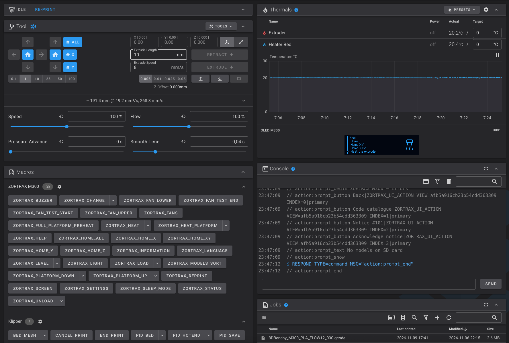
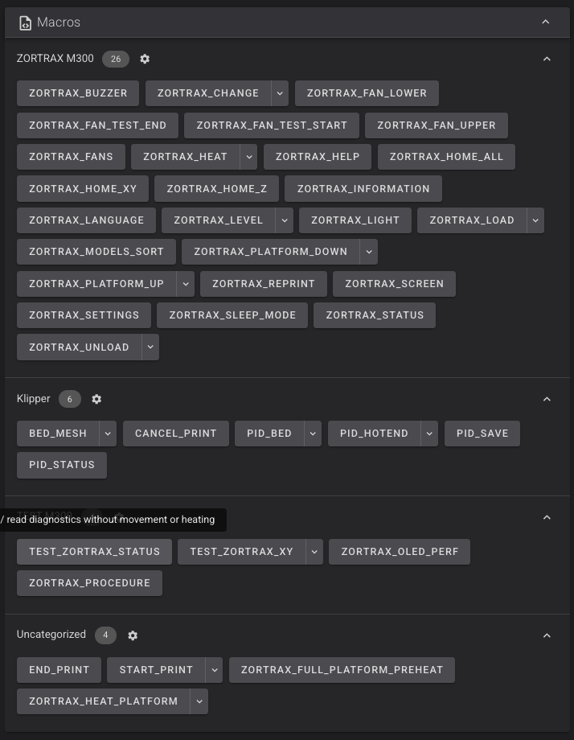
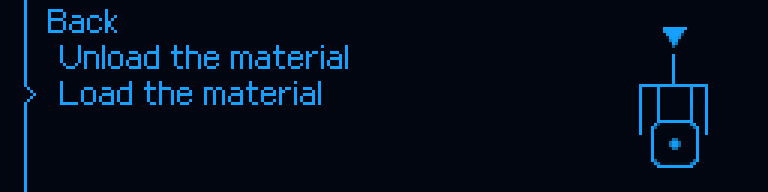

# Instrukcja codziennej obsługi

[Spis dokumentacji](../../README_PL.md) · [Obsługa](USER_GUIDE.md) · [Menu OLED](OLED_MENU_REFERENCE.md) · [Parametry](TECHNICAL_REFERENCE.md)

> Dokumentacja dla **M300 Classic**, stan kodu **v1.0.0-beta.17**, commit `d6ddf9c3bee58dc2209946a0073f8a708d964073`. Nie dotyczy M300 Plus, M300 Dual ani Inventure.


## 1. Kontrola przed pracą

Sprawdź mocowanie płyty i hotendu, czystość dyszy oraz metalowych pól kontaktowych, prowadzenie filamentu, działanie chłodzenia i wolną przestrzeń ruchu. Rozgrzana dysza i stół mogą spowodować oparzenie; nie dotykaj ich podczas bazowania i pomiaru. Pierwsze próby po instalacji wykonuj pod nadzorem.

W Fluidd oczekuj stanu **Ready**. Do odczytu bez celowego ruchu i grzania służą:

```gcode
ZORTRAX_MCU_STATUS
ZORTRAX_LINK_STATUS
ZORTRAX_OLED_STATUS
ZORTRAX_HARDWARE_STATUS
PRINT_CONTROL_STATUS
M105
QUERY_ENDSTOPS
QUERY_PROBE
```

Stan krańcówek i PC7 musi odpowiadać fizycznej sytuacji. Sam napis Ready nie potwierdza wolnego toru ruchu, poprawności dyszy ani pomiaru temperatury zewnętrznym termometrem.

## 2. Fluidd i makra



*Aktualny zrzut użytkownika z 10.11.2026. Sterowanie osią znajduje się po lewej, temperatury i podgląd OLED po prawej. Poniżej są makra, konsola i pliki.*

Grupa **ZORTRAX M300** zbiera funkcje specyficzne dla drukarki. **Klipper** zawiera m.in. START/END, CANCEL, BED_MESH i PID. **TEST M300** to osobne czynności diagnostyczne — nie uruchamiaj ich w ciemno. Rozwijana strzałka przy makrze otwiera parametry; kliknięcie głównej części wykonuje wariant domyślny. [Pełny katalog](MACRO_REFERENCE.md).

<details>
<summary>Historyczny panel z 08.11.2026 — dlaczego część makr była „Uncategorized”</summary>



To stan wcześniejszej wersji, nie oczekiwany wygląd beta.17. `ZORTRAX_HEAT_PLATFORM`, `ZORTRAX_FULL_PLATFORM_PREHEAT` i START/END były wtedy widoczne jako nieprzypisane. Najnowszy zrzut powyżej pokazuje poprawiony podział. Zachowanie starych ustawień lokalnych lub pamięć przeglądarki może wymagać odświeżenia; nie usuwaj własnych kategorii bez sprawdzenia.

</details>

## 3. Bazowanie i przygotowanie stołu

`ZORTRAX_HOME_X`, `ZORTRAX_HOME_Y`, `ZORTRAX_HOME_XY`, `ZORTRAX_HOME_Z` i `ZORTRAX_HOME_ALL` uruchamiają wspólną logikę z OLED. Przy wspólnym XY kolejność jest **Y, następnie X**. Z wymaga odniesienia XY, odpowiedniej temperatury dyszy oraz sprawnego kontaktu PC7. Samo wybranie Home Z w menu nie usuwa wymogu wstępnego grzania.

Procedury zapewniają odsunięcie platformy od dyszy o 5 mm przed ruchem XY, zgodnie z bieżącym stanem osi i kontaktem. Nie zastępuje to sprawdzenia, czy fizycznie jest miejsce na ruch. Z pozytywnym przyrostem Z platforma oddala się od dyszy. Po bazowaniu pozostaje bezpieczny odstęp.

Ordinary Z używa pięciu kolejnych kontaktów/zwolnień; końcowe odniesienie pochodzi z piątej krawędzi zwolnienia, nie ze średniej. M07 ma inną sekwencję. Nie zastępuj jej przypadkowym `samples: 5`. [Szczegóły](BED_MESH_AND_LEVELING.md).

## 4. Grzanie i pełne wygrzewanie platformy

**Ręczne temperatury w Thermals** to zwykłe zadania Klippera. **`ZORTRAX_HEAT`** uruchamia procedurę OEM grzania ekstrudera (domyślnie 260°C) z komunikatem i zakończeniem potwierdzanym przez operatora. **`ZORTRAX_HEAT_PLATFORM TEMP=60`** uruchamia wspólną procedurę stołu.

**`ZORTRAX_FULL_PLATFORM_PREHEAT STATE=ENABLED`** zapisuje opcję następnego START. Nie zaczyna samodzielnie grzać. Włącza dodatkowy okres stabilizacji platformy, domyślnie 60 s, po osiągnięciu zadanych temperatur. `STATE=DISABLED` wyłącza tę opcję. START odczytuje ustawienie przy rozpoczęciu; zmiana w menu nie modyfikuje rozpoczętej już sesji.

## 5. Filament

`ZORTRAX_LOAD` i `ZORTRAX_UNLOAD` prowadzą operatora przez nagrzewanie i potwierdzenia. Domyślna temperatura proceduralna wynosi **240°C**, a nominalne długości LOAD/UNLOAD to **130/110 mm**. To parametry procedury portu, nie uniwersalne zalecenie temperaturowe dla każdego filamentu. Wariant wymiany w pauzie wykorzystuje 110 mm wycofania i 150 mm podania.



Temperaturę dobierz w granicach materiału i konfiguracji, korzystając z obsługiwanych parametrów. Nie forsuj podawania, gdy materiał się zacina. Dalsza ekstruzja, potwierdzenie i anulowanie zależą od aktualnej fazy; stary przycisk nie jest zgodą na kolejną fazę. Zmiana podczas druku: PAUSE → `ZORTRAX_CHANGE` → potwierdzenie prawidłowego przepływu → jawne RESUME.

## 6. START_PRINT i END_PRINT

Slicer powinien wywołać **jeden** `START_PRINT`, z temperaturami materiału, i **jeden** `END_PRINT`. Nie dokładaj równolegle drugiego bazowania, starego makra CR10S5 ani kolejnych linii czyszczących. Przykład *struktury wywołania* dla materiału, dla którego wcześniej dobrano 200/60°C:

```gcode
START_PRINT EXTRUDER_TEMP=200 BED_TEMP=60 MESH=m300_pads
```

To nie zalecenie temperatur dla wszystkich materiałów. Kontroler: wstrzymuje wykonywanie dalszych komend pliku, nagrzewa dyszę i stół, ewentualnie wygrzewa platformę, wykonuje bazowanie M300, ładuje profil mesh, drukuje **dwie linie w Y oraz dwie w X** i dopiero przekazuje wykonanie do reszty pliku.

Wysokość linii w ustawieniach domyślnych to **0,28 mm**, nominalna długość 250 mm, z ograniczeniem do pola ruchu i marginesem przy dalszej krawędzi. Parametr `PURGE` zmienia długość, a dawka jest proporcjonalna. Nie skopiowano bez ograniczeń 350 mm z CR10S5. Linie korzystają z natywnej kompensacji mesh.

`MESH=AUTO` wybiera `m300_pads`, gdy istnieje, inaczej drukuje bez kompensacji. `MESH=m300_pads` wymaga profilu. `MESH=NONE` jawnie wyłącza siatkę. START nie mierzy mesh od nowa. Ustawienia i wcześniejsze tryby parsera są chronione; po sekwencji przywracane są m.in. tryby współrzędnych i mnożniki.

`END_PRINT` kończy ruchy, parkuje w dopuszczalnym zakresie, wyłącza cele grzałek i wentylator modelu. Chłodzenie hotendu pozostaje pod kontrolą polityki temperaturowej — wyłączenie wydruku nie oznacza wyłączenia wszystkich wentylatorów.

Źródła: [makra START/END](../../host/config/m300_operations.cfg), [kontroler druku](../../host/klippy/extras/m300_print_control.py).

## 7. PAUSE, RESUME i CANCEL

| Działanie | Oczekiwany przebieg |
|---|---|
| PAUSE z Fluidd lub OLED | Zatrzymanie czytania pliku, bezpieczne zakończenie zaplanowanych ruchów, zapamiętanie stanu, ewentualna retrakcja, 5 mm odsunięcia Z i parkowanie przy X300/Y305, o ile jest bezpieczne |
| Dłuższa pauza | Stół utrzymuje dotychczasowy cel; po 600 s domyślnie obniżenie celu dyszy do 150°C, po 1800 s wyłączenie celu dyszy |
| RESUME | Kontrola zgodności pliku i stanu, przywrócenie wymaganej temperatury, powrót i wznowienie; wymiana materiału może wymagać potwierdzenia przepływu |
| CANCEL_PRINT | Zatrzymanie pracownika SD, zamknięcie pliku, skasowanie pauzy, wyłączenie grzania i wentylatora modelu; ewentualne parkowanie nie może blokować samego anulowania |
| M112 | Awaryjny shutdown. Nie jest normalną pauzą; dalsza praca wymaga usunięcia przyczyny i świadomego restartu |


Nie wyłączaj silników, nie wykonuj bazowania i nie przestawiaj osi ręcznie podczas pauzy, z której chcesz wznowić wydruk. Restart nie jest metodą wznowienia. Żądanie anulowania ma pierwszeństwo przed kontynuacją grzania lub parkowania. Nie traktuj czasu drenażu już zaplanowanych ruchów jako zgody na dodawanie nowych ręcznych przejazdów.

## 8. Aktualizacja i kontrola wersji

Zachowaj kopię konfiguracji. Przy Ready, bez wydruku i aktywnej procedury, użyj poleceń z [README](../../README_PL.md). Instalator nie aktualizuje firmware MCU samoczynnie. W razie komunikatu o nieznanych plikach przerwij, zachowaj raport i porównaj lokalne zmiany; nie obchodź kontroli sum.

Dla beta.17: `PRINT_CONTROL_STATUS` ma rewizję `0.13.16.38-PRINT-DRAIN-XY-PURGE`; `ZORTRAX_OLED_STATUS` pokazuje `NAV-EVENT-1` dla API hosta. Frontend podglądu ma `data-preview-revision="NAV-PIPELINE-2"`; nie oczekuj tej nazwy w rewizji MCU. Pole `navigation_delivered` powinno rosnąć przy kręceniu pokrętłem i widocznym podglądzie.

## 9. Rozpoznawanie problemów

| Objaw | Co sprawdzić bez wymuszania ruchu |
|---|---|
| Nie można połączyć MCU | Zgodność baud, właściwy UART, brak konsoli Linux na porcie; `ZORTRAX_LINK_STATUS`, log Klippy |
| Podgląd OLED nie odpowiada menu | Wersję Fluidd po twardym odświeżeniu, `navigation_api`, widoczność karty, `data-navigation` event/fallback |
| Profil widoczny, ale „not active” | To normalny podgląd. Sprawdź `BED_MESH_OUTPUT`; wczytaj profilem albo START_PRINT |
| PC7 aktywny bez dotknięcia pola | Czystość styku, dyszy i przewodów. Nie powtarzaj bez końca kontaktowego bazowania |
| „Unknown runtime module” przy instalacji | Lokalna modyfikacja lub inny pakiet; porównaj SHA z oficjalnym wydaniem |
| Zacięcie materiału przy szybkim druku | Limit przepływu i temperaturę materiału, opory podawania i stan hotendu; nie zwiększaj automatycznie maksymalnej temperatury |
| Wentylator hotendu pracuje po CANCEL | Sprawdź temperaturę: to może być prawidłowe chłodzenie 50/45°C, nie pozostawiony wydruk |

Logi przydatne do zgłoszenia: `klippy.log`, `moonraker.log`, statusy powyżej i identyfikator wydania. Przed publicznym udostępnieniem usuń dane sieciowe, sekrety i identyfikatory niepotrzebne do diagnozy.
