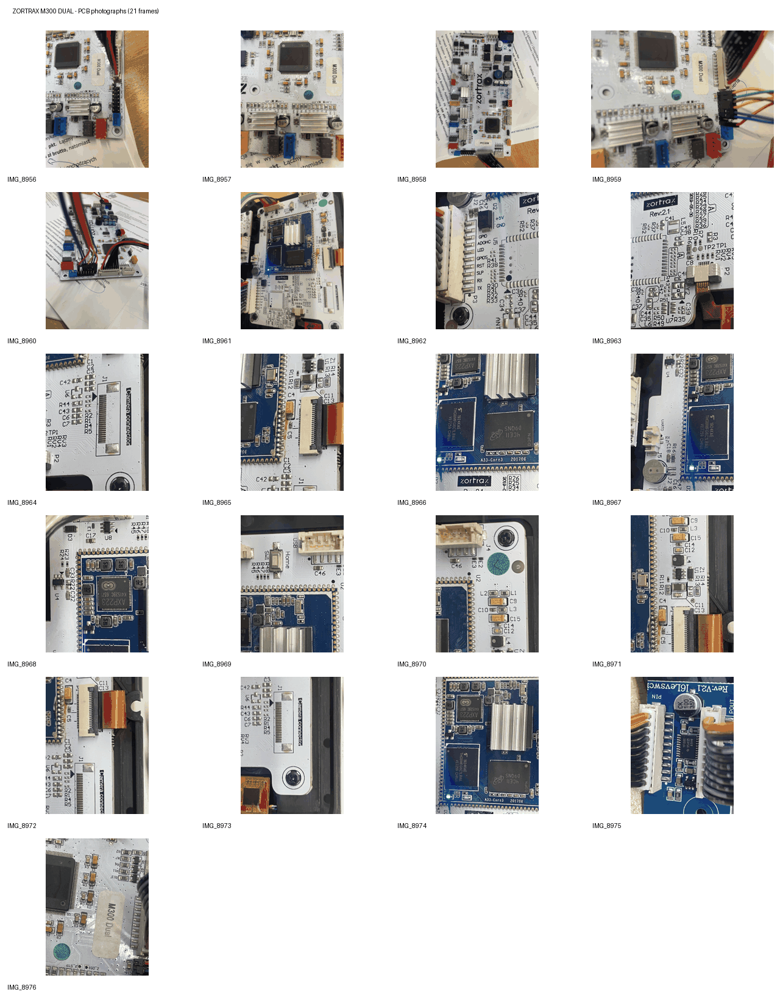

# Zortrax M300 Dual — hardware photos

Photographs contributed by Marcin Kowalik for reverse engineering and documentation of Zortrax M300 Dual hardware, including the [zmxxxp-re project](https://github.com/zharijs/zmxxxp-re).

## Hardware covered

- **M300 Dual motion-control motherboard** — STM32F2-family MCU (SWD Device ID `0x411`), with original firmware readout protected at RDP Level 1.
- **Android/display board** — Zortrax Rev. 2.1 with Allwinner A33-Core3, Toshiba eMMC, J5 UART0 and P3 inter-board interface.
- Peripheral connectors, PCB component identification, board-level markings and interfaces.

## Photo archive

[**Download the 21-photo PNG ZIP (compact, approx. 7.2 MiB)**](M300_Dual_Photos_21_PNG_GitHub_compact.zip)

The ZIP contains 21 source photographs (IMG_8956–IMG_8976), converted to reduced-size PNG images with camera EXIF/GPS metadata removed. The contact sheet above is available for a quick overview.

**Archive scope:** a further batch of 27 detailed PCB photographs (IMG_8997–IMG_9024, excluding IMG_9000) has been supplied separately but is **not included in this version yet**. This download must not be described as the complete image collection.

## Collaboration

I am working on a Klipper port for M300 Dual. Research on stock Zortrax Inventure firmware has recovered substantial information about motion control, temperature management, endstops and interfaces. I am interested in an original Allwinner A33 eMMC dump from any M200 Plus, M300 Plus or M300 Dual for examining how `update.zar2` is processed, without removing STM32 RDP protection.

If you need **additional photographs, detailed board data, pinout tracing, electrical measurements or further tests**, I can provide them.

For discussion and contact, see [this GitHub issue](https://github.com/MarcinKowalik-AGH/Zortrax-m300-Klipper/issues/1), mentioning [@zharijs](https://github.com/zharijs).

No proprietary firmware dumps or encryption keys are distributed here.
